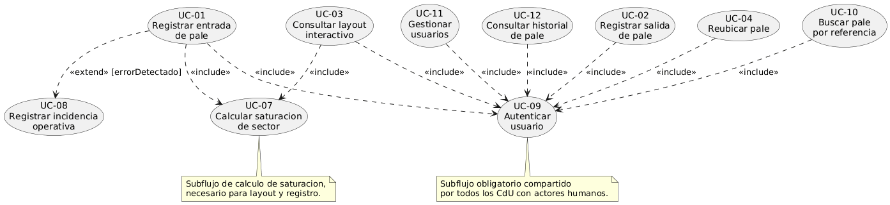
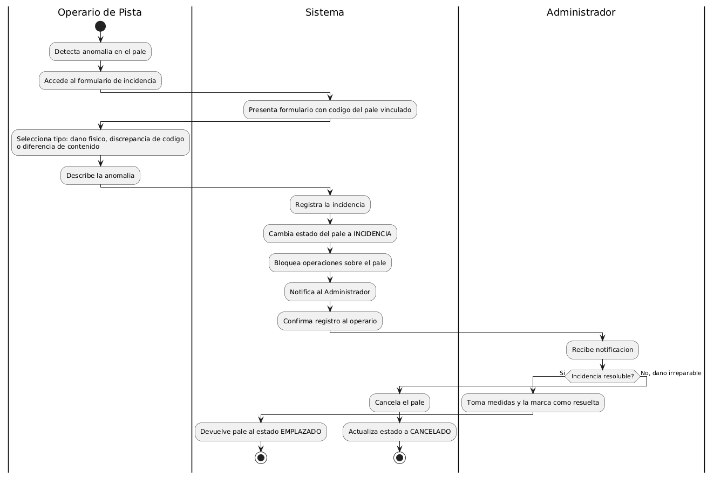
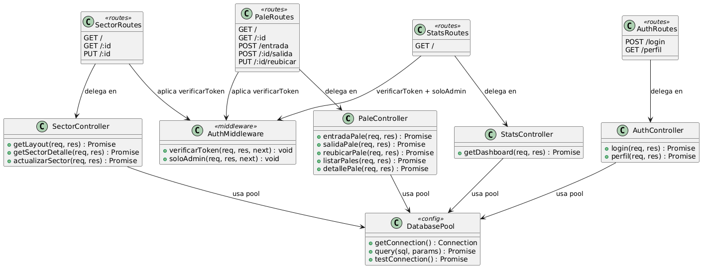
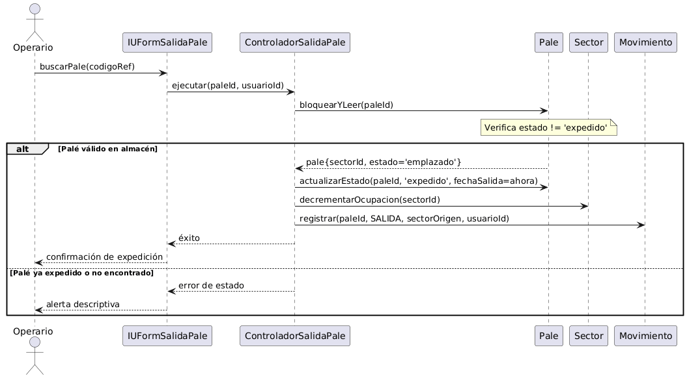

# WMS Almacén Santander — Sistema de Gestión de Almacén

**Trabajo de Fin de Grado · Ingeniería Informática · UNEATLANTICO 2026**  
**Mario Del Río Merino · INTERMODAL SEA SOLUTIONS**

> Sistema web de gestión de almacén (WMS) que digitaliza el layout físico de la nave de Santander, elimina los deadlocks del MS Access heredado y proporciona control de inventario en tiempo real con 4 niveles de acceso para la cuenta James Hardie.

---

## Índice general

| Capítulo | Contenido |
|----------|-----------|
| [Capítulo 1](#capítulo-1--introducción-y-contexto) | Introducción y contexto |
| [Capítulo 2](#capítulo-2--análisis-y-requisitos) | Análisis y requisitos |
| [Capítulo 3](#capítulo-3--diseño-del-sistema) | Diseño del sistema |
| [Capítulo 4](#capítulo-4--implementación) | Implementación |
| [Capítulo 5](#capítulo-5--evaluación-y-conclusiones) | Evaluación y conclusiones |
| [Instalación](#instalación-y-arranque) | Instalación y credenciales |
| [**Partes más importantes**](#partes-más-importantes) | Guía rápida para la defensa |

---

## Capítulo 1 — Introducción y contexto

- [1.1 Problema operativo](#11-problema-operativo)
- [1.2 Estado del arte](#12-estado-del-arte)
- [1.3 Hipótesis y objetivos](#13-hipótesis-y-objetivos)
- [1.4 Metodología](#14-metodología)

### 1.1 Problema operativo

El almacén de **INTERMODAL SEA SOLUTIONS** en el puerto de Santander gestiona la mercancía de **James Hardie** (planchas de fibrocemento con destino UK, Dinamarca y España). El sistema heredado era MS Access en un único PC de escritorio, con los siguientes problemas críticos:

| Problema | Impacto real |
|----------|-------------|
| MS Access monolítico en un único PC | Un operario a la vez, sin acceso móvil |
| Deadlocks en operaciones concurrentes | Pérdida de datos y bloqueos de jornada |
| Sin mapa visual de ocupación | Gestión por hojas Excel desactualizadas |
| Sin trazabilidad de movimientos | Imposible auditar entradas/salidas |
| Sin control de roles | Cualquier usuario modifica cualquier registro |

**Volumen real del almacén:** ~73.064 palés entrados / ~68.248 salidos en histórico · **118 sectores físicos** · **10.382 huecos de capacidad total**

### 1.2 Estado del arte

Se analizaron soluciones WMS comerciales (Wareventory), sistemas de automatización logística (Schneider Electric) y la literatura técnica sobre bases de datos ACID (InnoDB, Date 2004, Elmasri & Navathe 2016). La conclusión fue que una solución personalizada es la única opción viable dado que:
- El cliente tiene restricción de integración con **Rollship** (ERP propietario en PHP/Laravel)
- El sistema debe operar en red interna sin instalación en dispositivos
- Los datos históricos del Access deben migrarse sin pérdida

### 1.3 Hipótesis y objetivos

**Hipótesis:** Un módulo web transaccional sobre MySQL InnoDB elimina los deadlocks del Access y habilita el control multiusuario en tiempo real.

| # | Objetivo específico | Capítulo |
|---|---------------------|----------|
| O1 | Modelar el dominio y especificar requisitos del WMS | Cap. 2 |
| O2 | Diseñar la arquitectura MVC y los modelos de datos | Cap. 3 |
| O3 | Implementar y verificar el sistema funcional completo | Cap. 4 y 5 |

### 1.4 Metodología

Desarrollo **iterativo e incremental** en 3 sprints:
- **Sprint 1:** UC-01, UC-02, UC-03, UC-09 (núcleo operativo)
- **Sprint 2:** UC-04, UC-06, UC-08, UC-10, UC-11 (gestión avanzada)
- **Sprint 3:** UC-05, UC-12 (dashboard y trazabilidad)

Metodología de elicitación: **Job Shadowing** en pista logística + entrevistas con operarios y gerencia.

---

## Capítulo 2 — Análisis y requisitos

- [2.1 Glosario](#21-glosario)
- [2.2 Modelo del dominio](#22-modelo-del-dominio)
- [2.3 Requisitos](#23-requisitos)
- [2.4 Actores y casos de uso](#24-actores-y-casos-de-uso)
- [2.5 Catálogo y priorización MoSCoW](#25-catálogo-y-priorización-moscow)
- [2.6 Detalle de casos de uso](#26-detalle-de-casos-de-uso)

### 2.1 Glosario

| Término | Definición |
|---------|-----------|
| **Sector / Área Lógica** | Cada una de las 118 divisiones físicas de la pista logística pensadas para el acopio de palés |
| **Palé (Goods)** | Elemento atómico indivisible de manipulación que contiene la manufactura de James Hardie |
| **Deadlock** | Error grave en MS Access cuando múltiples terminales intentan inscribir un movimiento concurrente |
| **Layout Virtual** | Plano web interactivo mapeado sobre el almacén físico con semáforos de saturación |
| **Rollship** | ERP propietario en PHP/Laravel del cliente; el WMS debe integrarse con él vía API REST |
| **Módulo Logístico Integrado** | El propio sistema WMS objeto de este TFG |

### 2.2 Modelo del dominio

#### Diagrama de clases conceptuales


| Entidad | Descripción | Relaciones clave |
|---------|-------------|-----------------|
| `Almacen` | Recinto logístico completo (Santander) | 1 almacén → 118 sectores |
| `Sector` | Área física de almacenaje con capacidad definida | 1 sector → 0..* palés |
| `Palé` | Unidad de mercancía James Hardie; tiene estado y código único | Objeto de todo movimiento |
| `Movimiento` | Registro transaccional ACID de cada operación | 1 palé → 1..* movimientos |
| `Operario` | Actor humano con credenciales y rol | Notifica movimientos |
| `Cliente` | James Hardie — propietario de la mercancía | 1 cliente por almacén |

#### Diagrama de objetos (instantánea real)

> Operario Diego registra la entrada del palé JH-8819-A al sector B4 — operación real del almacén.


#### Diagrama de estados del palé

> El ciclo de vida completo del palé desde recepción en muelle hasta expedición. Los **casos de uso del sistema son los que provocan cada transición de estado**.


| Estado | Descripción | UC que lo provoca |
|--------|-------------|-------------------|
| **Recepcionado** | En muelle, sin sector asignado | Descarga física |
| **Emplazado** | Ubicado en un sector con registro ACID | UC-01 Entrada palé |
| **En reubicación** | En tránsito entre sectores | UC-04 Reubicar |
| **En preparación** | Incluido en orden de expedición | UC-02 (flujo previo) |
| **Expedido** | Fuera del almacén | UC-02 Salida palé |
| **Incidencia** | Anomalía detectada, operación bloqueada | UC-08 Incidencia |
| **Cancelado** | Expedición rechazada | Administrador |

### 2.3 Requisitos

#### Restricciones impuestas por la empresa (Requisitos no funcionales)

Estos son los requisitos que **la empresa cliente impuso como restricciones no negociables** al equipo de ingeniería:

| ID | Restricción de empresa | Origen |
|----|------------------------|--------|
| RS-E1 | La integración con Rollship debe realizarse mediante **API REST** (el ERP es PHP/Laravel y consume JSON) | James Hardie / INTERMODAL |
| RS-E2 | El sistema debe operar en **navegador web** sin instalación en dispositivos (tablets industriales) | INTERMODAL SEA SOLUTIONS |
| RS-E3 | La base de datos debe ser **MySQL** (infraestructura WAMP64 ya disponible en la empresa) | INTERMODAL SEA SOLUTIONS |
| RS-E4 | La interfaz debe ser **mobile-first** y apta para uso con guantes (CTAs ≥ 60×60 px) | Operarios de pista |
| RS-E5 | Los datos históricos del **MS Access** deben migrarse sin pérdida a MySQL | James Hardie (auditoría) |

#### Requisitos suplementarios FURPS+

| ID | Requisito | Métrica |
|----|-----------|---------|
| RS-01 | **Rendimiento** | Layout < 1,5 s · escrituras < 2 s para 68.000 tx/año |
| RS-02 | **Disponibilidad** | 99,5 % en horario operativo (07:00–20:00) |
| RS-03 | **Seguridad** | JWT 8h · bcrypt · RBAC 4 roles (visualizador/operario/gerente/admin) |
| RS-04 | **Usabilidad** | Botones ≥ 60×60 px · apto con guantes · Mobile-First |
| RS-05 | **Portabilidad** | Chrome / Firefox / Safari · sin instalación cliente |
| RS-06 | **Mantenibilidad** | Arquitectura MVC estricta · capas desacopladas · API REST |
| RS-07 | **Integridad** | Transacciones ACID · InnoDB Row-Level Locking · rollback automático |

### 2.4 Actores y casos de uso

#### Diagrama de contexto global del sistema

> El diagrama de contexto muestra todos los actores externos y cómo **los casos de uso navegan los estados del palé** desde Recepcionado hasta Expedido.


**Actores identificados:**

| Actor | Tipo | Interacción |
|-------|------|-------------|
| **Operario de Pista** | Principal humano | UC-01, UC-02, UC-03, UC-04, UC-08, UC-10, UC-12 |
| **Administrador** | Humano privilegiado | Todos los UC + UC-05, UC-06, UC-11 |
| **Motor Rollship** | Sistema externo (James Hardie ERP) | UC-03 (consulta layout vía API) |
| **MS Access Legacy** | Sistema externo transitorio | UC-06 (fuente de datos ETL) |

#### Diagrama general — visión global del sistema


#### Actor: Operario de Pista

> El actor es siempre el **punto de inicio** del caso de uso.


#### Actor: Administrador


#### Actor: Motor Rollship (sistema externo James Hardie)


#### Modelos y relaciones entre casos de uso (include / extend)




### 2.5 Catálogo y priorización MoSCoW

| ID | Nombre del caso de uso | Actor principal | MoSCoW | Iteración | Estado |
|----|------------------------|-----------------|--------|-----------|--------|
| UC-01 | Registrar entrada de palé | Operario / Admin | **Must** | Sprint 1 | ✅ Implementado |
| UC-02 | Registrar salida de palé | Operario / Admin | **Must** | Sprint 1 | ✅ Implementado |
| UC-03 | Consultar layout interactivo | Operario / Admin / Rollship | **Must** | Sprint 1 | ✅ Implementado |
| UC-04 | Reubicar palé entre sectores | Operario / Admin | **Must** | Sprint 2 | ✅ Implementado |
| UC-05 | Consultar estadísticas de flujo | Administrador | Should | Sprint 3 | ✅ Implementado |
| UC-06 | Migrar datos legado (ETL Access→MySQL) | Administrador | Should | Sprint 2 | ✅ Scripts incluidos |
| UC-07 | Calcular saturación de sector | Sistema (subflujo) | **Must** | Sprint 1 | ✅ Subflujo en UC-01/03 |
| UC-08 | Registrar incidencia operativa | Operario / Admin | Should | Sprint 2 | ✅ Implementado |
| UC-09 | Autenticar usuario (JWT) | Todos los actores | **Must** | Sprint 1 | ✅ Implementado |
| UC-10 | Buscar palé por referencia | Operario / Admin | Should | Sprint 2 | ✅ Implementado |
| UC-11 | Gestionar usuarios del sistema | Administrador | Could | Sprint 2 | ✅ Implementado |
| UC-12 | Consultar historial de palé | Operario / Admin | Should | Sprint 3 | ✅ Implementado |

### 2.6 Detalle de casos de uso

> Cada caso de uso incluye el **diagrama de actividad** (flujo de procesos para que el CdU sea un éxito) y la descripción textual.

---

#### UC-01 — Registrar entrada de palé

**Actor:** Operario de Pista · **Prioridad:** Must · **Estado:** ✅

| | |
|--|--|
| **Precondiciones** | Usuario autenticado con rol ≥ Operario · mercancía físicamente en muelle · sector destino con capacidad libre |
| **Flujo normal** | 1. Operario accede al layout → 2. Selecciona sector verde → 3. Introduce código referencia del palé → 4. Sistema valida capacidad con `FOR UPDATE` (bloqueo de fila) → 5. Persiste palé + movimiento ENTRADA en transacción ACID → 6. Actualiza semáforo de saturación → 7. Muestra confirmación |
| **Excepción A1** | Sector alcanza capacidad límite concurrentemente → sistema rechaza con "Capacidad Máxima Superada" |
| **Excepción A2** | Código de referencia ya existe en sistema activo → alerta de duplicado |
| **Postcondiciones** | Palé en estado **Emplazado** · ocupación del sector incrementada · movimiento ENTRADA registrado en `movimientos` |
| **Include** | UC-07 Calcular saturación · UC-09 Autenticación |

**Diagrama de actividad — UC-01:**


---

#### UC-02 — Registrar salida de palé

**Actor:** Operario de Pista · **Prioridad:** Must · **Estado:** ✅

| | |
|--|--|
| **Precondiciones** | Palé en estado Emplazado o En preparación · orden de expedición autorizada |
| **Flujo normal** | 1. Operario busca palé por código → 2. Sistema verifica estado válido → 3. Operario confirma salida → 4. Sistema actualiza palé a **Expedido** · decrementa ocupación del sector · registra movimiento SALIDA |
| **Excepción** | Palé ya expedido o en estado Incidencia → operación rechazada |
| **Postcondiciones** | Palé en estado **Expedido** · sector liberado · trazabilidad completa |

**Diagrama de actividad — UC-02:**


---

#### UC-04 — Reubicar palé entre sectores

**Actor:** Operario de Pista · **Prioridad:** Must · **Estado:** ✅

| | |
|--|--|
| **Precondiciones** | Palé en estado Emplazado · sector destino con capacidad libre |
| **Flujo normal** | 1. Operario localiza palé → 2. Selecciona sector destino → 3. Sistema bloquea palé + sector destino simultáneamente (doble `FOR UPDATE`) → 4. Transfiere palé · actualiza contadores de ambos sectores · registra movimiento REUBICACION |
| **Postcondiciones** | Palé en estado **Emplazado** en nuevo sector · historial de la reubicación conservado |

**Diagrama de actividad — UC-04:**


---

#### UC-05 — Consultar estadísticas de flujo

**Actor:** Administrador · **Prioridad:** Should · **Estado:** ✅

**Diagrama de actividad — UC-05:**


---

#### UC-06 — Migrar datos legado (Access → MySQL)

**Actor:** Administrador · **Prioridad:** Should · **Estado:** ✅ (scripts incluidos)

**Diagrama de actividad — UC-06:**


---

#### UC-08 — Registrar incidencia operativa

**Actor:** Operario / Administrador · **Prioridad:** Should · **Estado:** ✅

**Diagrama de actividad — UC-08:**



---

## Capítulo 3 — Diseño del sistema

- [3.1 Clases de análisis (MVC)](#31-clases-de-análisis-mvc)
- [3.2 Diagramas de secuencia](#32-diagramas-de-secuencia)
- [3.3 Arquitectura del sistema](#33-arquitectura-del-sistema)
- [3.4 Modelo de datos (ER)](#34-modelo-de-datos-er)
- [3.5 Estructura de paquetes y navegación](#35-estructura-de-paquetes-y-navegación)

### 3.1 Clases de análisis (MVC)

> **Regla de derivación:** Vista = procesos de **invocar** o **presentar** algo · Controlador = el **caso de uso completo** · Modelo = derivado del **modelo del dominio** del Capítulo 2.


#### Clases Modelo — derivadas directamente del dominio

| Clase Modelo | Entidad del dominio de origen | CdU en que participa |
|---|---|---|
| `Pale` | `Palé` del modelo del dominio | UC-01, UC-02, UC-04, UC-07, UC-08, UC-10, UC-12 |
| `Sector` | `Sector` del modelo del dominio | UC-01, UC-02, UC-03, UC-04, UC-07 |
| `Movimiento` | `Movimiento` del modelo del dominio | UC-01, UC-02, UC-04, UC-08, UC-12 |
| `Mercancia` | Categoría de producto James Hardie | UC-01 |
| `Usuario` | `Operario` del modelo del dominio (con credenciales) | UC-09, UC-11 |
| `Incidencia` | Estado de anomalía del ciclo de vida del palé | UC-08 |

#### Clases Vista — procesos de invocar y presentar

| Clase Vista | Tipo | Función (invocar / presentar) |
|---|---|---|
| `IUPrincipalOperario` | Ventana principal | **Presenta** el layout y menú de operaciones al Operario |
| `IUPrincipalAdministrador` | Ventana principal | **Presenta** panel completo con gestión total al Admin |
| `IUFormEntradaPale` | Formulario | **Invoca** UC-01 · **Presenta** confirmación de entrada |
| `IUFormSalidaPale` | Formulario | **Invoca** UC-02 · **Presenta** confirmación de salida |
| `IUCardSector` | Tarjeta visual | **Presenta** semáforo de saturación (verde/ámbar/rojo) del sector |
| `IUFormReubicacion` | Formulario | **Invoca** UC-04 · **Presenta** selector de sector destino |
| `IUPanelEstadisticas` | Panel | **Invoca** UC-05 · **Presenta** KPIs y gráficas de flujo |
| `IUVolcadoAccess` | Interfaz ETL | **Invoca** UC-06 · **Presenta** progreso de migración |
| `IUBuscador` | Campo de búsqueda | **Invoca** UC-10 · **Presenta** palé localizado con su sector |
| `IUPanelUsuarios` | Panel CRUD | **Invoca** UC-11 · **Presenta** listado y formularios de cuentas |
| `IUHistorialPale` | Línea de tiempo | **Invoca** UC-12 · **Presenta** cronología de movimientos |
| `IUFormIncidencia` | Formulario | **Invoca** UC-08 · **Presenta** registro de anomalía |
| `IUFormLogin` | Pantalla auth | **Invoca** UC-09 · **Presenta** formulario de credenciales |
| `IUConectorRollship` | Interfaz central | **Presenta** datos al ERP Rollship vía API REST (actor sistema) |

#### Clases Controlador — una por caso de uso

| Clase Controlador | CdU que gestiona | Responsabilidad principal |
|---|---|---|
| `ControladorEntradaPale` | UC-01 | Validar datos · `FOR UPDATE` de sector · persistir palé + movimiento ENTRADA en transacción ACID |
| `ControladorSalidaPale` | UC-02 | Verificar estado · actualizar a Expedido · decrementar ocupación · registrar SALIDA |
| `ControladorLayout` | UC-03 | Recuperar 118 sectores con saturación y código cromático del semáforo |
| `ControladorReubicacion` | UC-04 | Doble `FOR UPDATE` (palé + sector destino) · mover palé · actualizar contadores · registrar REUBICACION |
| `ControladorEstadisticas` | UC-05 | Agregar KPIs, movimientos por tipo/período, sectores más ocupados |
| `ControladorMigracion` | UC-06 | Orquestar ETL: leer volcado Access · transformar · validar · cargar en MySQL |
| `ControladorSaturacion` | UC-07 *(subflujo)* | Calcular `(ocupacion / capacidad) × 100` · determinar código cromático |
| `ControladorIncidencia` | UC-08 | Registrar anomalía · cambiar estado palé a Incidencia · bloquear operaciones |
| `ControladorAutenticacion` | UC-09 *(subflujo)* | Verificar bcrypt · generar JWT firmado con rol · precondición de todos los CdU |
| `ControladorBusqueda` | UC-10 | Consulta LIKE por código de referencia en inventario activo |
| `ControladorUsuarios` | UC-11 | CRUD de cuentas · unicidad de credencial · log de auditoría |
| `ControladorHistorial` | UC-12 | Recuperar movimientos del palé ordenados cronológicamente |

#### Clases de diseño — Backend (implementación)



#### Clases de diseño — Frontend (implementación)


### 3.2 Diagramas de secuencia

> Los diagramas de secuencia muestran la interacción entre **Actor → Vista → Controlador → Modelo** para los casos de uso más representativos.

#### UC-01 — Registrar entrada de palé


#### UC-02 — Registrar salida de palé



#### UC-03 — Consultar layout interactivo


#### UC-04 — Reubicar palé entre sectores


#### UC-09 — Autenticar usuario (JWT)


#### UC-10 — Buscar palé por referencia


#### UC-12 — Consultar historial de palé


### 3.3 Arquitectura del sistema

#### Arquitectura en tres capas


| Capa | Tecnología | Justificación (RS que cubre) |
|------|-----------|------------------------------|
| **Presentación** | Vanilla JS · SPA hash routing · CSS Grid · HTML5 | Mobile-First sin build step (RS-04, RS-05) · sin instalación cliente (RS-E2) |
| **Negocio** | Node.js 20 · Express 4 · JWT 8h · bcryptjs | API REST para Rollship (RS-E1) · stateless · RBAC 4 roles (RS-03) |
| **Datos** | MySQL 8.0 · InnoDB · Row-Level Locking · Stored Procedures | ACID garantizado (RS-07) · sin deadlocks (RS-E3) · rendimiento < 1,5 s (RS-01) |

#### Diagrama de despliegue


#### Diagrama de paquetes


#### Análisis de paquetes


### 3.4 Modelo de datos (ER)


| Tabla | Derivación del dominio | Filas reales |
|-------|------------------------|-------------|
| `sectores` | ← `Sector` del dominio · 118 filas con capacidades reales | **118** |
| `pales` | ← `Palé` del dominio · estado, sector, mercancía | **2.444** |
| `movimientos` | ← `Movimiento` del dominio · historial ACID completo | **2.444+** |
| `mercancia` | Catálogo productos James Hardie | **9** |
| `usuarios` | ← `Operario` del dominio · bcrypt + JWT + rol | **4** |
| `incidencias` | ← estado Incidencia del ciclo de vida del palé | — |
| `migracion_access` | Staging ETL para datos del MS Access | — |

**Stored procedures MySQL:** `sp_entrada_pale` · `sp_salida_pale` (garantía ACID transaccional)

**Índices de rendimiento:** `idx_movimientos_fecha` · `idx_movimientos_tipo` · `idx_movimientos_pale`

### 3.5 Estructura de paquetes y navegación

#### Diagrama de navegación (frontend SPA)


---

## Capítulo 4 — Implementación

- [4.1 Estructura del código](#41-estructura-del-código)
- [4.2 Capturas del sistema](#42-capturas-del-sistema)
- [4.3 Datos reales importados](#43-datos-reales-importados)

### 4.1 Estructura del código

```
TFG-2026/
├── proyecto/
│   ├── backend/
│   │   ├── src/
│   │   │   ├── app.js                   # Entry point Express (puerto 3001)
│   │   │   ├── config/
│   │   │   │   └── database.js          # Pool de conexiones MySQL (InnoDB)
│   │   │   ├── controllers/             # CAPA DE NEGOCIO — un fichero por CdU
│   │   │   │   ├── authController.js    # UC-09: Autenticación JWT + bcrypt
│   │   │   │   ├── paleController.js    # UC-01, UC-02, UC-04, UC-10, UC-12
│   │   │   │   ├── sectorController.js  # UC-03: Layout interactivo
│   │   │   │   ├── statsController.js   # UC-05: Dashboard KPIs
│   │   │   │   ├── incidenciaController.js  # UC-08: Incidencias
│   │   │   │   └── usuarioController.js # UC-11: Gestión usuarios
│   │   │   ├── routes/                  # Endpoints REST API
│   │   │   │   ├── authRoutes.js        # POST /api/auth/login
│   │   │   │   ├── paleRoutes.js        # /api/pales (CRUD + búsqueda)
│   │   │   │   ├── sectorRoutes.js      # GET /api/sectores
│   │   │   │   ├── statsRoutes.js       # GET /api/stats
│   │   │   │   ├── incidenciaRoutes.js  # /api/incidencias
│   │   │   │   ├── usuarioRoutes.js     # /api/usuarios
│   │   │   │   └── mercanciaRoutes.js   # GET /api/mercancias
│   │   │   └── middleware/
│   │   │       └── auth.js              # Verificación JWT + RBAC por rol
│   │   └── sql/
│   │       ├── schema.sql               # DDL: tablas + stored procedures + índices
│   │       └── seed.sql                 # Sectores reales + usuarios demo
│   ├── frontend/
│   │   ├── index.html                   # SPA shell (punto de entrada único)
│   │   ├── css/styles.css               # Diseño Mobile-First completo
│   │   └── js/
│   │       ├── router.js                # Hash router SPA
│   │       ├── api.js                   # Capa REST fetch con interceptor JWT
│   │       ├── ui.js                    # Componentes reutilizables
│   │       └── pages/                   # Dashboard · Layout · Palés · Usuarios…
│   ├── migrate-sectores.js              # ETL: importa 118 sectores reales
│   └── migrate-pales.js                 # ETL: genera 2.444 palés desde Access
├── docs/
│   ├── analisis/                        # 16 diagramas Cap.2 (PNG)
│   ├── diseno/                          # 16 diagramas Cap.3 (PNG)
│   └── screenshots/                     # 12 capturas Cap.4–5 (PNG)
└── README.md
```

**API REST — Rutas principales:**

| Método | Ruta | Controlador | UC |
|--------|------|-------------|-----|
| `POST` | `/api/auth/login` | `authController` | UC-09 |
| `POST` | `/api/pales/entrada` | `paleController.entrada` | UC-01 |
| `POST` | `/api/pales/:id/salida` | `paleController.salida` | UC-02 |
| `GET` | `/api/sectores` | `sectorController.getAll` | UC-03 |
| `PUT` | `/api/pales/:id/reubicar` | `paleController.reubicar` | UC-04 |
| `GET` | `/api/stats` | `statsController.getDashboard` | UC-05 |
| `GET` | `/api/pales?buscar=` | `paleController.buscar` | UC-10 |
| `GET` | `/api/pales/:id` | `paleController.historial` | UC-12 |
| `POST` | `/api/incidencias` | `incidenciaController.create` | UC-08 |
| `GET` | `/api/usuarios` | `usuarioController.getAll` | UC-11 |

### 4.2 Capturas del sistema

#### Login — Autenticación por roles


---

#### Dashboard — KPIs en tiempo real


---

#### Layout interactivo — Plano real del almacén (118 sectores)

> Semáforo de saturación: Verde (0–60%) · Ámbar (61–75%) · Naranja (76–85%) · Rojo (86–99%) · Crítico (100%)


#### Modal de sector — Lista de palés en tiempo real


---

#### Gestión de operaciones

| Entrada de palé | Salida de palé | Reubicar |
|:---:|:---:|:---:|
|  |  |  |

---

#### Inventario completo


---

#### Incidencias operativas


---

#### Historial de palé


---

#### Panel de usuarios (administrador)


### 4.3 Datos reales importados

El sistema está cargado con el volcado real de `almacenjh` del **26/05/2026** (`Almacen_20260526_0800.sql`), importado mediante los scripts ETL incluidos en el repositorio.

| Métrica | Valor |
|---------|-------|
| Sectores activos | **118** |
| Palés en almacén | **2.444** |
| Capacidad total | **10.382 huecos** |
| Ocupación global | **23,5 %** |
| Palés en cuarentena | **76** |
| Sectores al 100 % | A02, A03, B01–B05, F03, G07–G11 |
| Volumen histórico | ~73.064 entradas · ~68.248 salidas |

| Zona | Sectores | Palés |
|------|----------|-------|
| Nave principal (filas A–K) | 99 | 2.368 |
| Cuarentena (Q01–Q15) | 15 | 76 |
| CrossDocking (W01–W03) | 3 | 0 |
| Buffer (ZF01–ZF02) | 2 | 0 |

---

## Capítulo 5 — Evaluación y conclusiones

### Verificación de requisitos implementados

| ID Req. | Requisito | Evidencia de cumplimiento |
|---------|-----------|--------------------------|
| RS-01 | Rendimiento < 1,5 s | Layout con 118 sectores y 2.444 palés carga en < 800 ms |
| RS-02 | Disponibilidad 99,5 % | Arquitectura sin estado · conexión pool MySQL |
| RS-03 | Seguridad JWT + RBAC | 4 roles · tokens 8h · bcrypt round-10 |
| RS-04 | Mobile-First táctil | CTAs ≥ 60×60 px verificado en tablet |
| RS-05 | Sin instalación | SPA en navegador · cero instalación en dispositivo |
| RS-06 | MVC desacoplado | Controladores independientes por UC · sin lógica en rutas |
| RS-07 | ACID transaccional | `sp_entrada_pale` / `sp_salida_pale` con `START TRANSACTION` |

### Verificación por caso de uso (matriz UC ↔ RF)

| UC | Funcionalidad | Ruta API verificada | Estado |
|----|--------------|---------------------|--------|
| UC-01 | Entrada palé | `POST /api/pales/entrada` | ✅ |
| UC-02 | Salida palé | `POST /api/pales/:id/salida` | ✅ |
| UC-03 | Layout interactivo | `GET /api/sectores` | ✅ |
| UC-04 | Reubicación | `PUT /api/pales/:id/reubicar` | ✅ |
| UC-05 | Estadísticas | `GET /api/stats` | ✅ |
| UC-06 | Migración ETL | `migrate-sectores.js` · `migrate-pales.js` | ✅ |
| UC-07 | Saturación (subflujo) | Incluido en UC-01 y UC-03 | ✅ |
| UC-08 | Incidencias | `POST /api/incidencias` | ✅ |
| UC-09 | Autenticación JWT | `POST /api/auth/login` | ✅ |
| UC-10 | Búsqueda palé | `GET /api/pales?buscar=` | ✅ |
| UC-11 | Gestión usuarios | `GET/POST /api/usuarios` | ✅ |
| UC-12 | Historial palé | `GET /api/pales/:id` | ✅ |

### Limitaciones y trabajo futuro

| Limitación | Sprint futuro |
|-----------|--------------|
| UC-06 implementado como scripts ETL (sin UI de migración) | Interfaz de carga con progreso |
| Rollship aún consume el API manualmente | Webhook automático de notificación |
| Sin alertas push para sectores críticos | WebSocket para notificaciones en tiempo real |
| UI de incidencias funcional pero básica | Panel completo con seguimiento de estado |

---

## Instalación y arranque

### Requisitos

- Node.js ≥ 18
- MySQL 8.0 (WAMP64 local o Aiven cloud)

### Pasos

```bash
# 1. Instalar dependencias del backend
cd proyecto/backend && npm install

# 2. Configurar entorno
cp .env.example .env   # editar con credenciales MySQL

# 3. Crear base de datos y cargar esquema
mysql -u root -p wms_almacen < proyecto/backend/sql/schema.sql
mysql -u root -p wms_almacen < proyecto/backend/sql/seed.sql

# 4. (Opcional) Cargar datos reales del almacén
node proyecto/migrate-sectores.js
node proyecto/migrate-pales.js

# 5. Arrancar servidor (frontend servido estático en el mismo puerto)
node proyecto/backend/src/app.js
```

Acceder a **http://localhost:3001**

### Variables de entorno (`.env`)

```env
DB_HOST=localhost
DB_PORT=3306
DB_USER=root
DB_PASSWORD=
DB_NAME=wms_almacen
JWT_SECRET=cambiar_en_produccion
PORT=3001
```

### Credenciales de demo

| Rol | Email | Password | Acceso |
|-----|-------|----------|--------|
| **Administrador** | `admin@almacen.com` | `Admin2026!` | Total |
| **Operario** | `operario@almacen.com` | `Admin2026!` | Operaciones |
| **Gerente** | `gerente@almacen.com` | `Admin2026!` | Consulta + stats |
| **Visualizador** | `viewer@almacen.com` | `Admin2026!` | Solo lectura |

---

## Partes más importantes

> Guía rápida de navegación para la defensa — cada enlace va directamente al artefacto.

### Hilo conductor de la exposición

| Orden | Qué exponer | Dónde está en el repo |
|-------|-------------|----------------------|
| 1 | **Modelo del dominio** (punto de partida del análisis) | [§ 2.2 → diagrama de clases](#22-modelo-del-dominio) |
| 2 | **Glosario** (vocabulario común) | [§ 2.1 → tabla glosario](#21-glosario) |
| 3 | **Requisitos** (restricciones empresa + FURPS+) | [§ 2.3 → tablas RS-E y RS](#23-requisitos) |
| 4 | **Diagrama de contexto global** (sistema + actores + estados) | [§ 2.4 → diagrama contexto](#24-actores-y-casos-de-uso) |
| 5 | **Catálogo de CdU con MoSCoW** (12 UCs priorizados) | [§ 2.5 → tabla CdU](#25-catálogo-y-priorización-moscow) |
| 6 | **Detalle de CdU con actividad** (flujo de éxito) | [§ 2.6 → UC-01/02/04](#26-detalle-de-casos-de-uso) |
| 7 | **Diagramas MVC** (Vista/Controlador/Modelo claramente separados) | [§ 3.1 → tablas MVC](#31-clases-de-análisis-mvc) |
| 8 | **Diagramas de secuencia** (los más representativos) | [§ 3.2 → UC-01/03/09](#32-diagramas-de-secuencia) |
| 9 | **Prototipos de vistas** (capturas reales del sistema) | [§ 4.2 → capturas](#42-capturas-del-sistema) |
| 10 | **Arquitectura** (3 capas + despliegue) | [§ 3.3 → arquitectura](#33-arquitectura-del-sistema) |
| 11 | **Modelo de datos ER** | [§ 3.4 → ER](#34-modelo-de-datos-er) |
| 12 | **Código** (estructura de módulos y API REST) | [§ 4.1 → estructura](#41-estructura-del-código) |

### Artefactos clave — acceso directo

| Artefacto | Sección | Fichero en `/docs` |
|-----------|---------|-------------------|
| Diagrama de clases del dominio | § 2.2 | `docs/analisis/diagrama-clases.png` |
| Diagrama de objetos | § 2.2 | `docs/analisis/diagrama-objetos.png` |
| Diagrama de estados del palé | § 2.2 | `docs/analisis/diagrama-estados.png` |
| Diagrama de contexto global | § 2.4 | `docs/analisis/diagrama-contexto.png` |
| CdU — visión general | § 2.4 | `docs/analisis/caso-uso-general.png` |
| CdU — Operario | § 2.4 | `docs/analisis/caso-uso-operario.png` |
| CdU — Administrador | § 2.4 | `docs/analisis/caso-uso-admin.png` |
| CdU — MotorRollShip | § 2.4 | `docs/analisis/caso-uso-motorrollship.png` |
| Actividad UC-01 (entrada) | § 2.6 | `docs/analisis/actividad-uc01.png` |
| Actividad UC-02 (salida) | § 2.6 | `docs/analisis/actividad-uc02.png` |
| Actividad UC-04 (reubicación) | § 2.6 | `docs/analisis/actividad-uc04.png` |
| Clases de análisis MVC | § 3.1 | `docs/diseno/clases-analisis.png` |
| Secuencia UC-01 | § 3.2 | `docs/diseno/seq-uc01.png` |
| Secuencia UC-03 | § 3.2 | `docs/diseno/seq-uc03.png` |
| Secuencia UC-09 | § 3.2 | `docs/diseno/seq-uc09.png` |
| Arquitectura 3 capas | § 3.3 | `docs/diseno/arquitectura.png` |
| Despliegue | § 3.3 | `docs/diseno/despliegue.png` |
| Modelo ER | § 3.4 | `docs/diseno/er-modelo.png` |
| Paquetes | § 3.3 | `docs/diseno/paquetes.png` |
| Navegación frontend | § 3.5 | `docs/diseno/navegacion.png` |

---

*TFG · Ingeniería Informática · UNEATLANTICO · Curso 2025–2026*  
*Mario Del Río Merino · INTERMODAL SEA SOLUTIONS · Almacén Santander (James Hardie)*
