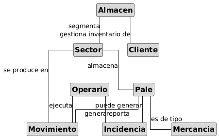
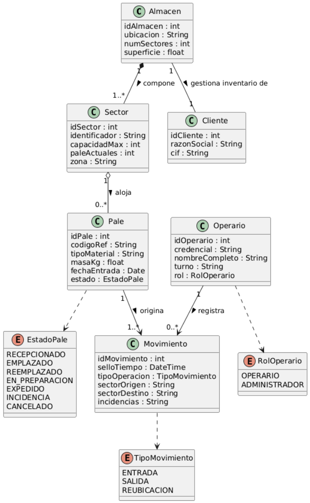
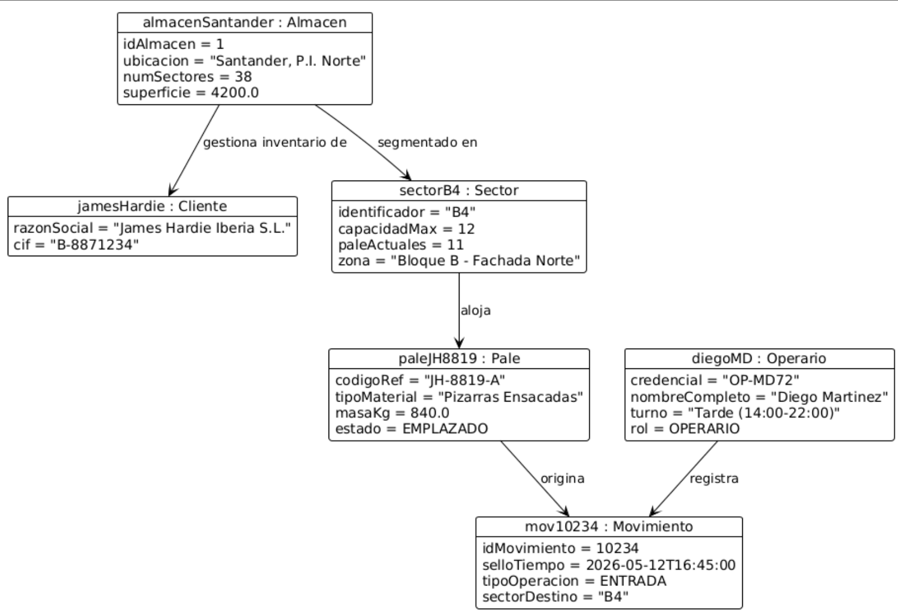
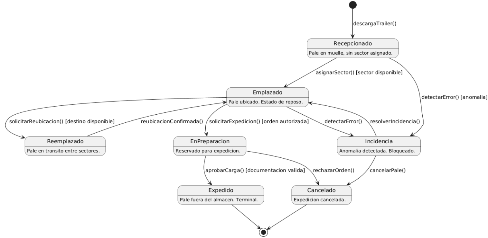
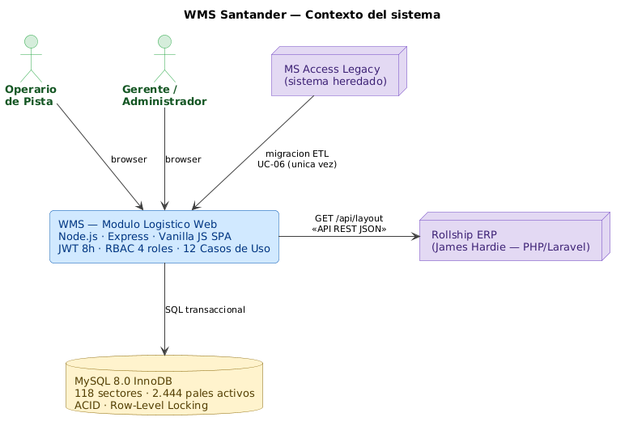
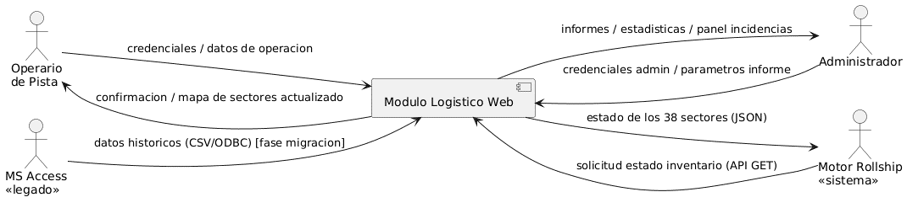

[← Índice](./README.md) | [Casos de Uso →](./02-casos-de-uso.md)

[Dominio](./01-dominio.md) | [Casos de Uso](./02-casos-de-uso.md) | [Actividades](./03-actividades.md) | [Arquitectura](./04-arquitectura.md) | [Secuencias](./05-secuencias.md) | [Screenshots](./06-screenshots.md)

---

# Dominio y Análisis

---

## Modelo del dominio (conceptual — Larman, nombre-only)

> 6 entidades derivadas del dominio real del almacén de Santander. Sin atributos ni métodos — solo nombres y asociaciones con verbo.

---

## Diagrama de clases conceptuales

> Refinamiento del modelo del dominio: atributos tipados, multiplicidades y 3 enumeraciones (EstadoPale · RolOperario · TipoMovimiento).

---

## Diagrama de objetos (instantánea real)

> Operario Diego registra la entrada del palé JH-8819-A al sector B4 — operación real del almacén de Santander.

---

## Ciclo de vida del palé (diagrama de estados)

> Los **casos de uso del sistema son los que provocan cada transición de estado**. Ningún estado cambia sin una operación registrada.

---

## Contexto del sistema (C4 Level 1)

> WMS en su entorno operativo: actores humanos, MySQL InnoDB, Rollship ERP (James Hardie) y el MS Access heredado que reemplaza.

---

## Diagrama de contexto (actores y flujo de estados)

> Muestra todos los actores externos y cómo los casos de uso navegan los estados del palé desde Recepcionado hasta Expedido.

---

[← Índice](./README.md) | [Casos de Uso →](./02-casos-de-uso.md)
