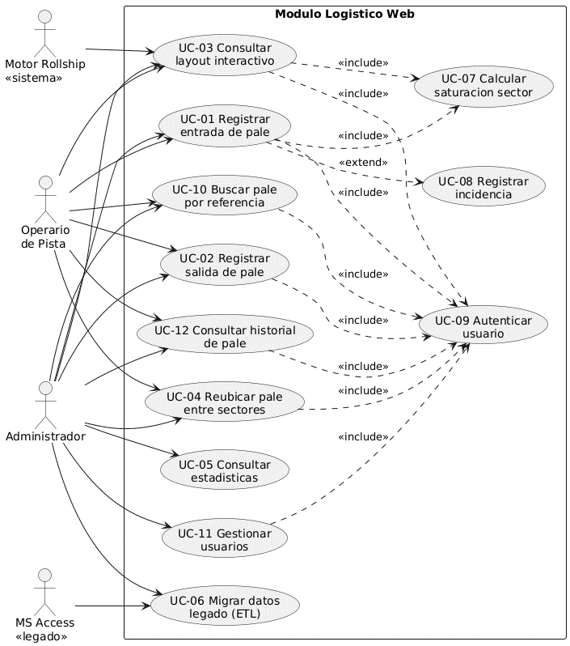
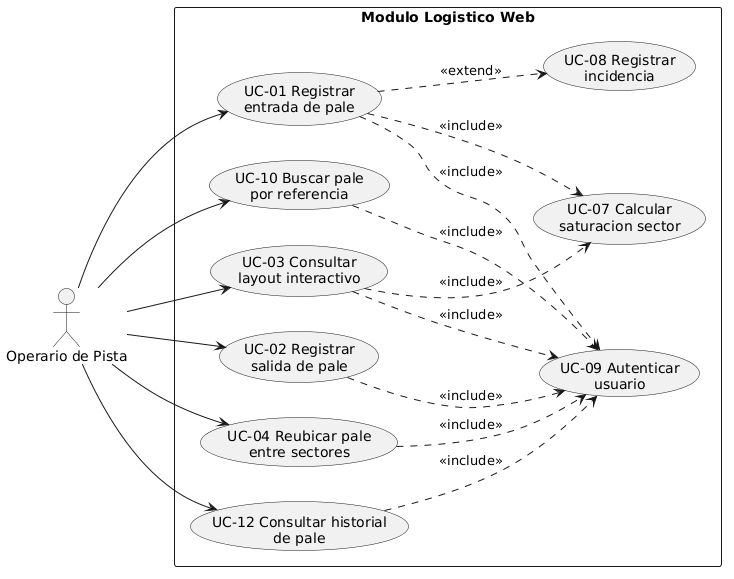
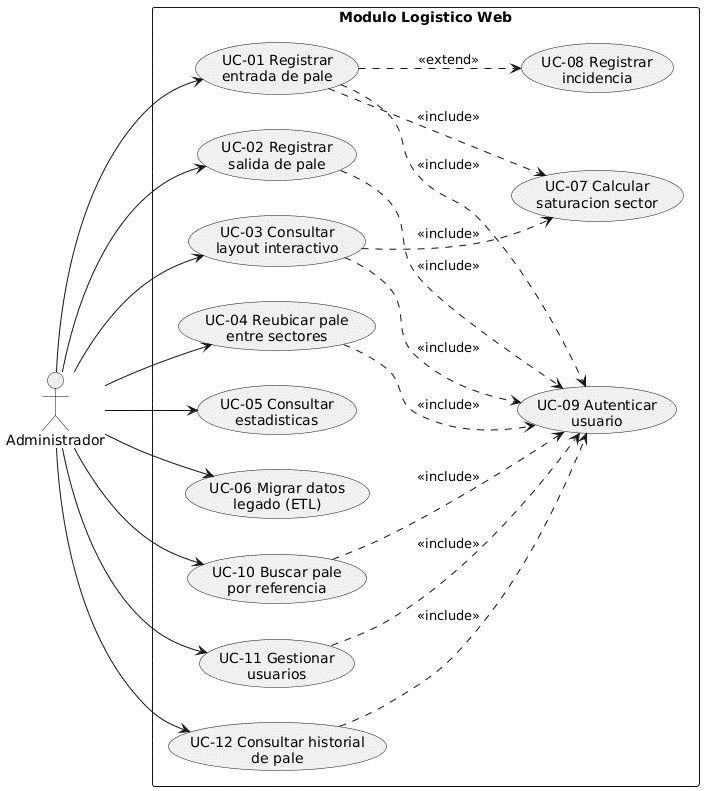
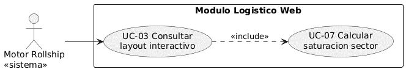
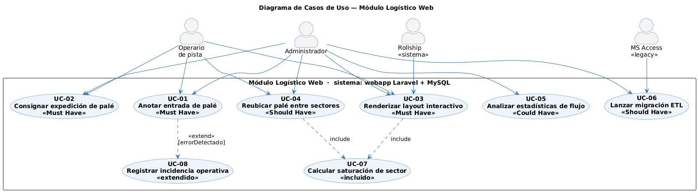
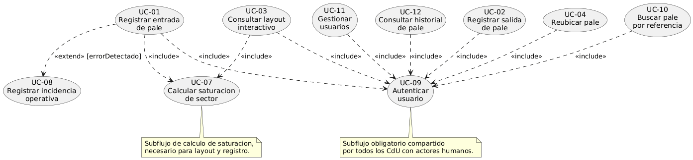

[← Dominio](./01-dominio.md) | [← Índice](./README.md) | [Actividades →](./03-actividades.md)

[Dominio](./01-dominio.md) | [Casos de Uso](./02-casos-de-uso.md) | [Actividades](./03-actividades.md) | [Arquitectura](./04-arquitectura.md) | [Secuencias](./05-secuencias.md) | [Screenshots](./06-screenshots.md)

---

# Casos de Uso

---

## Visión general — todos los actores

> 12 UC · 4 actores: Operario de Pista · Administrador · Motor Rollship · MS Access Legacy.

---

## Actor: Operario de Pista

> 6 UC directos: UC-01 · 02 · 03 · 04 · 10 · 12. UC-07 y UC-09 como `<<include>>` automático; UC-08 como `<<extend>>` si hay error.

---

## Actor: Administrador

> Hereda todos los UC del Operario y añade UC-05 (estadísticas) · UC-06 (migración ETL) · UC-11 (gestión de usuarios).

---

## Actor: Motor Rollship

> Actor sistema (James Hardie ERP). Solo accede a UC-03 vía `GET /api/sectores` — sin sesión JWT, solo API REST pública.

---

## Modelos y relaciones entre casos de uso

---

## Estructura include / extend

> Árbol completo de dependencias: qué UC incluyen a cuáles y cuáles se extienden bajo qué condición.

---

[← Dominio](./01-dominio.md) | [← Índice](./README.md) | [Actividades →](./03-actividades.md)
