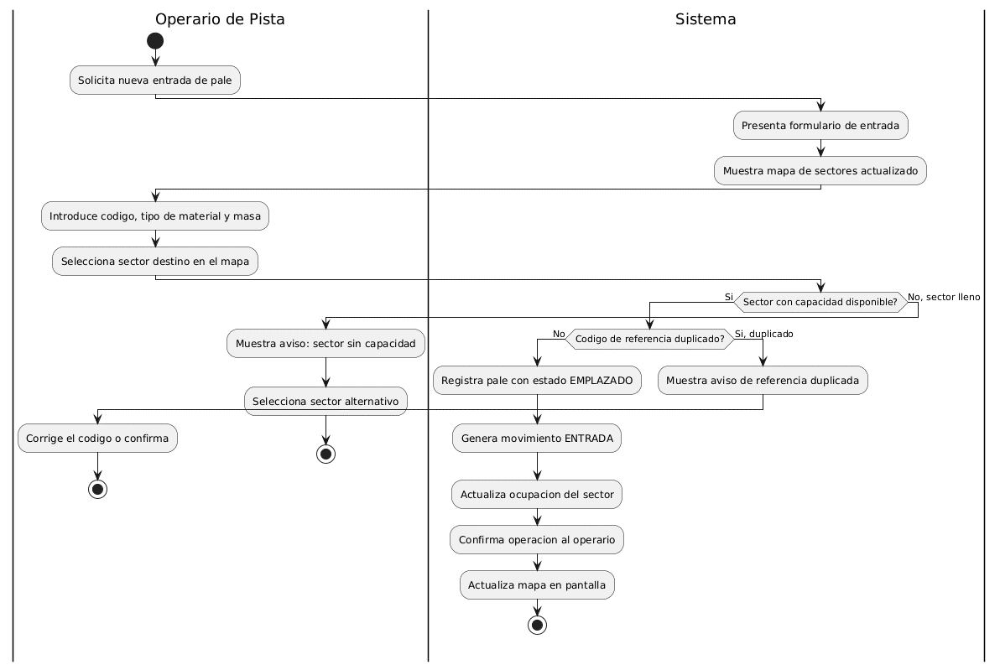
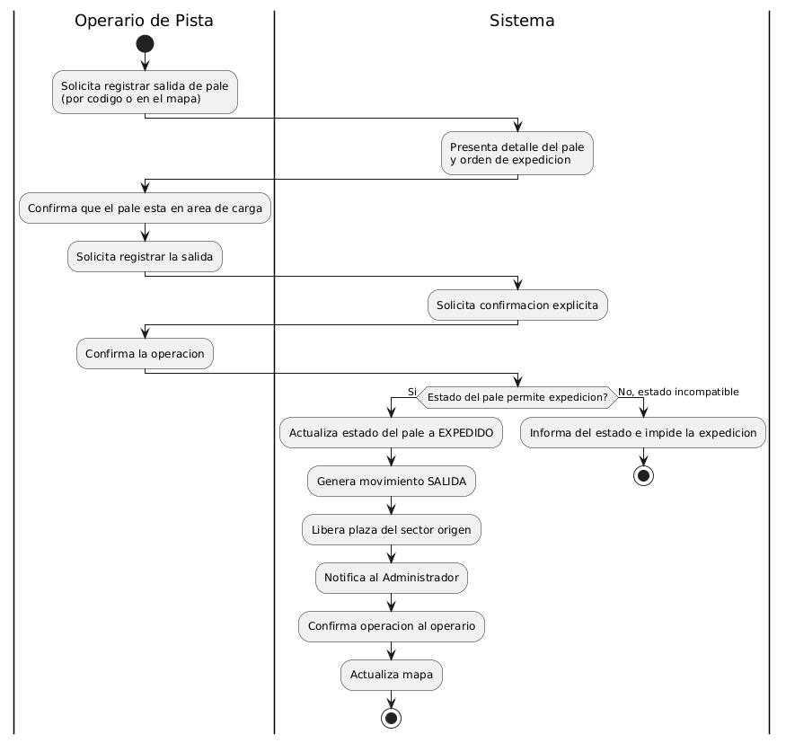
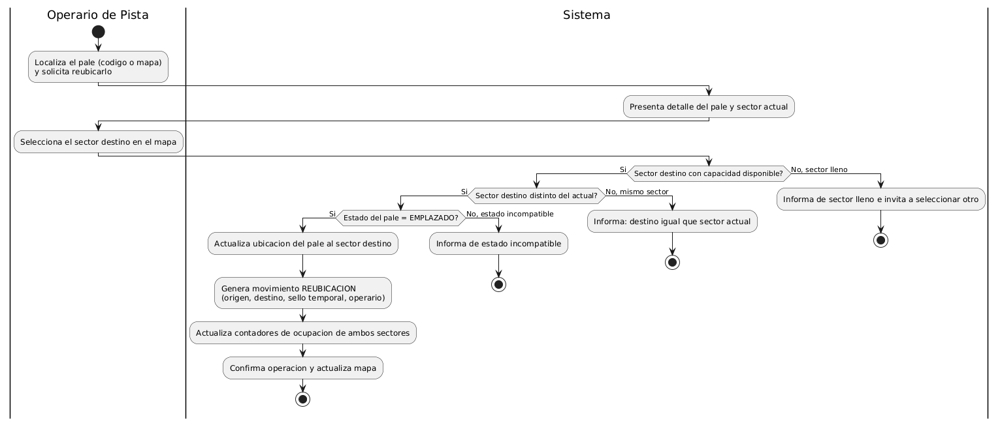
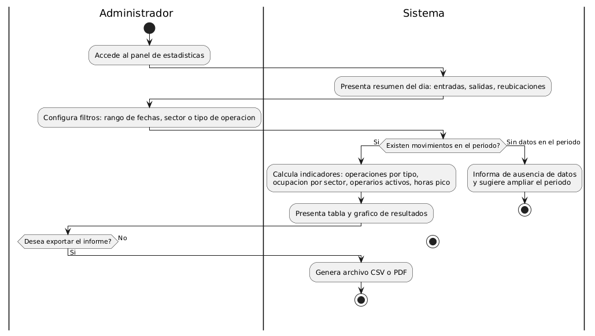
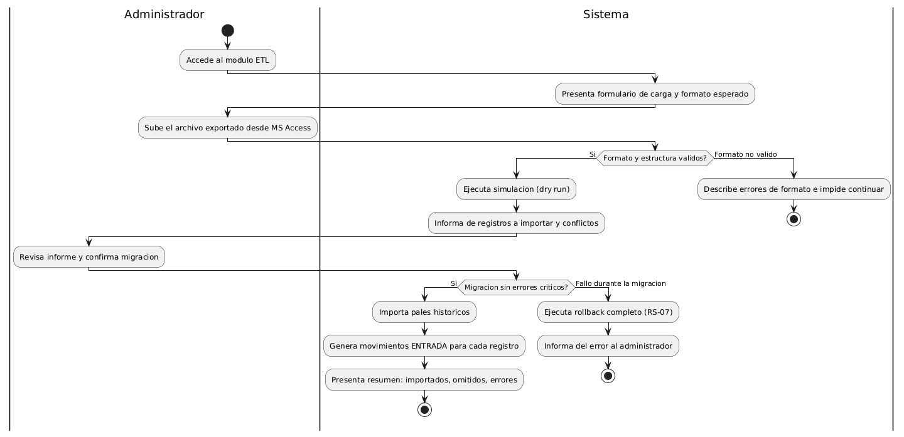
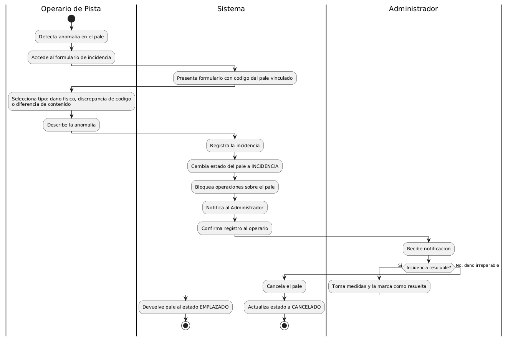

[← Casos de Uso](./02-casos-de-uso.md) | [← Índice](./README.md) | [Arquitectura →](./04-arquitectura.md)

[Dominio](./01-dominio.md) | [Casos de Uso](./02-casos-de-uso.md) | [Actividades](./03-actividades.md) | [Arquitectura](./04-arquitectura.md) | [Secuencias](./05-secuencias.md) | [Screenshots](./06-screenshots.md)

---

# Diagramas de Actividad

> Flujo de procesos de cada caso de uso desde la acción del actor hasta la postcondición. Ver [Secuencias](./05-secuencias.md) para la interacción entre capas MVC.

---

## UC-01 — Registrar entrada de palé

**Must · Sprint 1** · `<<include>>` UC-07 · UC-09

---

## UC-02 — Registrar salida de palé

**Must · Sprint 1** · `<<include>>` UC-09

---

## UC-04 — Reubicar palé entre sectores

**Must · Sprint 2** · Doble `FOR UPDATE` (palé + sector destino) · `<<include>>` UC-09

---

## UC-05 — Consultar estadísticas de flujo

**Should · Sprint 3** · Solo Administrador

---

## UC-06 — Migrar datos legado (ETL)

**Should · Sprint 2** · Access → MySQL · Operación única · Solo Administrador

---

## UC-08 — Registrar incidencia operativa

**Should · Sprint 2** · `<<extend>>` desde UC-01 · Bloquea palé en estado `INCIDENCIA`

---

[← Casos de Uso](./02-casos-de-uso.md) | [← Índice](./README.md) | [Arquitectura →](./04-arquitectura.md)
