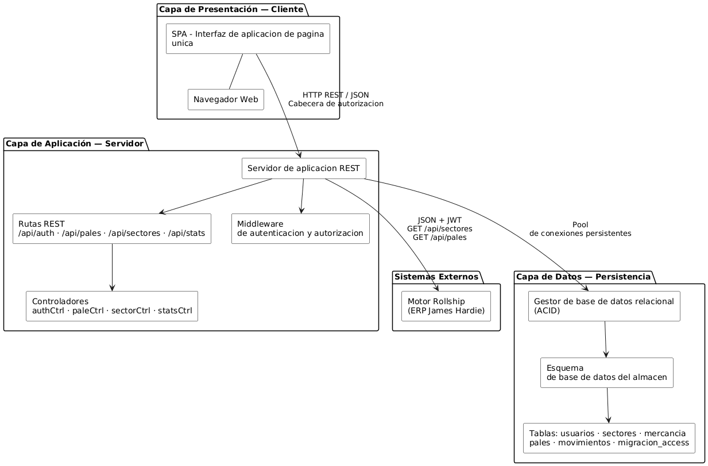
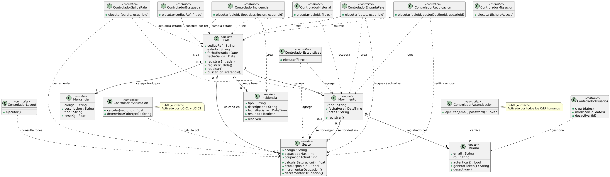
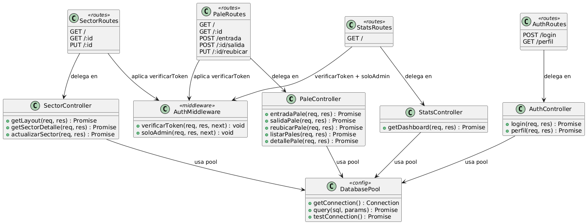
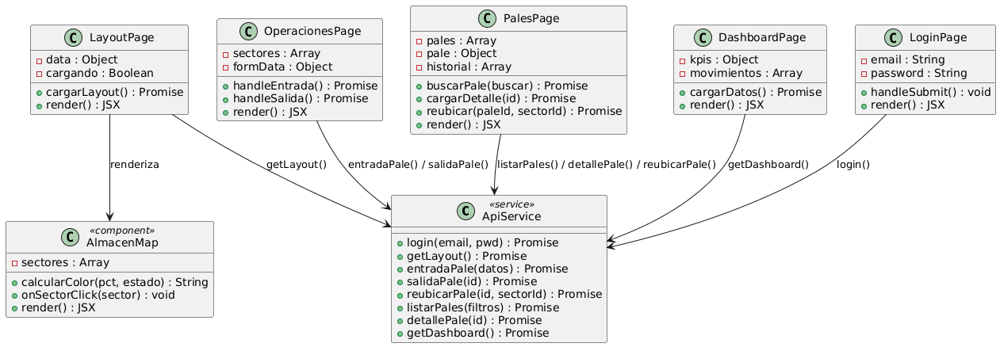
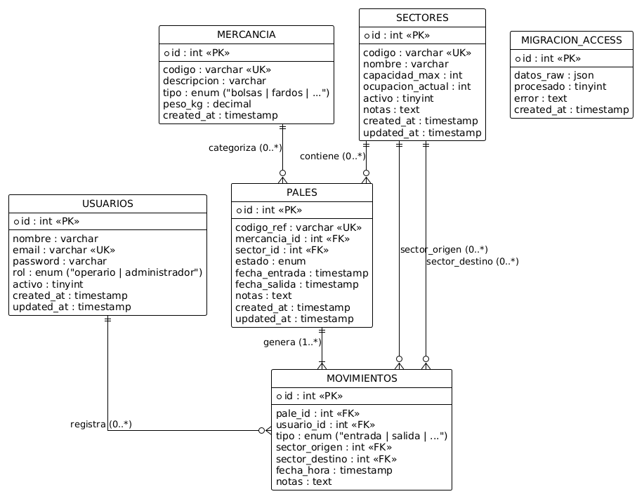
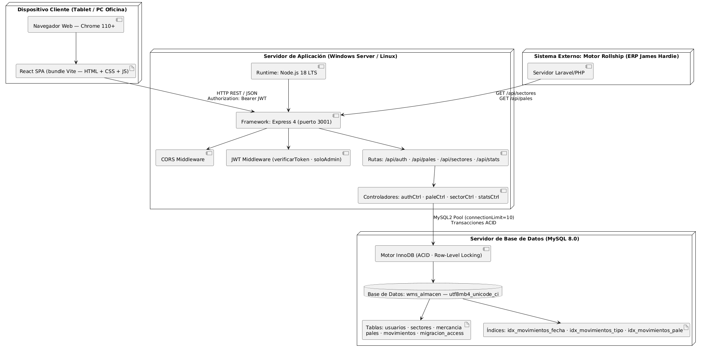
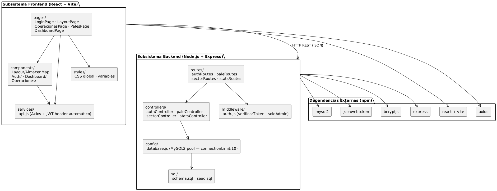
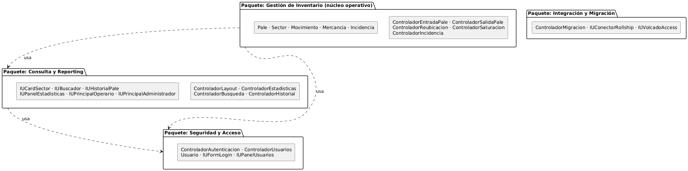
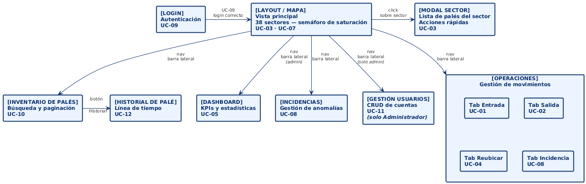

[← Actividades](./03-actividades.md) | [← Índice](./README.md) | [Secuencias →](./05-secuencias.md)

[Dominio](./01-dominio.md) | [Casos de Uso](./02-casos-de-uso.md) | [Actividades](./03-actividades.md) | [Arquitectura](./04-arquitectura.md) | [Secuencias](./05-secuencias.md) | [Screenshots](./06-screenshots.md)

---

# Arquitectura y Diseño

---

## Arquitectura del sistema en capas

> Capa de Presentación (SPA Vanilla JS) → Capa de Aplicación (Node.js + Express + JWT) → Capa de Datos (MySQL 8.0 InnoDB ACID).

---

## Clases de análisis MVC

> **Regla de derivación:** Vista = invocar/presentar · Controlador = un controlador por UC · Modelo = derivado del modelo del dominio.

---

## Clases de diseño — Backend

> Implementación real en Node.js + Express. Controladores, modelos y middleware de autenticación.

---

## Clases de diseño — Frontend

> Implementación real en Vanilla JS SPA con hash routing. Vistas y componentes del cliente.

---

## Modelo Entidad-Relación (ER)

> 6 tablas principales: `sectores` · `pales` · `movimientos` · `mercancia` · `usuarios` · `migracion_access`. PALES es el pivote central.

---

## Diagrama de despliegue

> Infraestructura WAMP64 existente en la empresa: Apache · MySQL 8.0 · Node.js 20 en la misma máquina.

---

## Diagrama de paquetes

---

## Análisis de paquetes

> Dependencias entre capas y módulos del sistema.

---

## Diagrama de navegación SPA (hash routing)

> Rutas del frontend: `#/login` · `#/layout` · `#/operaciones` · `#/inventario` · `#/dashboard` · `#/incidencias` · `#/usuarios`.

---

[← Actividades](./03-actividades.md) | [← Índice](./README.md) | [Secuencias →](./05-secuencias.md)
