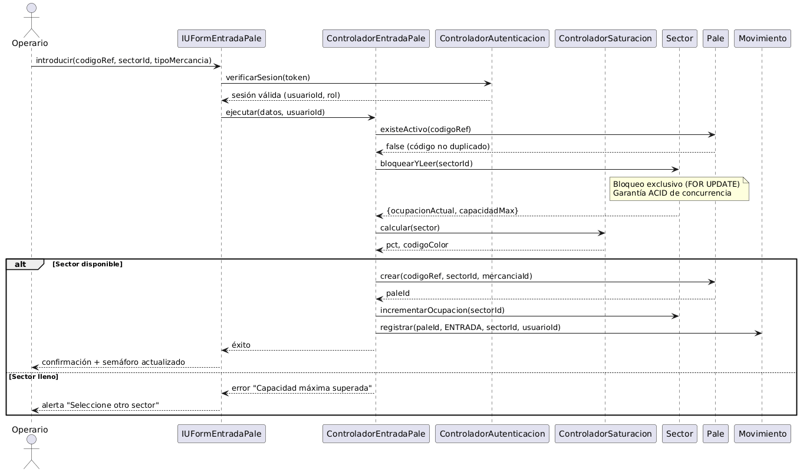
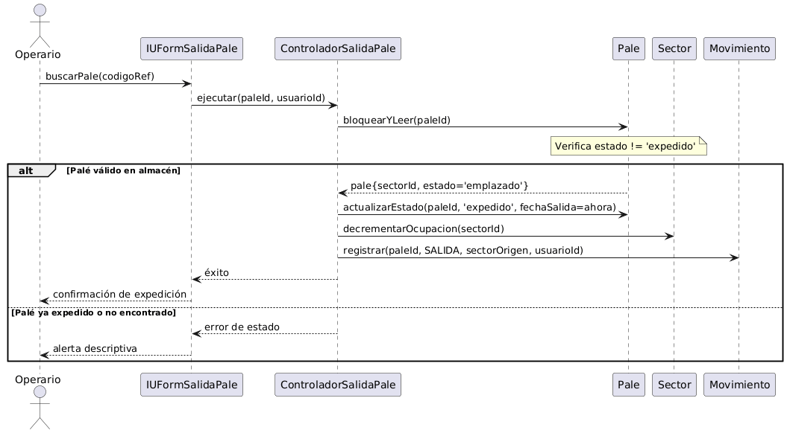
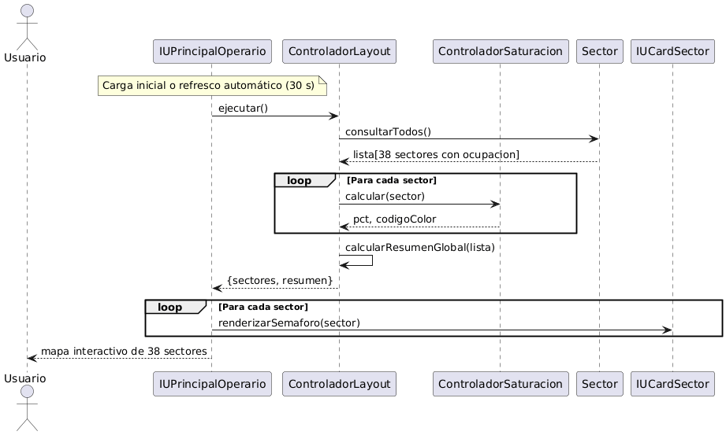
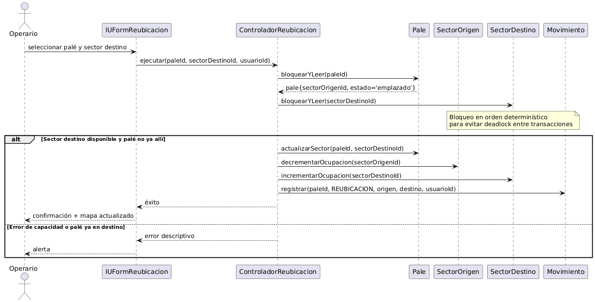
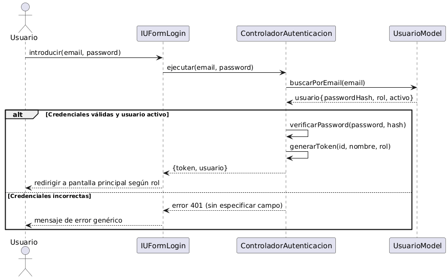
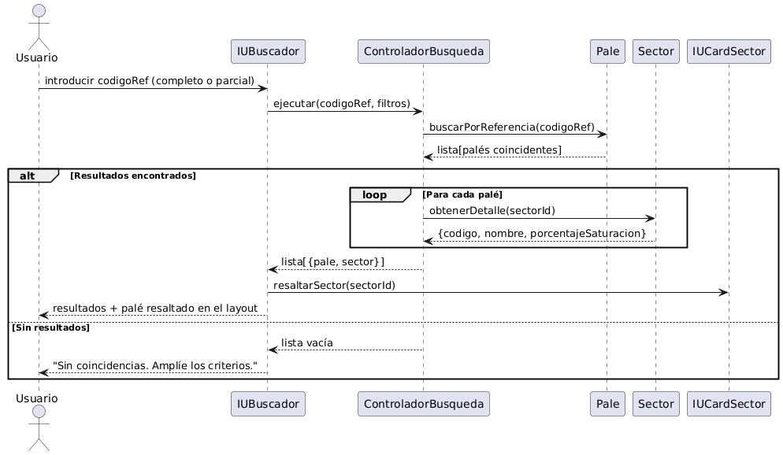
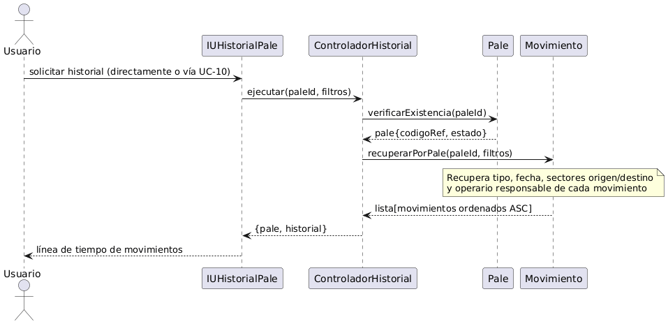

[← Arquitectura](./04-arquitectura.md) | [← Índice](./README.md) | [Screenshots →](./06-screenshots.md)

[Dominio](./01-dominio.md) | [Casos de Uso](./02-casos-de-uso.md) | [Actividades](./03-actividades.md) | [Arquitectura](./04-arquitectura.md) | [Secuencias](./05-secuencias.md) | [Screenshots](./06-screenshots.md)

---

# Diagramas de Secuencia

> Interacción **Actor → Vista → Controlador → Modelo** para los UC más representativos. Ver [Actividades](./03-actividades.md) para el flujo de proceso de cada UC.

---

## UC-01 — Registrar entrada de palé

> `SELECT … FOR UPDATE` sobre sector · inserción atómica palé + movimiento ENTRADA · ROLLBACK automático si sector lleno.

---

## UC-02 — Registrar salida de palé

---

## UC-03 — Consultar layout interactivo

> `GET /api/sectores` → semáforo de saturación → respuesta JSON a la Vista SPA · también accesible por Motor Rollship sin JWT.

---

## UC-04 — Reubicar palé (doble FOR UPDATE)

> Doble bloqueo exclusivo: palé + sector destino bloqueados simultáneamente para garantizar atomicidad de la reubicación.

---

## UC-09 — Autenticar usuario (JWT · bcrypt)

> Verificación bcrypt del hash · emisión JWT firmado con rol y expiración 8h · precondición de todos los demás UC.

---

## UC-10 — Buscar palé por referencia

---

## UC-12 — Consultar historial de palé

> Recupera todos los movimientos del palé ordenados por `fecha_hora` · permite reconstruir la trazabilidad completa para auditoría.

---

[← Arquitectura](./04-arquitectura.md) | [← Índice](./README.md) | [Screenshots →](./06-screenshots.md)
