[← Secuencias](./05-secuencias.md) | [← Índice](./README.md)

[Dominio](./01-dominio.md) | [Casos de Uso](./02-casos-de-uso.md) | [Actividades](./03-actividades.md) | [Arquitectura](./04-arquitectura.md) | [Secuencias](./05-secuencias.md) | [Screenshots](./06-screenshots.md)

---

# Sistema en Producción — Screenshots

> Capturas del sistema real desplegado. **Acceso en vivo:** `http://localhost:3001` · [ngrok público](https://showbiz-mockup-primp.ngrok-free.dev)

---

## Login — UC-09 Autenticación

> Credenciales de demo: `admin@almacen.com` · `operario@almacen.com` · `gerente@almacen.com` · `viewer@almacen.com` — contraseña: `ejecucion`

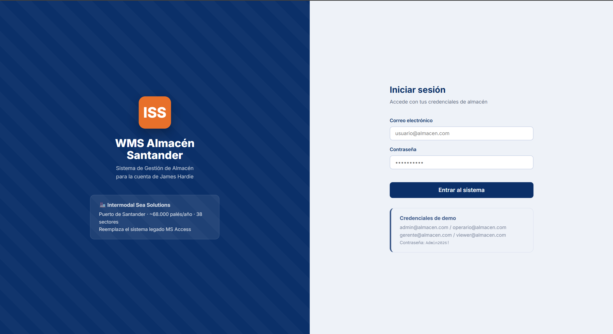

---

## Layout interactivo — UC-03

> 118 sectores · semáforo de 5 niveles (Libre · Bajo · Medio · Alto · Crítico) · KPIs en cabecera: 2.444 palés · 10.382 huecos · 23,5% ocupación.

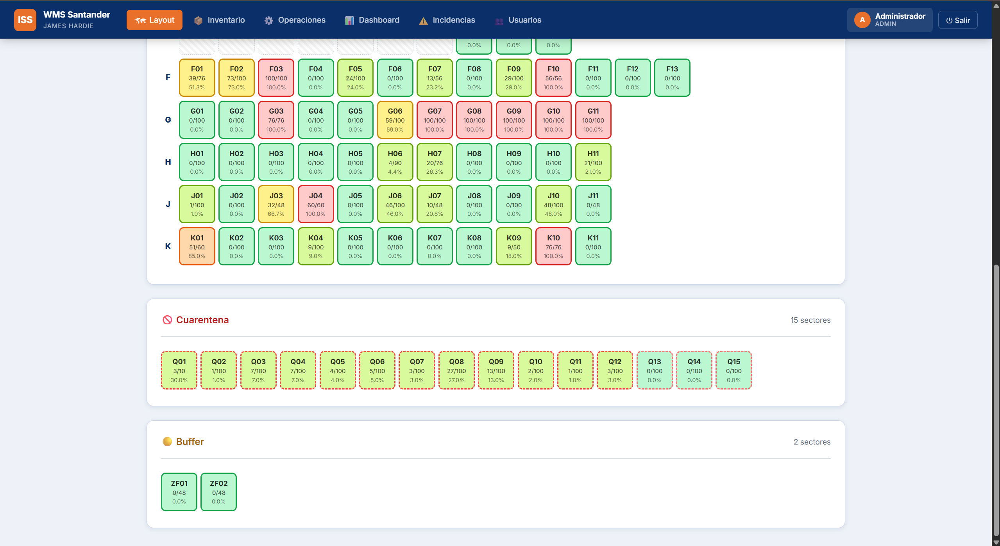

---

## Modal de sector — drill-down

> Clic en cualquier sector → lista de palés contenidos con código, mercancía, estado y fecha de entrada.

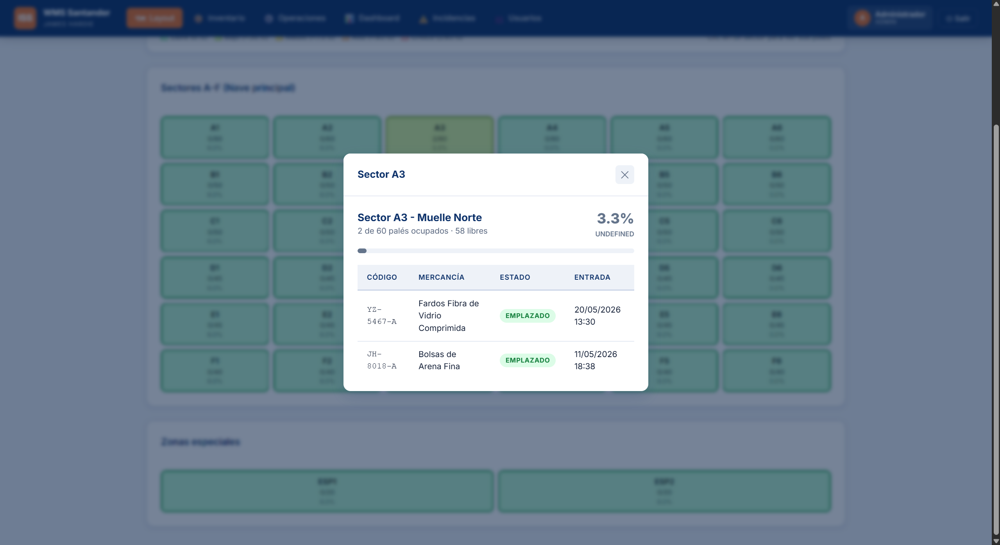

---

## Operaciones: Entrada — UC-01

> Formulario de registro de entrada: código de referencia (JH-XXXX-X) · tipo de mercancía · sector destino · transacción ACID con FOR UPDATE.

---

## Operaciones: Salida — UC-02

> Búsqueda por código · verificación de estado `EMPLAZADO` · confirmación de expedición en botón rojo.

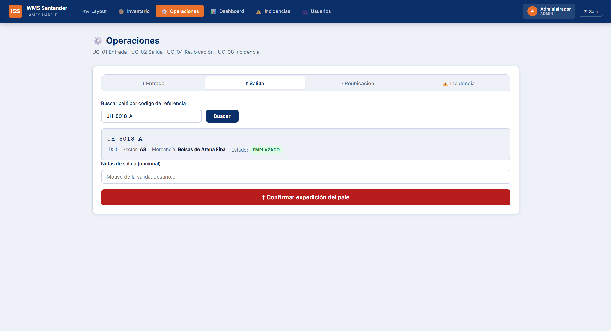

---

## Operaciones: Reubicación — UC-04

> Doble FOR UPDATE: bloquea palé y sector destino simultáneamente antes de mover.

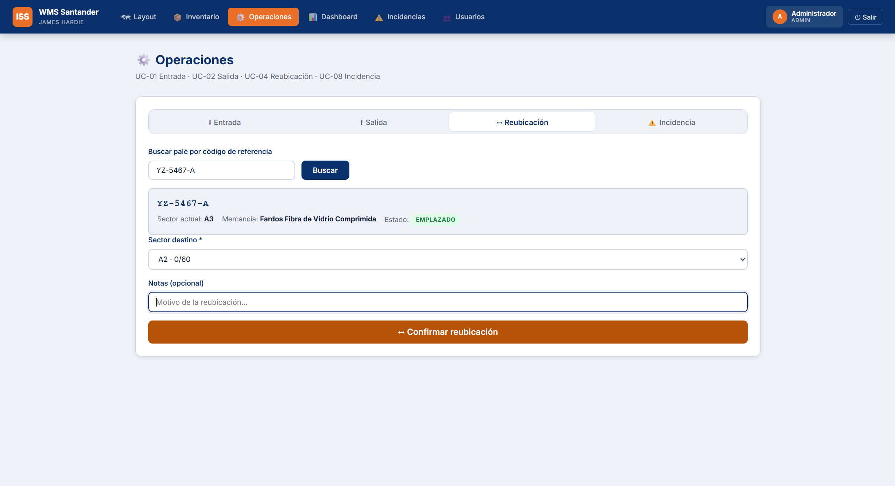

---

## Inventario — UC-10 Búsqueda

> Filtros combinados: código de referencia · estado · sector. Trazabilidad completa con fechas de entrada y salida.

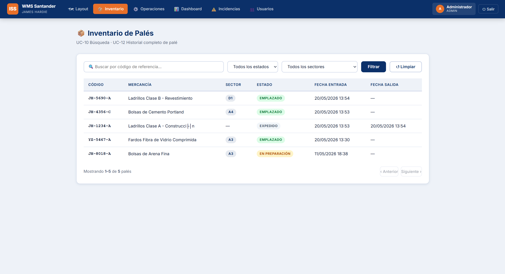

---

## Modal historial — UC-12 Trazabilidad

> Línea de tiempo completa de movimientos ACID del palé: ENTRADA · REUBICACION · SALIDA · INCIDENCIA ordenados por `fecha_hora`.

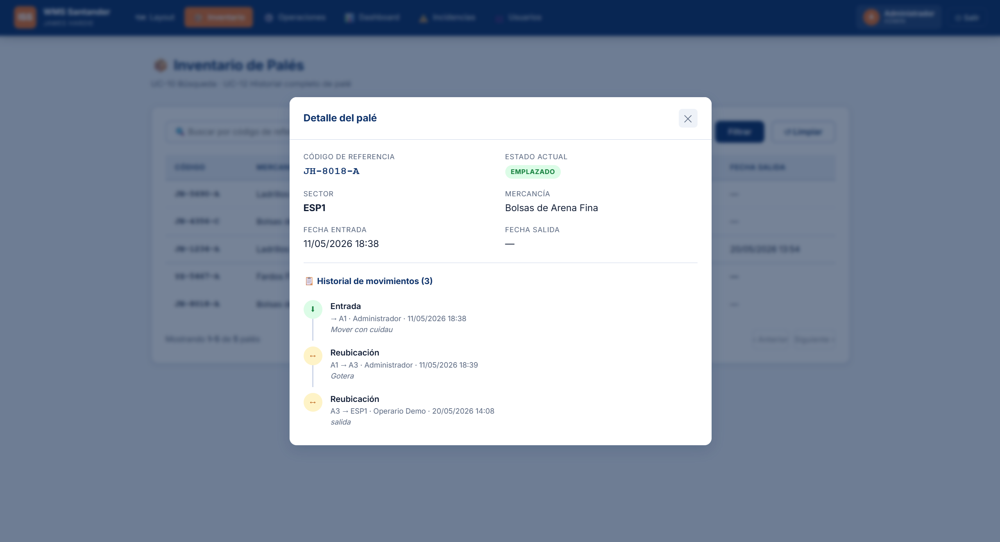

---

## Incidencias — UC-08

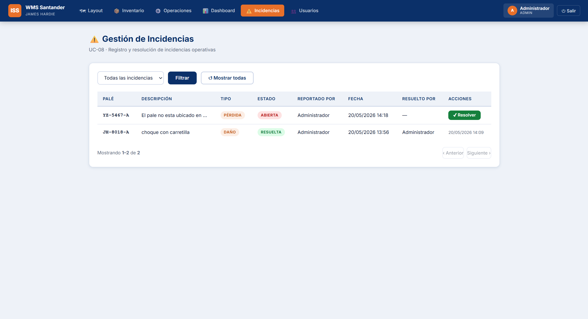

---

## Modal incidencia — UC-08

> Registrar anomalía → palé pasa a estado `INCIDENCIA` → bloqueado para salida y reubicación hasta resolución.

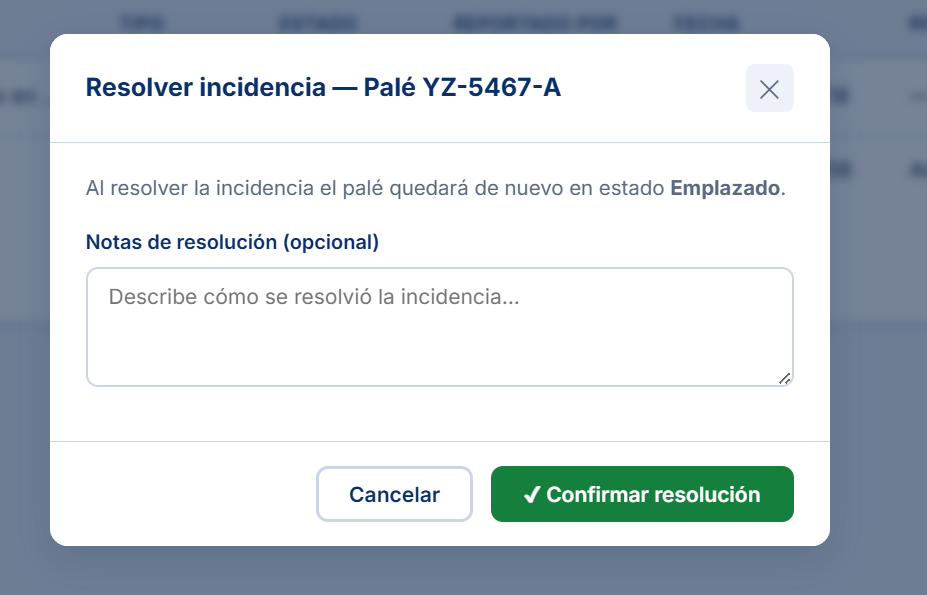

---

## Dashboard estadístico — UC-05

> KPIs en tiempo real: palés en almacén · entradas/salidas/reubicaciones del día · distribución por estado · top 5 sectores más ocupados.

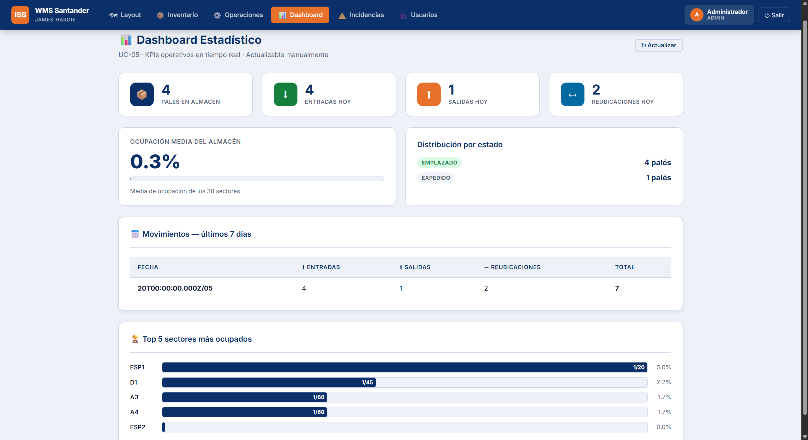

---

## Gestión de usuarios — UC-11

> CRUD de cuentas con RBAC. Solo Administrador. Contraseña siempre como hash bcrypt — nunca en texto plano.

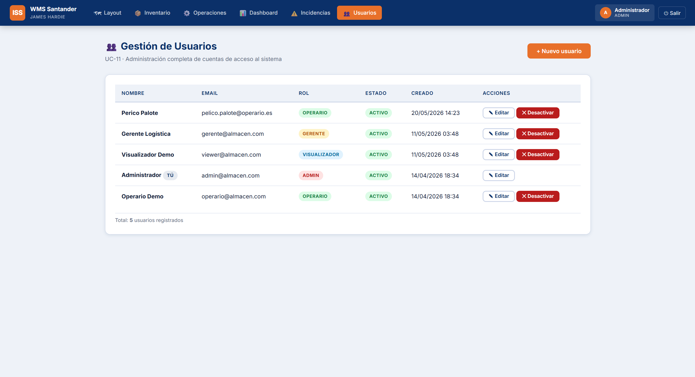

---

[← Secuencias](./05-secuencias.md) | [← Índice](./README.md)
