# Capítulo 2: Disciplina de Requisitos

---

## 1. Introducción

El presente capítulo da respuesta al **Objetivo Específico I** del Trabajo de Fin de Grado: ejecutar la disciplina de requisitos que conduzca al diseño y desarrollo del sistema WMS para el almacén de Santander de Intermodal Sea Solutions, gestionado para la cuenta de James Hardie Iberia S.L. El modelado del dominio sigue las convenciones de Larman (2004) y Pressman y Maxim (2020).

Su propósito es **dirigir el desarrollo hacia el sistema correcto**, describiendo los requisitos del sistema de tal forma que se alcance el acuerdo entre el cliente, los usuarios y el equipo de ingeniería sobre qué debe hacer el sistema. La información aquí formalizada procede de las sesiones de elicitación realizadas con el supervisor del almacén, la dirección de Intermodal Sea Solutions y la observación directa del trabajo diario de los operarios.

El capítulo se estructura en dos bloques metodológicos complementarios, siguiendo la secuencia indicada en la asignatura de Ingeniería del Software:

- **Modelo del Dominio:** establece el vocabulario común (glosario), abstrae la realidad del negocio logístico en diagramas UML conceptuales (clases, objetos, estados) y especifica los requisitos suplementarios (no funcionales).

- **Disciplina de Requisitos:** identifica actores y casos de uso, los diagrama por actor, los prioriza, los detalla con sus flujos de interacción, los prototipos en interfaces y estructura el modelo con relaciones de inclusión y extensión.

---

## 2. Modelo del Dominio

### 2.1 Glosario de Términos

El siguiente glosario establece el vocabulario acordado con el cliente durante las sesiones de elicitación. Su objetivo es eliminar ambigüedades en la comunicación entre el equipo de desarrollo y las partes interesadas del negocio (Larman, 2004).

| Término | Definición en el contexto del sistema |
|---|---|
| **Almacén** | Recinto logístico ubicado en el Polígono Industrial Norte de Santander, gestionado por Intermodal Sea Solutions para la cuenta de James Hardie. 38 sectores, 4.200 m² de superficie. |
| **Sector** | Cada una de las 38 subdivisiones físicas del almacén, identificadas por un código alfanumérico único (p. ej., "B4", "A1"). Unidad mínima de gestión espacial. |
| **Palé** | Unidad de carga física que agrupa mercancía de James Hardie sobre una base de madera normalizada. Unidad mínima de gestión de inventario. Identificado por un código de referencia único (p. ej., "JH-8819-A"). |
| **Entrada** | Operación de registro de la llegada de un palé al almacén. Genera un movimiento de tipo ENTRADA y cambia el estado del palé a *Emplazado*. |
| **Expedición** | Operación de salida autorizada de un palé del almacén. Genera un movimiento de tipo SALIDA y cambia el estado del palé a *Expedido*. |
| **Reubicación** | Traslado de un palé entre dos sectores del mismo almacén. Genera un movimiento de tipo REUBICACION. |
| **Saturación** | Porcentaje de ocupación de un sector: `(paleActuales / capacidadMax) × 100`. Determina el color del indicador visual (verde / ámbar / rojo). |
| **Layout virtual** | Representación visual interactiva del estado de ocupación de los 38 sectores en tiempo real. Pantalla principal del módulo web. |
| **Semáforo de saturación** | Sistema de codificación cromática: verde (0–60 %), ámbar (61–85 %), rojo (86–100 %). |
| **Movimiento** | Registro transaccional de cualquier operación que altera el estado o la ubicación de un palé. Constituye el log de auditoría del sistema. |
| **Turno** | Período de trabajo de un operario: mañana (06:00–14:00), tarde (14:00–22:00) y noche (22:00–06:00). |
| **Rollship** | Sistema de gestión corporativo externo de James Hardie. Consume los datos del módulo logístico mediante API para el seguimiento del inventario. |
| **ETL** | *Extract, Transform, Load*. Proceso de migración de los datos históricos desde el sistema MS Access legado hacia la nueva base de datos. |
| **Picking** | Proceso de selección y preparación de palés para su expedición, previo a la aprobación del supervisor. |
| **Incidencia** | Situación anómala que afecta a un palé e impide el flujo operativo normal: daño físico, discrepancia en el código de referencia o diferencia entre el contenido declarado y el real. |
| **Módulo Logístico Web** | Sistema informático objeto de este TFG. Aplicación web que sustituye al sistema MS Access legado para la gestión del inventario del almacén de Santander. |
| **Operario de pista** | Trabajador del almacén que registra las operaciones físicas de entrada, salida y reubicación de palés a través del módulo web. |
| **Administrador** | Usuario con privilegios de supervisión, gestión de incidencias y acceso a estadísticas. Rol con acceso completo al sistema. |

---

### 2.2 Diagrama de Clases Conceptuales

El diagrama de clases del dominio representa las entidades conceptuales más importantes del negocio logístico y sus relaciones. Es una abstracción de la realidad, expresada en el lenguaje del cliente, sin dependencias de ningún entorno tecnológico ni restricciones de implementación (Larman, 2004). Los diagramas se expresan en UML, estándar de modelado visual definido por el Object Management Group (OMG, 2017). Por este motivo, no incluye métodos ni artefactos de diseño.

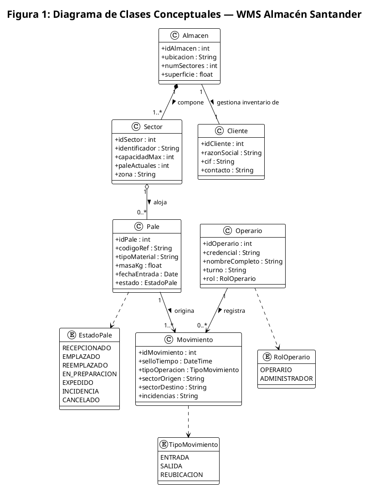

**Figura 1.** Diagrama de Clases Conceptuales — WMS Almacén Santander.

**Descripción de las relaciones:**

| Relación | Tipo | Cardinalidad | Significado |
|---|---|---|---|
| `Almacen` → `Sector` | Composición | 1 a 1..* | Un almacén se compone de sectores. Sin almacén no hay sectores. Contexto actual: 38 sectores. |
| `Sector` → `Palé` | Agregación | 1 a 0..* | Un sector aloja cero o más palés en un momento dado. Los palés existen independientemente del sector. |
| `Palé` → `Movimiento` | Asociación | 1 a 1..* | Cada palé origina al menos un movimiento (la entrada). Puede originar muchos más a lo largo de su ciclo de vida. |
| `Operario` → `Movimiento` | Asociación | 1 a 0..* | Un operario registra cero o muchos movimientos. Cada movimiento es registrado por exactamente un operario. |
| `Almacen` → `Cliente` | Asociación | 1 a 1 | El almacén gestiona el inventario de un único cliente corporativo (James Hardie). |

---

### 2.3 Diagrama de Objetos

El diagrama de objetos proyecta una instantánea del recinto logístico en un instante concreto, instanciando el modelo de clases con datos reales. Sirve para verificar la corrección del modelo conceptual (Larman, 2004).

El instante modelado corresponde a una operación de descarga registrada el 12 de mayo de 2026 en turno de tarde:

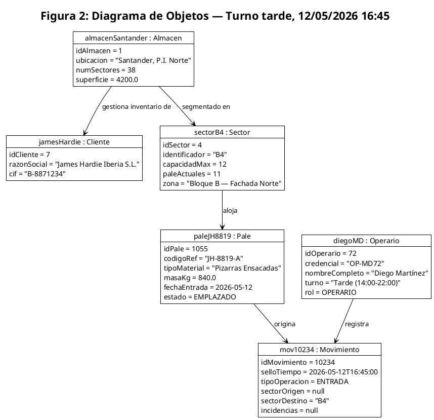

**Figura 2.** Diagrama de Objetos — Turno tarde, 12/05/2026, 16:45.

El diagrama confirma que el modelo conceptual captura correctamente la operativa real: el operario Diego Martínez registra la entrada del palé JH-8819-A (840 kg de Pizarras Ensacadas) en el sector B4, generando el movimiento MOV-10234 que queda vinculado al palé, al sector y al operario.

---

### 2.4 Diagrama de Estados del Palé

El diagrama de estados refleja el ciclo de vida completo de un palé desde su llegada al muelle de descarga hasta que abandona las instalaciones, incluyendo los estados de excepción que representan situaciones reales de incidencia operativa.

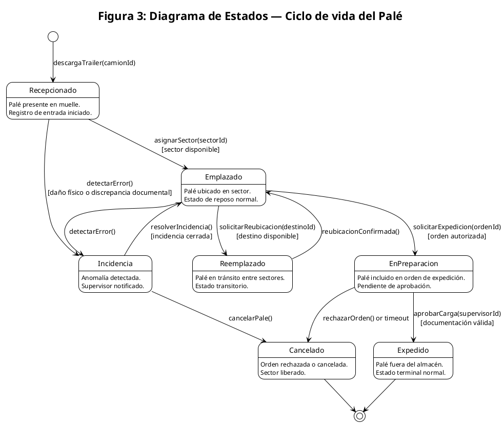

**Figura 3.** Diagrama de Estados — Ciclo de vida del Palé.

| Estado | Condición de entrada | Descripción |
|---|---|---|
| **Recepcionado** | Llegada física al muelle | El palé está presente pero sin sector asignado en el sistema. |
| **Emplazado** | Asignación de sector | El palé tiene sector asignado. Estado de reposo normal. |
| **Reemplazado** | Solicitud de reubicación | El palé está en tránsito entre dos sectores. Estado transitorio. |
| **En preparación** | Orden de expedición autorizada | El palé está reservado para su salida, pendiente de confirmación. |
| **Expedido** | Aprobación de carga confirmada | El palé ha salido del almacén. Estado terminal normal. |
| **Incidencia** | Detección de anomalía | El palé presenta un problema que impide el flujo normal. |
| **Cancelado** | Rechazo u orden anulada | La expedición fue rechazada o cancelada antes de producirse. |

---

### 2.5 Requisitos Suplementarios (No Funcionales)

Los requisitos suplementarios especifican las propiedades de calidad del sistema: cómo de rápido, seguro, fiable y usable debe ser (Sommerville, 2015). Condicionarán directamente las decisiones de arquitectura del Capítulo 3.

| ID | Categoría | Descripción | Métrica de verificación |
|---|---|---|---|
| **RS-01** | Rendimiento | El layout virtual se carga en menos de **1,5 s** en la red interna del almacén. Las operaciones de escritura se confirman en menos de **2 s**. | Prueba de carga con 5 operarios concurrentes. |
| **RS-02** | Disponibilidad | El sistema estará disponible el **99,5 %** del tiempo en horario operativo (06:00–22:00, lunes a sábado). | Monitorización de uptime. |
| **RS-03** | Seguridad | Acceso mediante credenciales únicas. Sesiones con expiración a los **30 minutos** de inactividad. El rol OPERARIO no puede modificar registros confirmados. | Revisión de código y pruebas básicas OWASP Top 10. |
| **RS-04** | Usabilidad | Interfaz operable con guantes de trabajo. Elementos táctiles ≥ **60×60 px**. Un operario sin formación técnica debe dominar el registro de entradas en menos de **15 minutos** de entrenamiento. Cumplimiento WCAG 2.1 nivel AA (W3C, 2018). | Test de usabilidad *think-aloud* con 3 operarios. |
| **RS-05** | Portabilidad | Compatible con Chrome 110+, Firefox 110+ y Safari 16+, en escritorio, tablet y smartphone (≥ 375×667 px). No requiere instalación de software adicional. | Pruebas manuales en los navegadores indicados. |
| **RS-06** | Mantenibilidad | Separación estricta de capas (MVC). Cobertura de pruebas unitarias sobre lógica de negocio ≥ **70 %**. | Informe de cobertura de pruebas. |
| **RS-07** | Integridad | Todas las operaciones de escritura son atómicas: ante cualquier error, el sistema garantiza que no existen registros parciales ni estados inconsistentes. | Pruebas de integración con simulación de fallos. |

---

## 3. Disciplina de Requisitos

### 3.1 Identificación de Actores y Casos de Uso

Un actor, en el sentido UML, es cualquier entidad externa al sistema que interactúa con él, ya sea una persona, un rol organizativo o un sistema informático externo (Larman, 2004). La identificación de actores delimita la frontera del sistema y es el punto de partida para la construcción de los casos de uso (Wiegers y Beatty, 2013).

#### Actores identificados

| Actor | Tipo | Descripción | CdU accesibles |
|---|---|---|---|
| **Operario de Pista** | Humano principal | Registra las operaciones físicas de entrada, salida y reubicación de palés desde un dispositivo móvil en tiempo real. | UC-01, 02, 03, 04, 10, 12 |
| **Administrador** | Humano privilegiado | Supervisa la ocupación del almacén, gestiona incidencias, extrae informes, rectifica registros y administra usuarios del sistema. | UC-01 a UC-12 |
| **Motor Rollship** | Sistema externo receptor | Sistema corporativo de James Hardie. Consulta el estado del inventario del almacén mediante API. | UC-03 |
| **MS Access (legado)** | Sistema externo transitorio | Fuente de datos históricos durante el proceso de migración ETL. Relevante únicamente en la fase de migración. | UC-06 |

#### Casos de Uso identificados

| ID | Nombre | Breve descripción |
|---|---|---|
| **UC-01** | Registrar entrada de palé | El operario registra la llegada de un palé al almacén y le asigna un sector. |
| **UC-02** | Registrar salida de palé | El operario registra la salida autorizada de un palé del almacén. |
| **UC-03** | Consultar layout interactivo | El usuario consulta el mapa de ocupación en tiempo real de los 38 sectores. |
| **UC-04** | Reubicar palé entre sectores | El operario traslada un palé de un sector a otro dentro del almacén. |
| **UC-05** | Consultar estadísticas de flujo | El administrador obtiene informes de movimientos históricos y ocupación. |
| **UC-06** | Migrar datos legado (ETL) | El administrador lanza el proceso de importación de datos desde MS Access. |
| **UC-07** | Calcular saturación de sector | El sistema calcula el porcentaje de ocupación de un sector. (*Subflujo incluido.*) |
| **UC-08** | Registrar incidencia operativa | El operario notifica una anomalía detectada en un palé. (*Flujo extendido desde UC-01.*) |
| **UC-09** | Autenticar usuario | El sistema verifica las credenciales del usuario antes de conceder acceso. (*Subflujo incluido.*) |
| **UC-10** | Buscar palé por referencia | El usuario localiza un palé concreto introduciendo su código de referencia en el buscador. |
| **UC-11** | Gestionar usuarios del sistema | El administrador crea, modifica y desactiva cuentas de operario. |
| **UC-12** | Consultar historial de palé | El usuario consulta la traza completa de movimientos de un palé concreto (trazabilidad). |

---

#### Figura 4 — Diagrama de Casos de Uso: Visión General

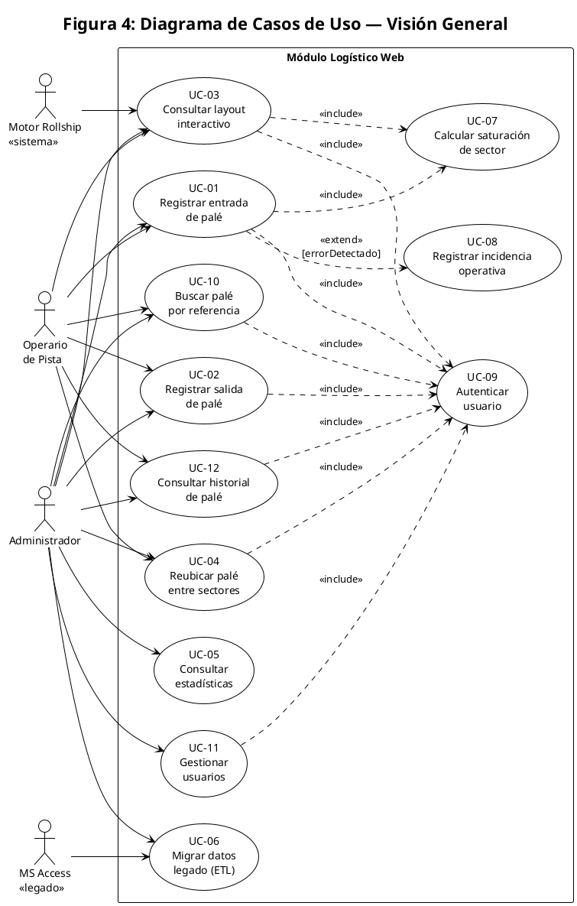

**Figura 4.** Diagrama de Casos de Uso — Visión General del sistema.

---

#### Figura 5 — Diagrama de Casos de Uso: Actor Operario de Pista

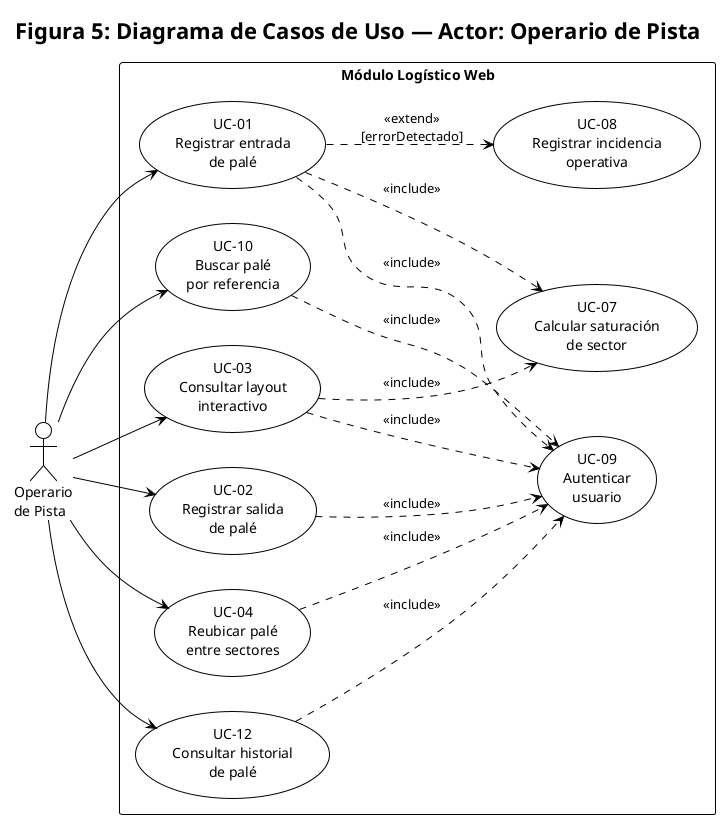

**Figura 5.** Diagrama de Casos de Uso — Actor: Operario de Pista.

---

#### Figura 6 — Diagrama de Casos de Uso: Actor Administrador

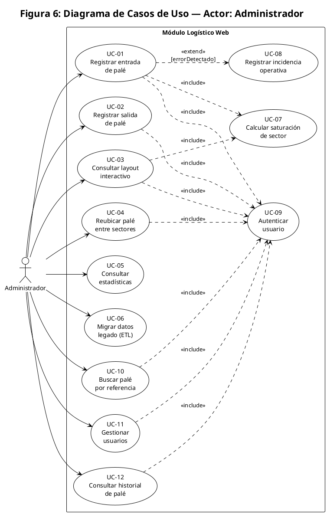

**Figura 6.** Diagrama de Casos de Uso — Actor: Administrador.

---

#### Figura 7 — Diagrama de Casos de Uso: Actor Motor Rollship

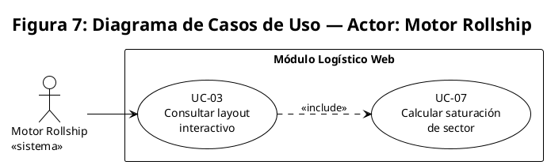

**Figura 7.** Diagrama de Casos de Uso — Actor: Motor Rollship (sistema externo receptor).

---

#### Figura 8 — Diagrama de Contexto del Sistema

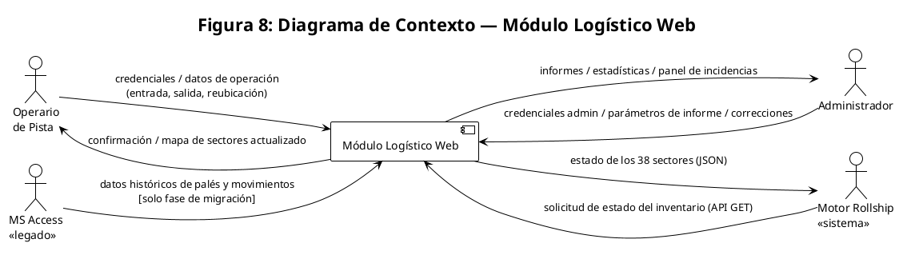

**Figura 8.** Diagrama de Contexto — Flujos de información entre el sistema y los actores externos.

---

### 3.2 Priorización de Casos de Uso

Los casos de uso se priorizan aplicando los criterios establecidos en RUP (Rational Unified Process): riesgo técnico, contribución a la arquitectura del sistema, valor para el negocio y dependencias entre casos de uso (Larman, 2004; Kruchten, 2004). El objetivo es ordenar la implementación de forma que las funcionalidades más críticas y riesgosas se aborden en las primeras iteraciones.

| ID | Nombre | Valor de negocio | Riesgo técnico | Contribución arquitectónica | Dependencias | **Iteración** |
|---|---|:-:|:-:|:-:|---|:-:|
| **UC-09** | Autenticar usuario | Alto | Bajo | Alta (base de toda interacción) | Ninguna | **1ª** |
| **UC-01** | Registrar entrada de palé | Muy alto | Medio | Alta (operación principal) | UC-09, UC-07 | **1ª** |
| **UC-02** | Registrar salida de palé | Muy alto | Medio | Alta (cierra ciclo de vida) | UC-09, UC-07 | **1ª** |
| **UC-03** | Consultar layout interactivo | Alto | Medio | Alta (pantalla principal, base del sistema) | UC-09, UC-07 | **1ª** |
| **UC-07** | Calcular saturación de sector | Alto | Bajo | Alta (subflujo compartido) | Ninguna | **1ª** |
| **UC-04** | Reubicar palé entre sectores | Medio | Bajo | Media | UC-09, UC-07 | **2ª** |
| **UC-08** | Registrar incidencia operativa | Medio | Bajo | Baja | UC-01 | **2ª** |
| **UC-06** | Migrar datos legado (ETL) | Alto | Alto | Baja (proceso puntual) | Ninguna | **2ª** |
| **UC-10** | Buscar palé por referencia | Alto | Bajo | Media | UC-09 | **2ª** |
| **UC-11** | Gestionar usuarios del sistema | Medio | Bajo | Media | UC-09 | **2ª** |
| **UC-05** | Consultar estadísticas de flujo | Bajo | Bajo | Baja | UC-09 | **3ª** |
| **UC-12** | Consultar historial de palé | Medio | Bajo | Baja | UC-09 | **3ª** |

**Producto Mínimo Viable (PMV):** los casos de uso de la primera iteración (UC-01, UC-02, UC-03, UC-07, UC-09) constituyen el sistema operativamente funcional para la actividad diaria del almacén. La segunda iteración incorpora UC-04, UC-06, UC-08, UC-10 y UC-11; la tercera, UC-05 y UC-12.

---

### 3.3 Detalle de Casos de Uso

#### UC-01 — Registrar Entrada de Palé

| Campo | Valor |
|---|---|
| **Denominación** | UC-01 — Registrar entrada de palé |
| **Actor principal** | Operario de Pista |
| **Actores secundarios** | — |
| **Incluye** | UC-09 (Autenticar usuario), UC-07 (Calcular saturación) |
| **Extiende** | UC-08 (Registrar incidencia) [condición: error detectado] |
| **Iteración** | 1ª — alta prioridad |

**Precondiciones:**
- El operario tiene sesión iniciada en la aplicación.
- El palé físico está presente en el muelle de descarga.

**Flujo principal (escenario de éxito):**

| Paso | Actor | Acción |
|---|---|---|
| 1 | Operario | Solicita registrar una nueva entrada de palé. |
| 2 | Sistema | Presenta el formulario de entrada y el mapa de sectores con el estado de ocupación actualizado. |
| 3 | Operario | Introduce el código de referencia del palé, el tipo de material y la masa aproximada. |
| 4 | Operario | Selecciona el sector destino en el mapa. |
| 5 | Sistema | Verifica que el sector seleccionado tiene capacidad disponible. |
| 6 | Sistema | Registra la operación de entrada: crea el palé con estado *Emplazado* y genera el movimiento de tipo ENTRADA vinculado al operario y al sector. |
| 7 | Sistema | Confirma la operación al operario y actualiza el mapa de sectores en pantalla. |

**Postcondiciones:**
- El palé queda registrado en el sistema con estado *Emplazado* en el sector seleccionado.
- El sistema ha generado un movimiento de tipo ENTRADA con sello temporal, sector destino y operario responsable.
- La ocupación del sector destino se ha actualizado.

**Flujos alternativos y excepciones:**

*A1 — Sector lleno:* En el paso 5, si el sector seleccionado no tiene capacidad disponible, el sistema informa al operario e invita a seleccionar un sector alternativo. El mapa muestra los sectores llenos en rojo y no seleccionables.

*A2 — Código de referencia duplicado:* En el paso 3, si el código introducido ya corresponde a un palé activo en el sistema, el sistema advierte al operario y le pide confirmación antes de registrar.

*A3 — Error detectado en recepción:* Si el operario detecta una anomalía en el palé durante el proceso, puede extender el flujo hacia UC-08 (Registrar incidencia).

---

**Figura 9.** Diagrama de Actividad — UC-01: Registrar entrada de palé.

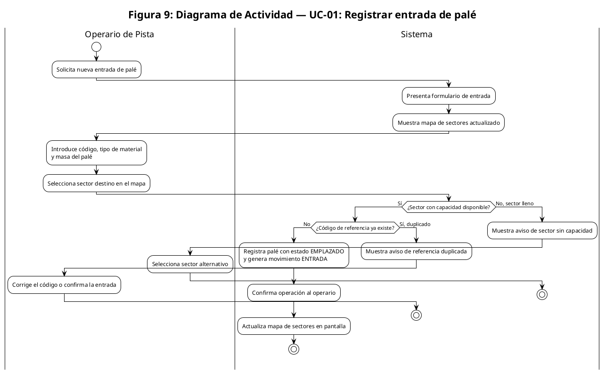

---

#### UC-02 — Registrar Salida de Palé

| Campo | Valor |
|---|---|
| **Denominación** | UC-02 — Registrar salida de palé |
| **Actor principal** | Operario de Pista |
| **Actores secundarios** | Administrador (aprobación de la orden de expedición) |
| **Incluye** | UC-09 (Autenticar usuario), UC-07 (Calcular saturación) |
| **Iteración** | 1ª — alta prioridad |

**Precondiciones:**
- El operario tiene sesión iniciada en la aplicación.
- El palé a expedir existe en el sistema con estado *Emplazado* o *En preparación*.
- El administrador ha emitido una orden de expedición para el palé.

**Flujo principal (escenario de éxito):**

| Paso | Actor | Acción |
|---|---|---|
| 1 | Operario | Solicita registrar la salida de un palé, indicando su código de referencia o buscándolo en el layout. |
| 2 | Sistema | Presenta el detalle del palé: código, tipo de material, sector actual y orden de expedición asociada. |
| 3 | Operario | Confirma que el palé físico está en el área de carga y solicita registrar la salida. |
| 4 | Sistema | Solicita confirmación explícita al operario antes de proceder. |
| 5 | Operario | Confirma la operación. |
| 6 | Sistema | Verifica que el estado actual del palé permite la expedición. |
| 7 | Sistema | Registra la operación de salida: actualiza el estado del palé a *Expedido*, genera el movimiento SALIDA, y libera la plaza del sector origen. |
| 8 | Sistema | Notifica al administrador la expedición realizada. |
| 9 | Sistema | Confirma la operación al operario y actualiza el mapa de sectores. |

**Postcondiciones:**
- El palé tiene estado *Expedido* y fecha de salida registrada.
- El sistema ha generado un movimiento de tipo SALIDA con sello temporal, sector origen y operario.
- La ocupación del sector origen ha disminuido en una unidad.

**Flujos alternativos y excepciones:**

*A1 — Palé en estado incompatible:* En el paso 6, si el palé presenta estado *Incidencia*, el sistema impide la expedición y redirige al operario al panel de gestión de incidencias.

*A2 — Orden cancelada:* Si la orden de expedición fue cancelada por el administrador, el sistema informa al operario y no permite la salida.

---

**Figura 10.** Diagrama de Actividad — UC-02: Registrar salida de palé.

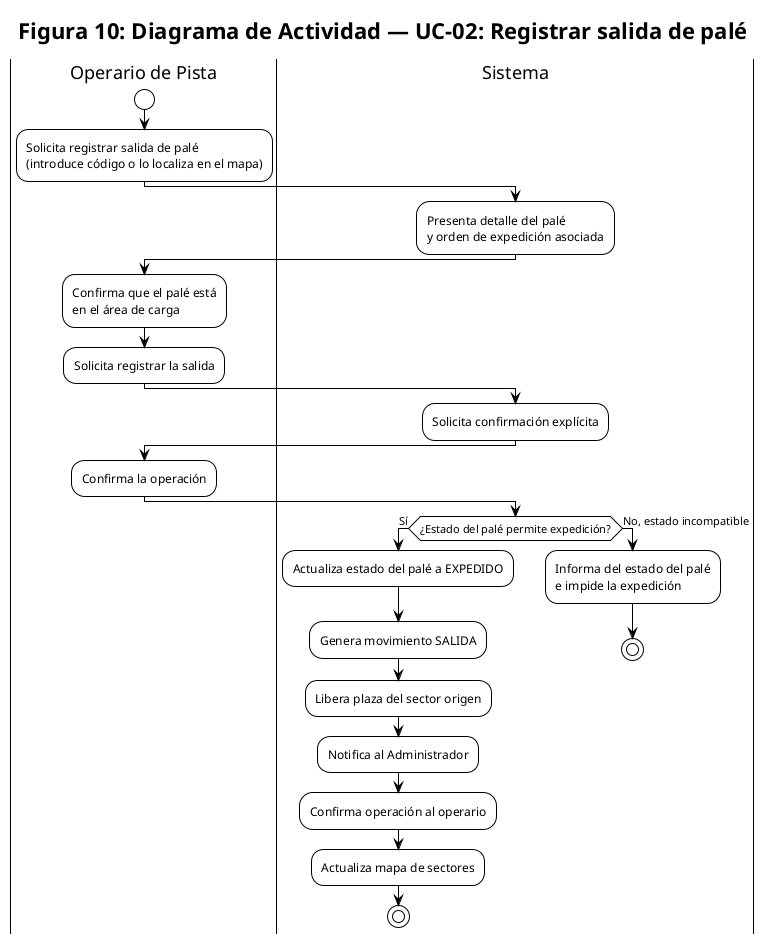

---

#### UC-03 — Consultar Layout Interactivo

| Campo | Valor |
|---|---|
| **Denominación** | UC-03 — Consultar layout interactivo |
| **Actores** | Operario de Pista, Administrador, Motor Rollship |
| **Incluye** | UC-09 (Autenticar usuario — para actores humanos), UC-07 (Calcular saturación) |
| **Iteración** | 1ª — alta prioridad |

**Precondiciones:**
- El usuario tiene sesión iniciada o el sistema externo dispone de credenciales de API válidas.

**Flujo principal (escenario de éxito):**

| Paso | Actor | Acción |
|---|---|---|
| 1 | Usuario/Sistema | Accede a la pantalla principal del módulo. |
| 2 | Sistema | Consulta el estado de ocupación actual de los 38 sectores. |
| 3 | Sistema | Presenta la cuadrícula de 38 sectores con codificación cromática: verde (0–60 %), ámbar (61–85 %), rojo (86–100 %). |
| 4 | Usuario | Pulsa sobre un sector. |
| 5 | Sistema | Presenta el detalle del sector seleccionado: listado de palés alojados con su referencia, tipo de material y fecha de entrada. |
| 6 | Sistema | Refresca el mapa periódicamente para mantener la información actualizada. |

**Flujo alternativo A1 — Acceso por API (Motor Rollship):** En el paso 3, si el actor es el Motor Rollship, la respuesta del sistema es un objeto JSON estructurado con el estado de cada sector (identificador, palés actuales, capacidad máxima, porcentaje de saturación y listado de palés).

**Postcondiciones:**
- El usuario dispone de una visión actualizada del estado del almacén.

---

#### UC-04 — Reubicar Palé entre Sectores

| Campo | Valor |
|---|---|
| **Denominación** | UC-04 — Reubicar palé entre sectores |
| **Actor principal** | Operario de Pista |
| **Incluye** | UC-09 (Autenticar usuario), UC-07 (Calcular saturación) |
| **Iteración** | 2ª — prioridad media |

**Precondiciones:**
- El operario tiene sesión iniciada.
- El palé a reubicar tiene estado *Emplazado*.
- El sector destino tiene capacidad disponible.

**Flujo principal (escenario de éxito):**

| Paso | Actor | Acción |
|---|---|---|
| 1 | Operario | Localiza el palé (por código o en el mapa) y solicita reubicarlo. |
| 2 | Sistema | Presenta el detalle del palé y su sector actual. |
| 3 | Operario | Selecciona el sector destino en el mapa. |
| 4 | Sistema | Verifica: (a) sector destino con capacidad; (b) sector destino distinto del actual; (c) estado del palé compatible. |
| 5 | Sistema | Registra la reubicación: actualiza la ubicación del palé, genera el movimiento de tipo REUBICACION y actualiza los contadores de ambos sectores. |
| 6 | Sistema | Confirma la operación y actualiza el mapa. |

**Postcondiciones:**
- El palé tiene estado *Emplazado* en el nuevo sector.
- El sistema ha generado un movimiento de tipo REUBICACION con sector origen, sector destino, sello temporal y operario.

**Figura 11.** Diagrama de Actividad — UC-04: Reubicar palé entre sectores.

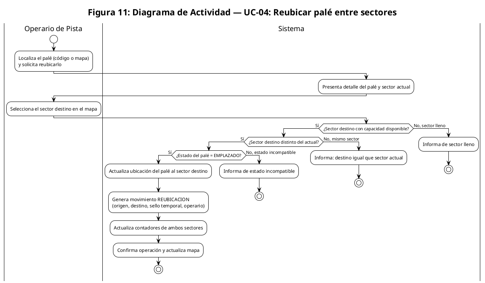

---

#### UC-05 — Consultar Estadísticas de Flujo

| Campo | Valor |
|---|---|
| **Denominación** | UC-05 — Consultar estadísticas de flujo |
| **Actor principal** | Administrador |
| **Incluye** | UC-09 (Autenticar usuario) |
| **Iteración** | 3ª — prioridad baja |

**Precondiciones:**
- El administrador tiene sesión iniciada con rol ADMINISTRADOR.
- Existe al menos un movimiento registrado en el sistema.

**Flujo principal (escenario de éxito):**

| Paso | Actor | Acción |
|---|---|---|
| 1 | Administrador | Accede al panel de estadísticas desde el menú principal. |
| 2 | Sistema | Presenta un resumen de actividad del período actual: entradas, salidas y reubicaciones del día. |
| 3 | Administrador | Configura los filtros: rango de fechas, sector o tipo de operación. |
| 4 | Sistema | Consulta los movimientos y calcula indicadores: operaciones por tipo, evolución de la ocupación por sector, operarios más activos y horas pico. |
| 5 | Sistema | Presenta los resultados en forma de tabla y gráfico de barras. |
| 6 | Administrador | Opcionalmente exporta el informe en formato CSV o PDF. |

**Postcondiciones:**
- El administrador dispone de un informe de actividad del período seleccionado.

**Flujos alternativos:**

*A1 — Sin datos en el período:* el sistema informa que no hay movimientos y sugiere ampliar el rango de fechas.

*A2 — Exportación:* el sistema genera el archivo y lo pone a disposición del administrador para su descarga.

**Figura 12.** Diagrama de Actividad — UC-05: Consultar estadísticas de flujo.

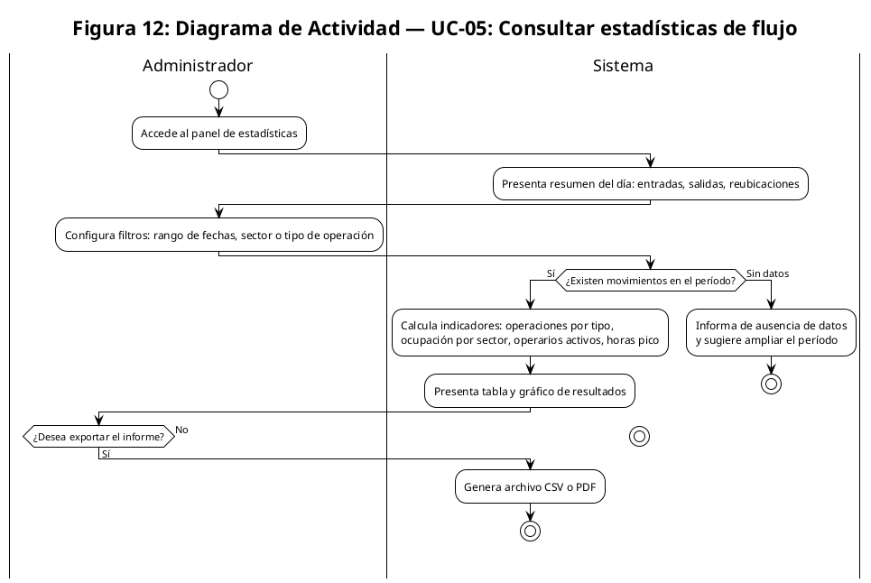

---

#### UC-06 — Migrar Datos Legado (ETL)

| Campo | Valor |
|---|---|
| **Denominación** | UC-06 — Migrar datos legado (ETL) |
| **Actor principal** | Administrador |
| **Actores secundarios** | MS Access (legado) — fuente de datos históricos |
| **Iteración** | 2ª — alto riesgo técnico |

**Precondiciones:**
- El administrador tiene sesión iniciada con rol ADMINISTRADOR.
- Existe el archivo exportado del sistema MS Access con el inventario histórico.
- La migración no ha sido ejecutada previamente (proceso irrepetible sin reset manual).

**Flujo principal (escenario de éxito):**

| Paso | Actor | Acción |
|---|---|---|
| 1 | Administrador | Accede al módulo ETL desde el panel de administración. |
| 2 | Sistema | Presenta el formulario de carga y las instrucciones de formato esperado. |
| 3 | Administrador | Sube el archivo exportado desde MS Access (CSV o MDB convertido). |
| 4 | Sistema | Valida el formato y la estructura del archivo: columnas requeridas y tipos de datos. |
| 5 | Sistema | Ejecuta simulación (*dry run*) e informa del número de registros a importar y conflictos detectados. |
| 6 | Administrador | Revisa el informe de simulación y confirma la migración. |
| 7 | Sistema | Ejecuta el proceso ETL: importa palés históricos y genera movimientos de tipo ENTRADA para cada registro. |
| 8 | Sistema | Presenta el resumen final: registros importados, omitidos y errores. |

**Postcondiciones:**
- Los datos históricos del sistema MS Access están disponibles en la nueva base de datos.
- Cada palé importado tiene al menos un movimiento de tipo ENTRADA con la fecha original.
- El log de migración queda registrado para auditoría.

**Flujos alternativos:**

*A1 — Formato no válido:* el sistema describe los errores de formato e impide continuar.

*A2 — Conflicto de duplicados:* el sistema identifica los registros duplicados y permite al administrador decidir si omitirlos o sobrescribirlos.

*A3 — Error durante la migración:* el sistema ejecuta un rollback completo (RS-07), garantizando que no quedan registros parciales.

**Figura 13.** Diagrama de Actividad — UC-06: Migrar datos legado (ETL).

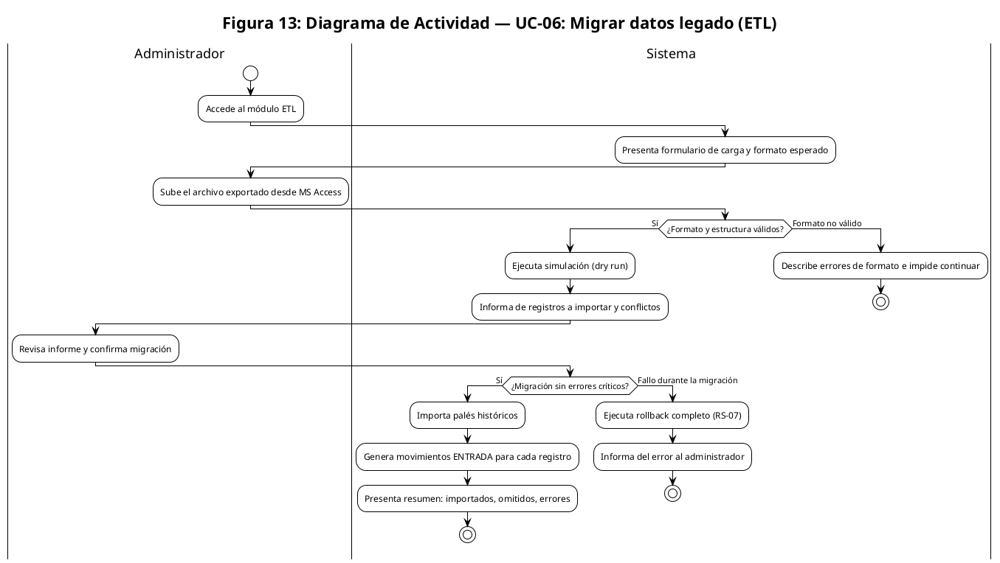

---

#### UC-07 — Calcular Saturación de Sector *(subflujo incluido)*

| Campo | Valor |
|---|---|
| **Denominación** | UC-07 — Calcular saturación de sector |
| **Tipo** | Subflujo — incluido por UC-01 y UC-03 |
| **Actor** | Sistema (interno, no iniciado directamente por actores humanos) |
| **Iteración** | 1ª — base arquitectónica |

Este caso de uso no es iniciado directamente por ningún actor humano. Es un subflujo obligatorio activado por UC-01 (al registrar una entrada) y UC-03 (al renderizar el layout). El sistema calcula el porcentaje de ocupación de cada sector mediante la fórmula: `saturación = (paleActuales / capacidadMax) × 100`.

| Rango de saturación | Código cromático | Significado |
|---|---|---|
| 0–60 % | Verde | Sector disponible. |
| 61–85 % | Ámbar | Sector con ocupación elevada. |
| 86–100 % | Rojo | Sector próximo al límite o lleno. |

**Precondición:** Los campos `paleActuales` y `capacidadMax` del sector son accesibles.

**Postcondición:** El porcentaje de saturación y el código de color quedan calculados y disponibles para su presentación en el layout.

---

#### UC-08 — Registrar Incidencia Operativa

| Campo | Valor |
|---|---|
| **Denominación** | UC-08 — Registrar incidencia operativa |
| **Actor principal** | Operario de Pista |
| **Actores secundarios** | Administrador (recibe notificación) |
| **Extiende** | UC-01 (Registrar entrada) [condición: error detectado] |
| **Incluye** | UC-09 (Autenticar usuario) |
| **Iteración** | 2ª — prioridad media |

**Precondiciones:**
- El operario tiene sesión iniciada en la aplicación.
- El palé sobre el que se registra la incidencia existe en el sistema o se está registrando en UC-01.

**Flujo principal (escenario de éxito):**

| Paso | Actor | Acción |
|---|---|---|
| 1 | Operario | Detecta una anomalía en el palé y accede al formulario de incidencia. |
| 2 | Sistema | Presenta el formulario con el código del palé ya vinculado y solicita el tipo de incidencia. |
| 3 | Operario | Selecciona el tipo: daño físico, discrepancia de código o diferencia de contenido. |
| 4 | Operario | Describe la anomalía con detalle y opcionalmente adjunta una fotografía. |
| 5 | Sistema | Registra la incidencia, cambia el estado del palé a *Incidencia* e impide operaciones sobre él hasta su resolución. |
| 6 | Sistema | Notifica al administrador la incidencia con el detalle completo. |
| 7 | Sistema | Confirma al operario que la incidencia ha sido registrada. |

**Postcondiciones:**
- La incidencia queda registrada con sello temporal y operario responsable.
- El palé tiene estado *Incidencia* y no puede ser expedido hasta que el administrador la resuelva.
- El administrador ha recibido la notificación.

**Flujos alternativos:**

*A1 — Resolución de incidencia:* el administrador revisa, toma medidas correctoras y la marca como resuelta. El sistema devuelve el palé al estado *Emplazado*.

*A2 — Cancelación del palé:* si la anomalía es irresoluble, el administrador cancela el palé desde el panel de incidencias.

**Figura 14.** Diagrama de Actividad — UC-08: Registrar incidencia operativa.

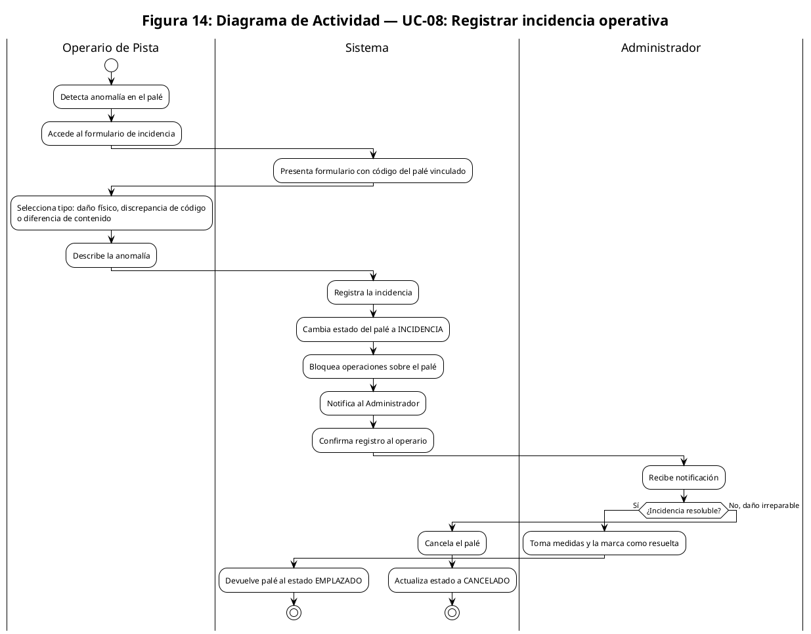

---

#### UC-09 — Autenticar Usuario *(subflujo incluido)*

| Campo | Valor |
|---|---|
| **Denominación** | UC-09 — Autenticar usuario |
| **Tipo** | Subflujo — incluido por todos los CdU con actores humanos |
| **Actor** | Sistema (interno, no iniciado directamente) |
| **Iteración** | 1ª — base de toda interacción |

Este caso de uso es un subflujo de autenticación que se activa cuando un actor humano accede al módulo sin sesión activa. No es invocado directamente por el usuario: el sistema lo ejecuta de forma transparente al inicio de cualquier interacción protegida.

**Precondición:** El usuario dispone de una credencial válida registrada en el sistema.

**Flujo principal:**

| Paso | Actor | Acción |
|---|---|---|
| 1 | Sistema | Detecta el acceso sin sesión activa y presenta la pantalla de inicio de sesión. |
| 2 | Usuario | Introduce su credencial (usuario y contraseña). |
| 3 | Sistema | Valida las credenciales. Si son correctas, genera un token JWT con el rol del usuario y expiración a los 30 min de inactividad (RS-03). |
| 4 | Sistema | Redirige al usuario a la pantalla principal según su rol: layout interactivo (Operario) o panel de administración (Administrador). |

**Postcondición:** El usuario tiene una sesión activa con token JWT válido.

**Flujo alternativo:**

*A1 — Credenciales incorrectas:* el sistema informa del error sin especificar el campo incorrecto. Tras 3 intentos fallidos consecutivos, la cuenta queda bloqueada temporalmente 15 minutos.

---

#### UC-10 — Buscar Palé por Referencia

| Campo | Valor |
|---|---|
| **Denominación** | UC-10 — Buscar palé por referencia |
| **Actores** | Operario de Pista, Administrador |
| **Incluye** | UC-09 (Autenticar usuario) |
| **Iteración** | 2ª — alta prioridad |

**Precondiciones:**
- El usuario tiene sesión iniciada en la aplicación.

**Flujo principal (escenario de éxito):**

| Paso | Actor | Acción |
|---|---|---|
| 1 | Usuario | Introduce el código de referencia del palé (completo o parcial) en el campo de búsqueda. |
| 2 | Sistema | Busca el palé en el inventario activo filtrando por el código introducido. |
| 3 | Sistema | Presenta los resultados: código, tipo de material, sector actual, estado y fecha de entrada. |
| 4 | Usuario | Selecciona el palé de la lista de resultados. |
| 5 | Sistema | Muestra el detalle completo del palé y lo resalta en el layout virtual. |

**Postcondiciones:**
- El usuario conoce la ubicación exacta del palé y su estado actual.

**Flujos alternativos:**

*A1 — Sin resultados:* el sistema indica que no hay coincidencias y ofrece ampliar los criterios.

*A2 — Palé expedido o cancelado:* el sistema informa de que el palé ya no está activo y muestra su último estado registrado.

---

#### UC-11 — Gestionar Usuarios del Sistema

| Campo | Valor |
|---|---|
| **Denominación** | UC-11 — Gestionar usuarios del sistema |
| **Actor principal** | Administrador |
| **Incluye** | UC-09 (Autenticar usuario) |
| **Iteración** | 2ª — prioridad media |

**Precondiciones:**
- El administrador tiene sesión iniciada con rol ADMINISTRADOR.

**Flujo principal — Crear operario (escenario de éxito):**

| Paso | Actor | Acción |
|---|---|---|
| 1 | Administrador | Accede al panel de gestión de usuarios. |
| 2 | Sistema | Presenta la lista de usuarios activos con nombre, credencial, turno y rol. |
| 3 | Administrador | Solicita crear un nuevo operario e introduce nombre, credencial, turno y rol. |
| 4 | Sistema | Verifica que la credencial no existe en el sistema. |
| 5 | Sistema | Crea la cuenta y la registra en el log de auditoría. |
| 6 | Sistema | Confirma la creación y muestra la cuenta en la lista actualizada. |

**Postcondiciones:**
- La cuenta del nuevo operario está activa y puede autenticarse en el sistema.

**Subflujos:**
- *SF-A Modificar operario:* el administrador actualiza turno, rol o contraseña de un usuario existente.
- *SF-B Desactivar operario:* el administrador desactiva la cuenta sin eliminarla, conservando el historial de movimientos.

**Flujos alternativos:**

*A1 — Credencial duplicada:* el sistema informa del conflicto y solicita una credencial distinta.

---

#### UC-12 — Consultar Historial de Palé

| Campo | Valor |
|---|---|
| **Denominación** | UC-12 — Consultar historial de palé |
| **Actores** | Operario de Pista, Administrador |
| **Incluye** | UC-09 (Autenticar usuario) |
| **Iteración** | 3ª — prioridad media |

**Precondiciones:**
- El usuario tiene sesión iniciada.
- El palé existe en el sistema (puede estar activo o expedido).

**Flujo principal (escenario de éxito):**

| Paso | Actor | Acción |
|---|---|---|
| 1 | Usuario | Localiza el palé (directamente o vía UC-10) y solicita ver su historial. |
| 2 | Sistema | Recupera todos los movimientos asociados al palé, ordenados cronológicamente. |
| 3 | Sistema | Presenta la línea de tiempo: tipo de operación, sector origen, sector destino, sello temporal y operario responsable. |
| 4 | Usuario | Navega por el historial. Opcionalmente filtra por tipo de operación o rango de fechas. |
| 5 | Sistema | Actualiza la vista con los filtros aplicados. |

**Postcondiciones:**
- El usuario dispone de la traza completa de movimientos del palé, útil para auditorías e incidencias.

---

### 3.4 Prototipos de Casos de Uso

Los prototipos de interfaz de usuario constituyen un artefacto de validación: permiten contrastar, antes de comenzar la implementación, que el diseño de pantallas es coherente con lo descrito en los casos de uso y que satisface los requisitos de usabilidad (RS-04). Se presentan como bocetos de baja fidelidad (wireframes) que no implican decisiones de diseño visual definitivas.

#### Figura 15 — Prototipo: Layout Virtual (pantalla principal — UC-03)

```
┌─────────────────────────────────────────────────────────────────────┐
│  MÓDULO LOGÍSTICO WEB — ALMACÉN SANTANDER           [Diego M. ▼]   │
├─────────────────────────────────────────────────────────────────────┤
│  [+ Nueva entrada]  [↑ Registrar salida]  [↔ Reubicar]  [📊 Más]   │
├─────────────────────────────────────────────────────────────────────┤
│                                                                     │
│  ┌────────┐  ┌────────┐  ┌────────┐  ┌────────┐  ┌────────┐       │
│  │  A1    │  │  A2    │  │  A3    │  │  B1    │  │  B2    │  ...  │
│  │ 45 %   │  │ 78 %   │  │ 91 %   │  │ 12 %   │  │100 %   │       │
│  │  5/11  │  │  7/9   │  │ 11/12  │  │  2/17  │  │ 12/12  │       │
│  │[VERDE] │  │[ÁMBAR] │  │ [ROJO] │  │[VERDE] │  │ [ROJO] │       │
│  └────────┘  └────────┘  └────────┘  └────────┘  └────────┘       │
│                                                                     │
│  ... (38 sectores en total) ...                                     │
│                                                                     │
│  Última actualización: hace 12 s              [Actualizar ahora]   │
└─────────────────────────────────────────────────────────────────────┘
```

**Figura 15.** Prototipo de interfaz — Layout Virtual (pantalla principal, UC-03).

---

#### Figura 16 — Prototipo: Formulario de Entrada de Palé (UC-01)

```
┌────────────────────────────────────────────┐
│  ← Volver al mapa       NUEVA ENTRADA      │
├────────────────────────────────────────────┤
│  Código de referencia:                     │
│  ┌────────────────────────────────────┐    │
│  │  JH-____-_  (autocompletado)       │    │
│  └────────────────────────────────────┘    │
│                                            │
│  Tipo de material:                         │
│  ┌────────────────────────────────────┐    │
│  │  ▼ Seleccionar tipo...             │    │
│  └────────────────────────────────────┘    │
│                                            │
│  Masa aproximada (kg):                     │
│  ┌────────────────────────────────────┐    │
│  │  _____ kg                          │    │
│  └────────────────────────────────────┘    │
│                                            │
│  Sector destino:                           │
│  ┌────────────────────────────────────┐    │
│  │  ▼ Seleccionar en el mapa          │    │
│  └────────────────────────────────────┘    │
│                                            │
│  ┌──────────────────────────────────┐      │
│  │     ✓ CONFIRMAR ENTRADA          │      │
│  └──────────────────────────────────┘      │
└────────────────────────────────────────────┘
```

**Figura 16.** Prototipo de interfaz — Formulario de registro de entrada (UC-01).

---

#### Figura 17 — Prototipo: Panel de Detalle de Sector (UC-03)

```
┌───────────────────────────────────────────┐
│  SECTOR B4  —  11 / 12 palés (91 %)  [✕] │
│  Zona: Bloque B — Fachada Norte           │
├───────────────────────────────────────────┤
│  REFERENCIA     MATERIAL      ENTRADA     │
│  JH-8819-A   Pizarras Ens.  12/05/2026   │
│  JH-7203-B   Fibrocemento   08/05/2026   │
│  JH-6541-C   Fibrocemento   08/05/2026   │
│  ...                                      │
├───────────────────────────────────────────┤
│  [↔ Reubicar palé]  [↑ Registrar salida] │
└───────────────────────────────────────────┘
```

**Figura 17.** Prototipo de interfaz — Panel de detalle de sector (UC-03).

---

### 3.5 Estructura del Modelo de Casos de Uso

La estructura del modelo de casos de uso formaliza las relaciones de **inclusión** y **extensión** entre casos de uso, identificando la funcionalidad compartida y los flujos opcionales (Larman, 2004).

#### Relaciones de inclusión (`<<include>>`)

| Caso de uso | Incluye | Justificación |
|---|---|---|
| UC-01, UC-02, UC-03, UC-04, UC-10, UC-11, UC-12 | UC-09 (Autenticar usuario) | Todo acceso al sistema requiere verificación de credenciales. Es un subflujo obligatorio, incondicional y compartido. |
| UC-01, UC-03 | UC-07 (Calcular saturación) | Ambos casos de uso necesitan el porcentaje de ocupación de los sectores para su correcta presentación. |

#### Relaciones de extensión (`<<extend>>`)

| Caso de uso base | Extendido por | Condición de activación |
|---|---|---|
| UC-01 (Registrar entrada) | UC-08 (Registrar incidencia) | El operario detecta una anomalía en el palé durante el proceso de registro de entrada. |

---

**Figura 18.** Diagrama de Estructura del Modelo de Casos de Uso (relaciones include/extend).

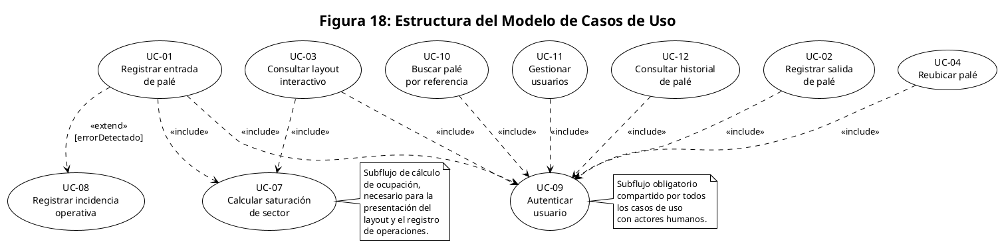

---

## 4. Matriz de Trazabilidad

La matriz de trazabilidad garantiza la correspondencia entre los requisitos capturados en este capítulo y los artefactos que los satisfacen. Constituye evidencia de coherencia entre el escenario descrito en el Capítulo 1 y lo especificado aquí.

| Necesidad (Capítulo 1) | Artefacto en Capítulo 2 | Capítulo que lo implementa |
|---|---|---|
| Registro de entradas en tiempo real (sustitución del papel) | UC-01, RS-01, RS-07 | Cap. 3 (diseño), Cap. 4 (solución) |
| Registro de salidas autorizado | UC-02, RS-03 | Cap. 3, Cap. 4 |
| Visibilidad del estado del almacén en tiempo real | UC-03, RS-01, Glosario "Layout virtual", Figura 15 | Cap. 3, Cap. 4 |
| Reubicación de palés entre sectores | UC-04 | Cap. 3, Cap. 4 |
| Localización rápida de un palé concreto | UC-10 | Cap. 3, Cap. 4 |
| Trazabilidad y auditoría de movimientos | UC-12, Clase Movimiento (Figura 1) | Cap. 3, Cap. 4 |
| Gestión de accesos del personal | UC-11, RS-03, Actores | Cap. 3, Cap. 4 |
| Integración con el sistema Rollship (James Hardie) | Actor Motor Rollship, UC-03 API, RS-05, Figura 8 | Cap. 3, Cap. 4 |
| Migración del histórico de MS Access | UC-06, Actor MS Access | Cap. 4 |
| Operabilidad con guantes en nave industrial | RS-04, Figuras 15-17 (wireframes) | Cap. 3 (diseño UI) |
| Integridad del inventario sin pérdida de registros | RS-07, Figura 3 (ciclo de vida palé) | Cap. 3 (arquitectura) |
| Control de acceso por roles (operario / administrador) | RS-03, Actores, Figuras 5 y 6 (diagramas actor) | Cap. 3 (diseño) |
| Estadísticas de flujo para gerencia | UC-05 | Cap. 4 |

---

## 5. Referencias Bibliográficas del Capítulo

Kruchten, P. (2004). *The rational unified process: An introduction* (3.ª ed.). Addison-Wesley.

Larman, C. (2004). *Applying UML and patterns: An introduction to object-oriented analysis and design and iterative development* (3.ª ed.). Prentice Hall.

Object Management Group. (2017). *Unified Modeling Language specification version 2.5.1*. OMG. https://www.omg.org/spec/UML/2.5.1/

Pressman, R. S., & Maxim, B. R. (2020). *Software engineering: A practitioner's approach* (9.ª ed.). McGraw-Hill.

Sommerville, I. (2015). *Software engineering* (10.ª ed.). Pearson.

W3C. (2018). *Web content accessibility guidelines (WCAG) 2.1*. World Wide Web Consortium. https://www.w3.org/TR/WCAG21/

Wiegers, K. E., & Beatty, J. (2013). *Software requirements* (3.ª ed.). Microsoft Press.

---

*Fin del Capítulo 2*
