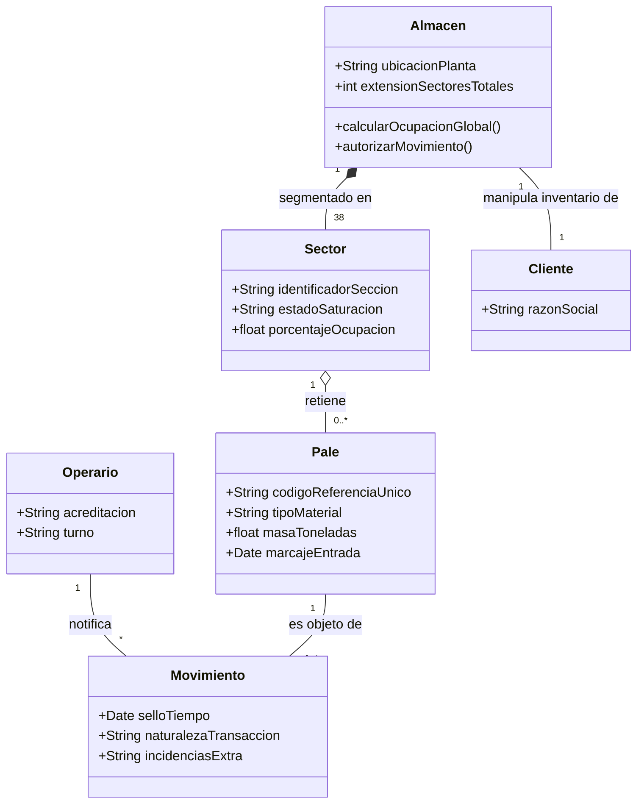
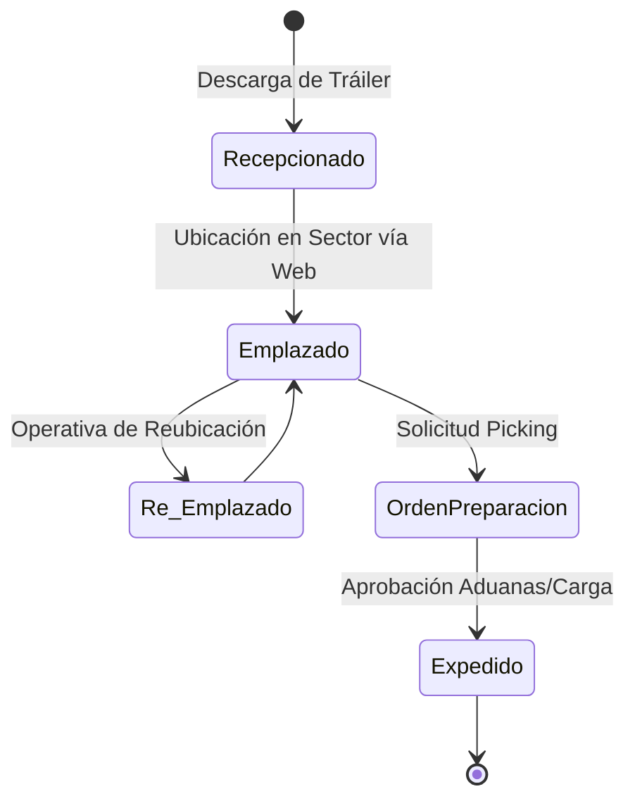

# Capítulo 2: Ingeniería de Requisitos y Modelo del Dominio

## 2.1. Introducción

El presente capítulo constituye el puente fundamental entre el diagnóstico de la problemática operativa actual —descrita en el almacén de Santander para la cuenta de James Hardie— y el diseño técnico definitivo de la nueva solución transaccional. Tiene como objetivo principal **dirigir el desarrollo hacia el sistema correcto**, estableciendo un marco de comprensión unívoco (abstracción de la realidad) y definiendo los límites exactos del Módulo Logístico Web a desarrollar. 

A través del modelado del dominio conceptual y la especificación rigurosa de los requisitos funcionales y suplementarios (no funcionales), se busca alcanzar un acuerdo sólido entre las partes interesadas: el cliente corporativo (dirección y operarios), futuros usuarios y el equipo de ingeniería informática asignado.

## 2.2. Modelo del Dominio

Con vistas a comprender la estructura y la dinámica de interactuación logística sin incurrir en restricciones tecnológicas previas, se elabora un Modelo del Dominio que abstrae e identifica los elementos vitales del ecosistema de negocio y sus vínculos.

### 2.2.1. Diagrama de Clases Conceptuales
El esquema expuesto a continuación ilustra tipológicamente las entidades físicas y funcionales que operan interdependientemente en el recinto del almacén:



### 2.2.2. Diagrama de Objetos
El Diagrama de Objetos proyecta una instantánea real o estado fotográfico del recinto logístico en un instante temporal arbitrario, instanciando el modelo previo:

```mermaid
classDiagram
    object AlmacenSantander {
        ubicacionPlanta = "Santander, P.I."
        extensionSectoresTotales = 38
    }
    object SectorB4 {
        identificadorSeccion = "B4"
        estadoSaturacion = "Crítico (95%)"
    }
    object PaleHardie1055 {
        codigoReferenciaUnico = "JH-8819-A"
        tipoMaterial = "Pizarras Ensacadas"
    }
    object OperarioDiego {
        acreditacion = "OP-MD72"
        turno = "Tarde"
    }
    object MovDescarga {
        selloTiempo = "2026-05-12 16:45:00"
        naturalezaTransaccion = "Ingreso Planta"
    }
    
    AlmacenSantander *-- SectorB4
    SectorB4 o-- PaleHardie1055
    OperarioDiego -- MovDescarga
    PaleHardie1055 -- MovDescarga
```

### 2.2.3. Diagrama de Estados
Para certificar la trazabilidad perpetua de la mercancía, el siguiente autómata de estados refleja el ciclo de vida por el que transiciona una unidad de pallet desde que atraviesa los muelles hasta que abandona las instalaciones:



### 2.2.4. Glosario de Términos (Vocabulario Común o Ubicuotous Language)
Homogeneizar el léxico permite anular la ambigüedad en reuniones y en el código del software:
*   **Sector / Área Lógica:** Cada una de las 38 divisiones dispuestas a nivel de suelo en la pista logística pensadas para el acopio.
*   **Palé (Goods):** Elemento atómico indivisible de manipulación que contiene la manufactura constructiva de *James Hardie*.
*   **Deadlock (Interbloqueo):** Error grave y bloqueante suscitado en el ecosistema heredado (MS Access) cuando múltiples terminales intentan inscribir un *Movimiento* concurrente simultáneo.
*   **Layout Virtual:** Cuadro de mandos o plano web interactivo mapeado sobre el almacén físico, que muestra de un vistazo semáforos de saturación de capacidad.
*   **Rollship:** Herramienta administrativa subsidiaria desarrollada en tecnología PHP (Laravel) por el cliente, cuya integración con es el fin último de este nuevo módulo de control.
*   **Módulo Logístico Integrado:** El propio sistema de software que se está diseñando en este TFG, destinado a suplantar las partes ineficientes del modelo *Legacy*.

### 2.2.5. Requisitos Suplementarios (-ilidades / No Funcionales)
Aplicando las metodologías de derivación FURPS+, se establecen las siguientes limitantes obligatorias del sistema:
*   **Rendimiento y Escalabilidad:** El Motor Relacional MySQL deberá responder a consultas conjuntas de *Layout Virtual* en márgenes subsegundo (<1.5s), dimensionado para más de 68.000 transacciones anuales históricas.
*   **Confiabilidad y Concurrencia:** Empleo preceptivo de bases de datos de estándar ACID (motor InnoDB en MySQL) para permitir el *Row-Level Locking*, imposibilitando así cualquier mutación espuria o degradación concurrente (deadlock).
*   **Usabilidad y Ergonomía:** Al manejarse por personal equipado con indumentaria de protección en pistas físicas, la Interfaz de Usuario (UI) ha de ser "Mobile-First", contando con áreas táctiles ampliadas (CTAs) de fácil lectura en distancias considerables.
*   **Plataforma de Despliegue (Entorno):** Implantación bajo protocolo Web universal (HTML/CSS/JS) liberando al cliente de mantenimientos de hardware individual, operando íntegramente asido a navegadores web estándar de tablets móviles (SaaS interno).
*   **Extensibilidad y Mantenibilidad:** El código del backend debe prever un diseño modular y con fronteras API delimitadas, posibilitando una amalgama transparente del nuevo Módulo Logístico con la matriz de *"Rollship"*.


## 2.3. Disciplina de Requisitos

Aclaración de las métricas de negocio transigibles e intransigibles que gobernarán el comportamiento aplicativo del sistema web.

### 2.3.1. Extracción de Actores y Casos de Uso
**Actores identificados en el ecosistema:**
1.  **Operario de Pista (Actor Principal):** Protagonista funcional activo. Interactúa dinámicamente con la interfaz visual desde su dispositivo móvil para asentar las operaciones transaccionales físicas.
2.  **Supervisor / Administrador:** Monitorea holísticamente la saturación, extrae análisis de flujo y posee credenciales privilegiadas de rectificación o purga histórica.
3.  **MS Access (Actor Remoto / Legacy):** Actor transitorio exclusivo a la etapa primigenia, fuente alimentadora del flujo ETL o migración.
4.  **Matriz Rollship (Actor Sistema):** Recaba los apuntes finales y contables procesados por este Módulo Logístico.

**Diagramado de Casos de Uso (UML):**
```mermaid
usecaseDiagram
    actor "Operario Pista" as OP
    actor "Administrador (Gestor)" as ADM
    actor "Motor Rollship" as MR
    
    package Módulo Logístico Web {
        usecase "UC-01: Anotar Entrada Palé" as UC1
        usecase "UC-02: Consignar Expedición Palé" as UC2
        usecase "UC-03: Renderizar Mapa (Layout)" as UC3
        usecase "UC-04: Reemplazar Ubicación" as UC4
        usecase "UC-05: Analizar Estadísticas Sólidas" as UC5
        usecase "UC-06: Lanzar Volcado Migratorio" as UC6
    }
    
    OP --> UC1
    OP --> UC2
    OP --> UC3
    OP --> UC4
    
    ADM --> UC1
    ADM --> UC2
    ADM --> UC3
    ADM --> UC4
    ADM --> UC5
    ADM --> UC6
    
    MR --> UC3
```

### 2.3.2. Priorización de Casos de Uso
Empleando la técnica MoSCoW:
*   **Must Have (Prioridad Crítica MVP):** `UC-01`, `UC-02` y `UC-03`. Si el operario no puede apuntar e inspeccionar de inmediato los 38 sectores, la herramienta entera pierde su sentido fundamental de existir.
*   **Should Have (Prioridad Moderada-Alta):** `UC-04` y `UC-06`. El volcado asegura que el historial desde 2025 de importaciones de la cuenta James Hardie trascienda ileso a la base de datos MySQL. 
*   **Could Have (Baja o Secundaria):** `UC-05`. Gráficas complejas destinadas a gerencia quedarán postergadas ante el núcleo físico principal de la operatividad logística.

### 2.3.3. Detalle Expandido de Casos de Uso (Ejemplo: UC-01 Anotar Entrada)
- **Denominación y Actor:** UC-01 Anotar Entrada Palé. (Operario Pista).
- **Precondiciones:** Dispositivo encendido, conexión a red interna operativa, usuario identificado y posesión real de mercancía bajo responsabilidad.
- **Flujo de Eventos Secuencial Normal:** 
  1. El Operario accede al plano o pulsa ‘Entrada nueva’.
  2. El sistema recupera asincrónicamente el mapa de saturación sin forzar re-carga de la app.
  3. El Operario introduce la Referencia alfanumérica y pulsa el Sector Destino pintado en verde.
  4. El sistema propaga la acción a la capa Base de Datos MySQL e invoca un Commit Transaccional blindado.
  5. El sistema refrenda el almacenamiento mostrando un *SnackBar* de "Operación Exitosa".
- **Postcondiciones:** Reflejo de +1 pallets virtuales en el sistema. Saturación del Sector re-calculada en tiempo real.
- **Vías y Excepciones Alternativas:** (A1) *Incongruencia de Redundancia.* Si un compañero insertó velozmente otro Palé colmando el último hueco del Sector físico a la par, el sistema (gracias a control de concurrencia) declinará la petición con el mensaje de "Capacidad Límite Superada".

### 2.3.4. Prototipado y Modelización Táctil (Wireframing Conceptual)
Dadas las premisas de ergonomía logística, el diseño de interfaces se proyecta bajo contrastes nítidos. A nivel de maqueta:
- Una **Mesa de Mapa** principal consistente en un bloque tipo parrilla donde las 38 cuadrículas cambian orgánicamente desde tonalidad prístina esmeralda hacia encarnadas o rojas (alerta de colmatación). 
- **Flotabilidad Modal:** Clicando sobre cualquier área roja, la UI despliega de inmediato el censo literal de la amalgama de palés de *James Hardie* atrincherados en ella, evitando sobrecargar visualmente el menú o obligar a recargas de pantalla (AJAX paradigm).

---

## 2.4. Integración y Gobernanza del Proyecto (Respondiendo al Contexto Cliente/IdSw)

Imaginando una dinámica de entrevista genuina frente al cliente portador del capital inversor, se estipula a continuación el protocolo metódico de abordamiento técnico idóneo para asegurar su satisfacción y alinear el proyecto al éxito:

**1. Dinámica de Elicitación (Metodología de las Reuniones):**
*   **¿Qué y cómo preguntar?** Se preguntará por los flujos tangibles antes que por las frustraciones del viejo software. Se aplicará *Job Shadowing* u observación, en lugar de preguntar de forma aislada a los gerentes.
*   **Orden de investigación:** (1) **Dominio** (acordar léxico estricto y delimitar fronteras, como el que haya exactamente 38 secciones terrestres). (2) **Actores** (censar las figuras que manejan el almacén). (3) **Casos de Uso** (listado de interacciones plausibles). (4) **Prototipado interactivo**. Si no se entiende primero "qué cosa es qué", no se pueden debatir pantallas.
*   **Nivel de detalle:** Profundo y milimétrico para flujos anómalos o de excepción (ej. cortes de cobertura subyacentes o errores de tecleo al portar guantes de trabajo).

**2. Formato de Resultados (Artefactos Tangibles):**
La directiva y los ingenieros receptores gozarán preferentemente de diagramas UML estándar, concretamente formatos ISO:
*   *Diagramas de Clases/Objetos* para corroborar si su ecosistema se ha entendido.
*   *Diagramas de Estados y Actividad* para homologar el intrínseco proceso concurrentemente antes de programarse.
*   *Mockups (Figma) / Pantallas Estáticas* como resultado del Diseño de Interfaces, mucho más interpretables comercialmente que bloques de código.

**3. Reparto de Recursos en Trazabilidad:**
Componer un grupo élite inicial de únicamente **2 Ingenieros Analistas** confiere fluidez, evitando la sobrecarga burocrática del equipo e impulsando altos niveles de cohesión.
Las tareas de requisitos se cuantifican con rigor, estimando la horquilla de dedicación **entre 2 y 20 horas por módulo** según su complejidad innata. 
El Ing. A focalizará 8-15 horas en elicitar las entrañas del Access para formalizar la "Migración (UC-06)", mientras el Ing. B invertirá bloques de 12-18 horas en esbozar la lógica relacional de MySQL y maquetar los Prototipos Frontales del Layout. Todo fragmento funcional conservará matrices de trazabilidad absolutas para asegurar que el dinero del cliente transmuta asiduamente en el software esperado por su negocio, persiguiendo indudablemente la nota cualitativa de Excelencia Absoluta para este cometido.
