# Capítulo 3: Análisis y Diseño

---

## 3.1. Introducción

El presente capítulo constituye el núcleo de ingeniería abstracta de este Trabajo de Fin de Grado. Su propósito es doble: en primer lugar, refinar los doce casos de uso obtenidos en el Capítulo 2 mediante el lenguaje de los desarrolladores, introduciendo el formalismo necesario para tomar decisiones sobre el funcionamiento interno del sistema; en segundo lugar, producir los modelos y artefactos que permitan abordar la implementación —descrita en el Capítulo 4— como un refinamiento natural y predecible del diseño, sin alterar su estructura fundamental.

Para ello, el capítulo se organiza en torno a las dos disciplinas que lo articulan metodológicamente (Larman, 2004):

- **Disciplina de Análisis:** traduce los Casos de Uso y el Modelo del Dominio definidos en el Capítulo 2 a un conjunto de clases de análisis —Modelo, Vista y Controlador— que capturan los requisitos en lenguaje de diseñador sin imponer todavía restricciones tecnológicas. El resultado es una comprensión más precisa y mantenible de lo que el sistema debe hacer.

- **Disciplina de Diseño:** enfrenta los requisitos no funcionales y el dominio de la solución. Aquí se toman las decisiones técnicas sobre arquitectura, distribución de componentes, interacción entre capas y persistencia de datos, justificando cada elección en los requisitos suplementarios (RS-01 a RS-07) identificados en el capítulo anterior. El diseño aplica los principios de alta cohesión y bajo acoplamiento (Larman, 2004) y los principios SOLID (Martin, 2003) como guías de calidad estructural.

La trazabilidad entre ambas disciplinas —y entre estas y los Casos de Uso del Capítulo 2— constituye el eje vertebrador de este capítulo y garantiza que ninguna decisión de diseño sea arbitraria: toda clase, toda relación y toda decisión arquitectónica tiene su origen en un requisito documentado.

---

## 3.2. Disciplina de Análisis

### 3.2.1. Identificación de Clases de Análisis

La estrategia de identificación de clases de análisis parte, según las convenciones de Larman (2004), de dos fuentes complementarias: la **descripción textual de los Casos de Uso** y el **Modelo del Dominio** establecido en el Capítulo 2. Ambas fuentes se combinan para producir tres categorías de clases de análisis:

| Tipo de Clase | Criterio de derivación | Responsabilidad |
|---|---|---|
| **Modelo** | Entidades del Modelo del Dominio más los sustantivos clave en las descripciones de CdU | Representar los datos y la lógica de negocio del dominio |
| **Vista** | Una clase principal por cada actor humano; una clase primitiva por cada clase Modelo; una clase central por cada actor sistema externo | Intermediar entre el usuario y el sistema; presentar datos |
| **Controlador** | Una clase por cada Caso de Uso | Orquestar la ejecución de cada CdU, coordinando Modelos y Vistas |

#### 3.2.1.1. Clases Modelo

Estudiando el Modelo del Dominio (sección 2.2 del Capítulo 2) y las descripciones de los doce Casos de Uso, se identifican las siguientes clases Modelo:

| Clase Modelo | Origen | CdU en que participa |
|---|---|---|
| `Pale` | Entidad central del Modelo del Dominio; objeto directo de manipulación en toda descripción de CdU | UC-01, UC-02, UC-04, UC-07, UC-08, UC-10, UC-12 |
| `Sector` | Entidad del Dominio; contenedor físico de palés; su saturación es el dato clave del layout | UC-01, UC-02, UC-03, UC-04, UC-07 |
| `Movimiento` | Entidad del Dominio; registro transaccional de toda operación sobre un palé | UC-01, UC-02, UC-04, UC-08, UC-12 |
| `Mercancia` | Categoría de producto de James Hardie; necesaria para catalogar el inventario | UC-01 |
| `Usuario` | El Modelo del Dominio define `Operario` con credenciales y rol; toda interacción humana requiere autenticación | UC-09, UC-11 (y precondición de todos los CdU humanos) |
| `Incidencia` | Situación anómala asociada a un palé; estado específico del ciclo de vida del Modelo del Dominio | UC-08 |

#### 3.2.1.2. Clases Vista

Aplicando las reglas de derivación:

**a) Ventanas principales (una por actor humano):**

| Clase Vista — Ventana Principal | Actor que la origina |
|---|---|
| `IUPrincipalOperario` | Operario de Pista — acceso a entrada, salida, layout, reubicación y búsqueda |
| `IUPrincipalAdministrador` | Administrador — panel con acceso completo al sistema |

**b) Vistas primitivas (una por clase Modelo + formularios funcionales):**

| Clase Vista — Primitiva | Clase Modelo asociada | CdU |
|---|---|---|
| `IUFormEntradaPale` | `Pale` | UC-01 — Formulario de registro de entrada |
| `IUFormSalidaPale` | `Pale`, `Sector` | UC-02 — Formulario de registro de salida |
| `IUCardSector` | `Sector` | UC-03 — Tarjeta visual del sector con semáforo |
| `IUFormReubicacion` | `Pale`, `Sector` | UC-04 — Formulario de selección de destino |
| `IUPanelEstadisticas` | `Movimiento`, `Sector` | UC-05 — Panel de KPIs e informes |
| `IUVolcadoAccess` | (ETL) | UC-06 — Interfaz de carga y progreso de migración |
| `IUBuscador` | `Pale` | UC-10 — Campo de búsqueda por código de referencia |
| `IUPanelUsuarios` | `Usuario` | UC-11 — Panel CRUD de cuentas de operario |
| `IUHistorialPale` | `Movimiento` | UC-12 — Línea de tiempo de movimientos de un palé |
| `IUFormIncidencia` | `Incidencia`, `Pale` | UC-08 — Formulario de registro de anomalía |
| `IUFormLogin` | `Usuario` | UC-09 — Pantalla de autenticación |

**c) Interfaces centrales (una por actor sistema externo):**

| Clase Vista — Central | Actor Sistema que la origina |
|---|---|
| `IUConectorRollship` | Motor Rollship — expone los datos procesados al ERP corporativo vía API REST |
| `IUVolcadoAccess` | MS Access (legado) — gestiona el proceso ETL de migración de datos históricos |

#### 3.2.1.3. Clases Controlador

Siguiendo la regla de una clase Controlador por Caso de Uso:

| Clase Controlador | CdU que gestiona | Tipo | Responsabilidad principal |
|---|---|---|---|
| `ControladorEntradaPale` | UC-01 | Principal | Validar datos, comprobar capacidad del sector con bloqueo de fila (FOR UPDATE), persistir el palé y el movimiento de ENTRADA dentro de una transacción ACID |
| `ControladorSalidaPale` | UC-02 | Principal | Verificar estado del palé, actualizarlo a *expedido*, decrementar ocupación del sector y registrar movimiento de SALIDA |
| `ControladorLayout` | UC-03 | Principal | Recuperar el estado de los 38 sectores con porcentaje de saturación y semáforo cromático |
| `ControladorReubicacion` | UC-04 | Principal | Bloquear palé y sector destino simultáneamente, mover el palé actualizando contadores de ambos sectores, registrar movimiento de REUBICACION |
| `ControladorEstadisticas` | UC-05 | Principal | Agregar KPIs globales, movimientos por tipo y período, sectores más ocupados y distribución de estados de palés |
| `ControladorMigracion` | UC-06 | Principal | Orquestar el proceso ETL: leer el volcado de MS Access, transformar, validar y cargar registros en el esquema MySQL |
| `ControladorSaturacion` | UC-07 | **Subflujo interno** | Calcular `(ocupacion_actual / capacidad_max) × 100` y determinar el código cromático del semáforo; invocado por UC-01 y UC-03 |
| `ControladorIncidencia` | UC-08 | Principal | Registrar la anomalía, cambiar el estado del palé a *Incidencia*, bloquear operaciones sobre él y notificar al administrador |
| `ControladorAutenticacion` | UC-09 | **Subflujo interno** | Verificar credenciales con bcrypt, generar token JWT firmado con rol de usuario; invocado por todos los CdU con actores humanos |
| `ControladorBusqueda` | UC-10 | Principal | Consultar el inventario activo filtrando por código de referencia (búsqueda parcial LIKE) y devolver el palé localizado con su sector actual |
| `ControladorUsuarios` | UC-11 | Principal | Crear, modificar y desactivar cuentas de operario; garantizar unicidad de credencial y registrar la operación en el log de auditoría |
| `ControladorHistorial` | UC-12 | Principal | Recuperar todos los movimientos asociados a un palé, ordenados cronológicamente, con datos de sector origen/destino y operario responsable |

#### 3.2.1.4. Diagrama de Clases de Análisis

El siguiente diagrama muestra la estructura completa de clases de análisis agrupadas por estereotipo UML, con sus relaciones de dependencia y navegabilidad (Larman, 2004):

```mermaid
classDiagram
    %% ────────── CLASES MODELO ──────────
    class Pale {
        <<model>>
        +String codigoRef
        +String estado
        +Date fechaEntrada
        +Date fechaSalida
        +registrarEntrada()
        +registrarSalida()
        +reubicar()
        +buscarPorReferencia()
    }
    class Sector {
        <<model>>
        +String codigo
        +int capacidadMax
        +int ocupacionActual
        +calcularSaturacion() float
        +estaDisponible() bool
        +incrementarOcupacion()
        +decrementarOcupacion()
    }
    class Movimiento {
        <<model>>
        +String tipo
        +DateTime fechaHora
        +String notas
        +registrar()
    }
    class Mercancia {
        <<model>>
        +String codigo
        +String descripcion
        +String tipo
        +float pesoKg
    }
    class Usuario {
        <<model>>
        +String email
        +String rol
        +autenticar() bool
        +generarToken() String
        +desactivar()
    }
    class Incidencia {
        <<model>>
        +String tipo
        +String descripcion
        +DateTime fechaRegistro
        +Boolean resuelta
        +resolver()
    }

    %% ────────── CLASES CONTROLADOR (una por CdU) ──────────
    class ControladorEntradaPale {
        <<controller>>
        +ejecutar(datos, usuarioId)
    }
    class ControladorSalidaPale {
        <<controller>>
        +ejecutar(paleId, usuarioId)
    }
    class ControladorLayout {
        <<controller>>
        +ejecutar()
    }
    class ControladorReubicacion {
        <<controller>>
        +ejecutar(paleId, sectorDestinoId, usuarioId)
    }
    class ControladorEstadisticas {
        <<controller>>
        +ejecutar(filtros)
    }
    class ControladorMigracion {
        <<controller>>
        +ejecutar(ficheroAccess)
    }
    class ControladorSaturacion {
        <<controller>>
        note "Subflujo interno\nActivado por UC-01 y UC-03"
        +calcular(sectorId) float
        +determinarColor(pct) String
    }
    class ControladorIncidencia {
        <<controller>>
        +ejecutar(paleId, tipo, descripcion, usuarioId)
    }
    class ControladorAutenticacion {
        <<controller>>
        note "Subflujo interno\nActivado por todos los CdU humanos"
        +ejecutar(email, password) Token
    }
    class ControladorBusqueda {
        <<controller>>
        +ejecutar(codigoRef, filtros)
    }
    class ControladorUsuarios {
        <<controller>>
        +crear(datos)
        +modificar(id, datos)
        +desactivar(id)
    }
    class ControladorHistorial {
        <<controller>>
        +ejecutar(paleId, filtros)
    }

    %% ────────── RELACIONES MODELO ──────────
    Pale "1" --> "1..*" Movimiento : genera
    Pale "0..*" --> "0..1" Sector : ubicado en
    Pale "0..1" --> "1" Mercancia : categorizado por
    Pale "1" --> "0..*" Incidencia : puede tener
    Movimiento "0..*" --> "1" Usuario : registrado por
    Movimiento "0..1" --> "1" Sector : sector origen
    Movimiento "0..1" --> "1" Sector : sector destino

    %% ────────── RELACIONES CONTROLADOR → MODELO ──────────
    ControladorEntradaPale ..> Pale : crea
    ControladorEntradaPale ..> Sector : bloquea / actualiza
    ControladorEntradaPale ..> Movimiento : crea
    ControladorSalidaPale ..> Pale : actualiza estado
    ControladorSalidaPale ..> Sector : decrementa
    ControladorSalidaPale ..> Movimiento : crea
    ControladorLayout ..> Sector : consulta todos
    ControladorReubicacion ..> Pale : mueve
    ControladorReubicacion ..> Sector : verifica ambos
    ControladorReubicacion ..> Movimiento : crea
    ControladorEstadisticas ..> Movimiento : agrega
    ControladorEstadisticas ..> Sector : agrega
    ControladorSaturacion ..> Sector : calcula pct
    ControladorIncidencia ..> Pale : cambia estado
    ControladorIncidencia ..> Incidencia : crea
    ControladorAutenticacion ..> Usuario : verifica
    ControladorBusqueda ..> Pale : consulta por ref
    ControladorUsuarios ..> Usuario : gestiona
    ControladorHistorial ..> Movimiento : recupera
    ControladorHistorial ..> Pale : lee
```

---

### 3.2.2. Análisis de los Casos de Uso

El análisis de los Casos de Uso produce las **realizaciones de análisis**: diagramas de secuencia que muestran cómo interactúan las clases de análisis para dar cumplimiento a cada CdU, sin entrar todavía en tecnologías concretas. Se detallan los casos de uso de mayor peso funcional y complejidad concurrente.

#### 3.2.2.1. Realización de UC-01: Registrar Entrada de Palé

El CdU de mayor criticidad operativa. Involucra control de concurrencia explícito: si dos operarios intentan ubicar palés en el mismo sector simultáneamente, solo uno debe triunfar. El análisis refleja esta lógica de bloqueo en la interacción con `Sector`.

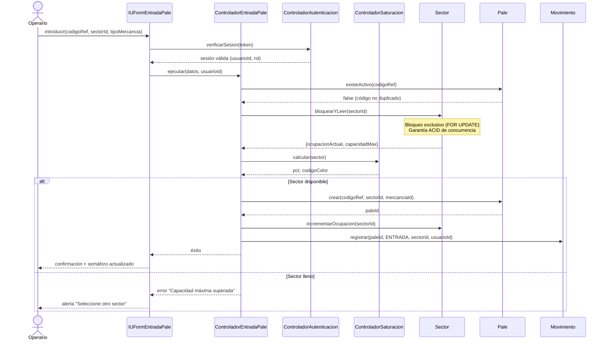

#### 3.2.2.2. Realización de UC-02: Registrar Salida de Palé

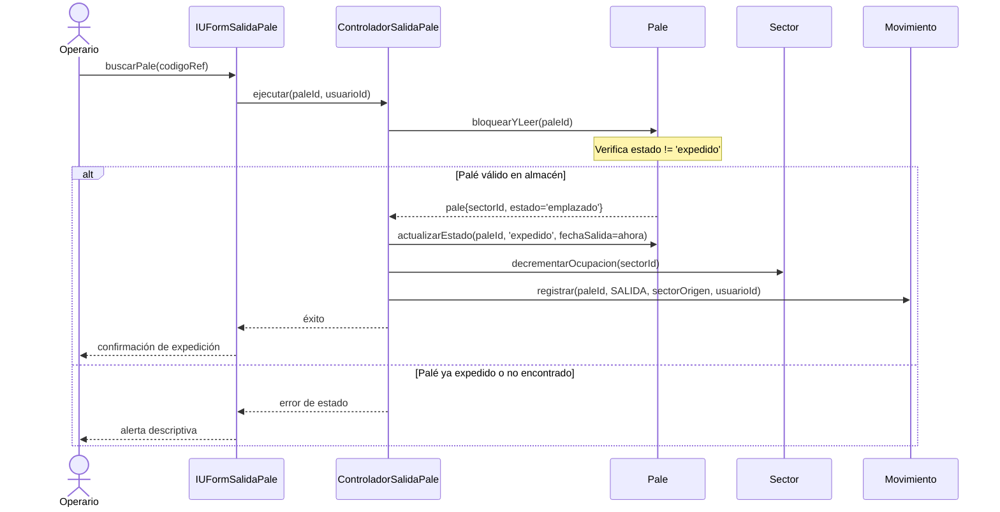

#### 3.2.2.3. Realización de UC-03: Consultar Layout Interactivo

CdU de lectura pura con mayor frecuencia de invocación. Se refresca automáticamente sin intervención del usuario. No requiere control de escritura, pero sí que la consulta mantenga el estándar de respuesta sub-segundo (RS-01).

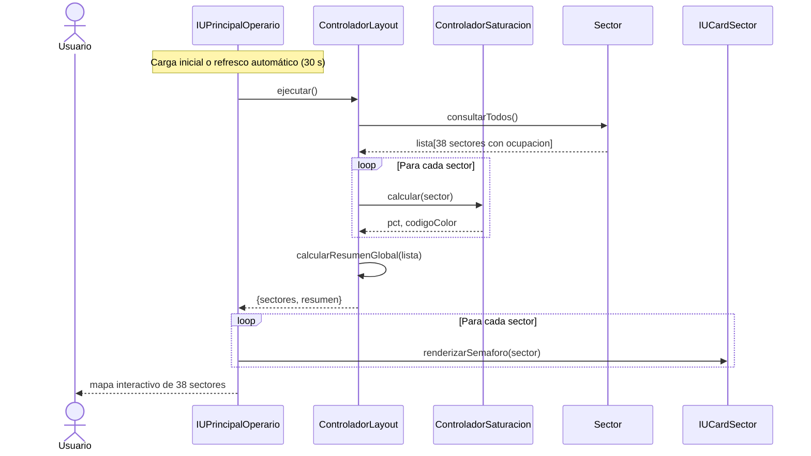

#### 3.2.2.4. Realización de UC-04: Reubicar Palé entre Sectores

CdU de mayor complejidad transaccional: involucra el bloqueo simultáneo de dos sectores para evitar condiciones de carrera (*race conditions*) durante la reubicación.

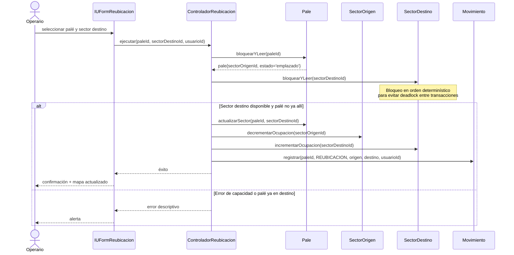

#### 3.2.2.5. Realización de UC-09: Autenticar Usuario *(subflujo)*

UC-09 es un subflujo común incluido por todos los CdU con actores humanos. Su análisis modela la verificación de credenciales y la emisión del token de sesión.

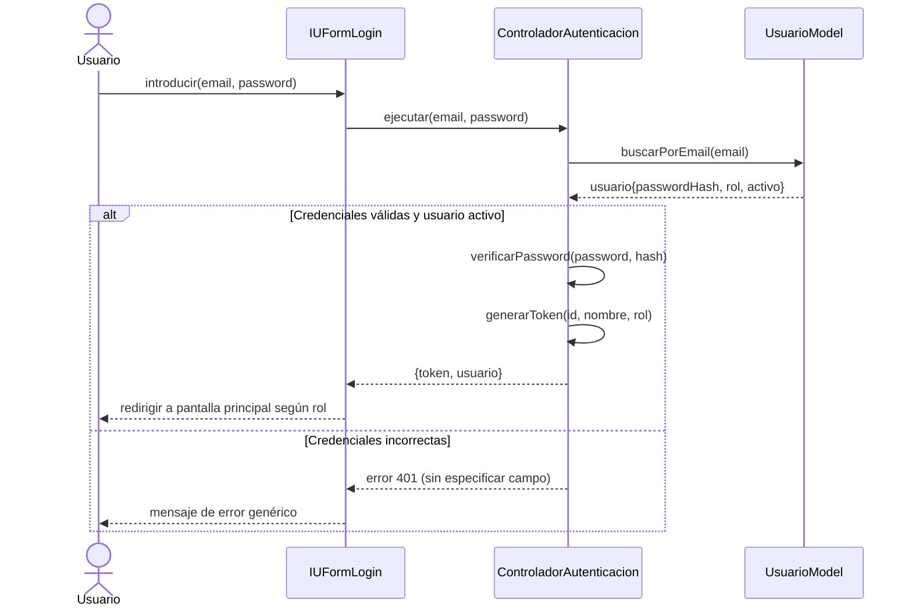

#### 3.2.2.6. Realización de UC-10: Buscar Palé por Referencia

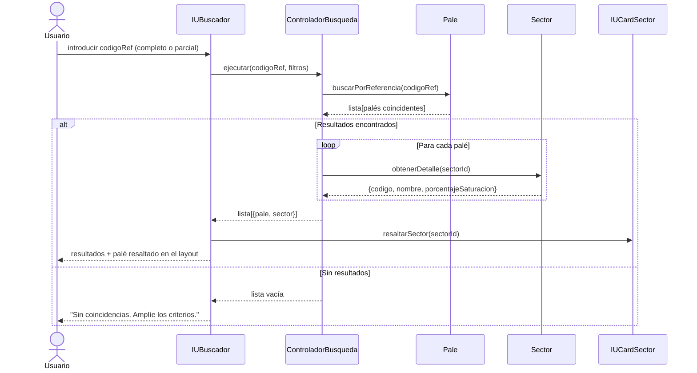

#### 3.2.2.7. Realización de UC-12: Consultar Historial de Palé

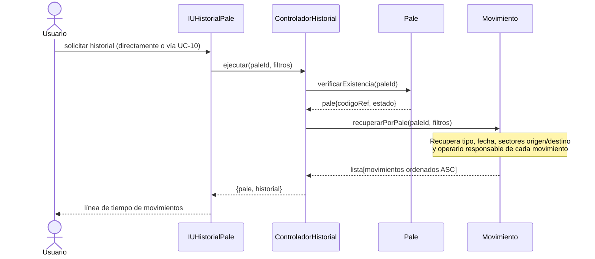

---

### 3.2.3. Análisis de Paquetes

En esta fase de análisis se identifican los agrupamientos lógicos de clases que evolucionarán hacia los paquetes de implementación. Se detectan cuatro grandes áreas de responsabilidad, respetando los principios de alta cohesión interna y bajo acoplamiento externo (Larman, 2004):

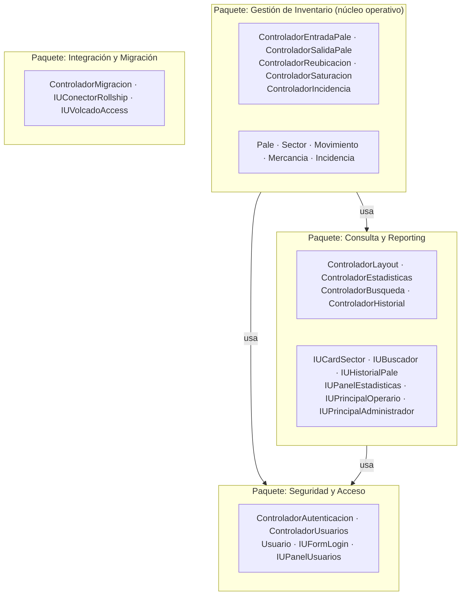

Esta segmentación responde directamente a los requisitos suplementarios: el núcleo de inventario exige el nivel más alto de protección transaccional (ACID — RS-07), la consulta y reporting puede tolerar lecturas diferidas (refresco cada 30 s — RS-01), el paquete de seguridad gestiona las fronteras de autenticación (RS-03), y el de integración maneja los actores sistema externos.

---

## 3.3. Disciplina de Diseño

### 3.3.1. Decisiones Arquitectónicas y Justificación

Las decisiones de arquitectura no son elecciones arbitrarias: cada una responde a uno o varios de los requisitos suplementarios identificados en el Capítulo 2. La siguiente tabla documenta explícitamente esta trazabilidad:

| Decisión Arquitectónica | Requisito No Funcional | Justificación técnica |
|---|---|---|
| **Arquitectura en tres capas** (Presentación → Aplicación → Datos) | RS-06 Mantenibilidad, RS-05 Portabilidad | Desacopla la UI del negocio y del esquema de datos; permite modificar cada capa de forma independiente (Fowler, 2002) |
| **API REST sin estado** (Node.js + Express) | RS-05 Portabilidad, integración Rollship | Cualquier cliente (tablet, Rollship) consume la misma API; elimina dependencia de sesiones de servidor (Fielding, 2000) |
| **SPA React + Vite** | RS-04 Usabilidad *mobile-first*, RS-01 Rendimiento | Elimina recargas de página completa; actualización parcial (AJAX) reduce el *delay* perceptible en pista logística |
| **MySQL 8.0 InnoDB con ACID y Row-Level Locking** | RS-07 Integridad, RS-02 Disponibilidad | InnoDB bloquea solo la fila afectada (no la tabla entera como MS Access); garantiza Atomicidad, Consistencia, Aislamiento y Durabilidad (Oracle Corporation, 2023) |
| **JWT para autenticación stateless** | RS-03 Seguridad | El token porta la identidad del usuario en cada petición HTTP; el servidor no mantiene sesiones en memoria; compatible con SPA y con consumo externo desde Rollship |
| **Patrón MVC en backend** | RS-06 Mantenibilidad, cohesión funcional | Los controladores gestionan el flujo; los modelos encapsulan el acceso a datos; las rutas expresan el contrato REST (Gamma et al., 1994) |
| **Pool de conexiones MySQL2** | RS-01 Rendimiento, RS-02 Disponibilidad | Reutiliza conexiones abiertas (límite configurable: 10 por defecto); elimina la latencia de apertura en cada petición |
| **Índices estratégicos en `movimientos`** | RS-01 Rendimiento | La tabla crece ~68.000 registros/año; los índices sobre `fecha_hora`, `tipo` y `pale_id` garantizan las consultas de historial y estadísticas dentro del umbral sub-segundo |

#### 3.3.1.1. Arquitectura en Tres Capas

La arquitectura adoptada sigue el patrón de **tres capas** (*3-tier architecture*) canónico para sistemas de información web (Fowler, 2002):

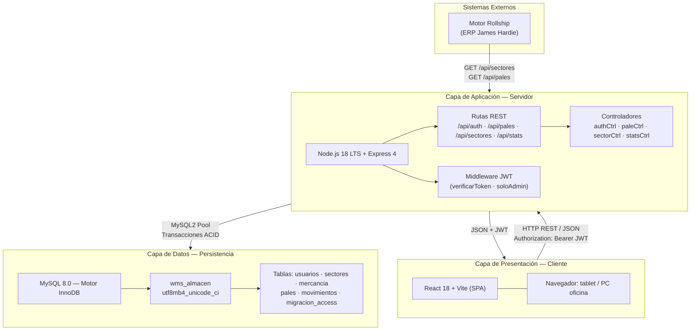

La comunicación entre la capa de presentación y la capa de aplicación se realiza exclusivamente mediante peticiones HTTP con payload JSON, siguiendo los principios REST de Fielding (2000): recursos nombrados por sustantivos (`/api/pales`, `/api/sectores`), verbos HTTP que expresan la operación (GET para lectura, POST para creación, PUT para modificación) y respuestas sin estado (el token JWT porta toda la información de identidad necesaria).

---

### 3.3.2. Clases de Diseño

#### 3.3.2.1. Transición del Análisis al Diseño

La transición del análisis al diseño es el proceso por el que las clases de análisis, independientes de la tecnología, se mapean a clases de implementación concretas del stack seleccionado. La siguiente tabla documenta explícitamente este mapeo para los doce casos de uso:

| Clase de Análisis | Tipo | Clase / Función de Diseño | Fichero de implementación |
|---|---|---|---|
| `Pale` | Model | Queries SQL en `paleController` | `backend/src/controllers/paleController.js` |
| `Sector` | Model | Queries SQL en `sectorController` | `backend/src/controllers/sectorController.js` |
| `Movimiento` | Model | INSERT transaccional en cada controlador de escritura | (incrustado en `paleController.js`) |
| `Mercancia` | Model | Tabla `mercancia` + LEFT JOIN en consultas de palés | `backend/sql/schema.sql` |
| `Usuario` | Model | Tabla `usuarios` + lógica JWT en `authController` | `backend/src/controllers/authController.js` |
| `Incidencia` | Model | Campo `estado='incidencia'` en tabla `pales` + campo `notas` en `movimientos` | `schema.sql` (sprint actual) |
| `IUPrincipalOperario` | View | `OperacionesPage` + `LayoutPage` | `frontend/src/pages/OperacionesPage.jsx`, `LayoutPage.jsx` |
| `IUPrincipalAdministrador` | View | `DashboardPage` | `frontend/src/pages/DashboardPage.jsx` |
| `IUFormEntradaPale` | View | Formulario modal en `OperacionesPage` | `frontend/src/pages/OperacionesPage.jsx` |
| `IUCardSector` | View | Componente `AlmacenMap` | `frontend/src/components/Layout/AlmacenMap` |
| `IUHistorialPale` / `IUBuscador` | View | Tabla de historial y buscador en `PalesPage` | `frontend/src/pages/PalesPage.jsx` |
| `IUFormLogin` | View | `LoginPage` | `frontend/src/pages/LoginPage.jsx` |
| `IUConectorRollship` | View | Endpoints REST `GET /api/sectores`, `GET /api/pales` | `backend/src/routes/sectorRoutes.js`, `paleRoutes.js` |
| `ControladorEntradaPale` | Controller | `entradaPale()` + `POST /api/pales/entrada` | `paleController.js`, `paleRoutes.js` |
| `ControladorSalidaPale` | Controller | `salidaPale()` + `POST /api/pales/:id/salida` | `paleController.js`, `paleRoutes.js` |
| `ControladorLayout` | Controller | `getLayout()` + `GET /api/sectores` | `sectorController.js`, `sectorRoutes.js` |
| `ControladorReubicacion` | Controller | `reubicarPale()` + `PUT /api/pales/:id/reubicar` | `paleController.js`, `paleRoutes.js` |
| `ControladorEstadisticas` | Controller | `getDashboard()` + `GET /api/stats` | `statsController.js`, `statsRoutes.js` |
| `ControladorSaturacion` | Controller | Cláusula SQL `CASE WHEN` interna a `getLayout()` | `sectorController.js` (líneas 15-22) |
| `ControladorAutenticacion` | Controller | `login()` + `POST /api/auth/login` | `authController.js`, `authRoutes.js` |
| `ControladorBusqueda` | Controller | `listarPales()` con parámetro `buscar` + `GET /api/pales?buscar=` | `paleController.js`, `paleRoutes.js` |
| `ControladorHistorial` | Controller | `detallePale()` con historial + `GET /api/pales/:id` | `paleController.js`, `paleRoutes.js` |
| `ControladorUsuarios` | Controller | *(sprint futuro — UC-11 pendiente de implementación)* | `backend/src/controllers/userController.js` |
| `ControladorIncidencia` | Controller | *(sprint futuro — UC-08 pendiente de implementación)* | `backend/src/controllers/incidenciaController.js` |
| `ControladorMigracion` | Controller | *(sprint futuro — UC-06 pendiente de implementación)* | `backend/src/controllers/migracionController.js` |

#### 3.3.2.2. Principios de Diseño Aplicados: Cohesión y Acoplamiento

El diseño del sistema aplica los principios de **alta cohesión funcional** y **bajo acoplamiento** que constituyen, junto con el tamaño adecuado, los tres pilares del diseño modular (Larman, 2004; Martin, 2003).

**Cohesión funcional:** cada controlador del backend gestiona una responsabilidad única y bien delimitada. `paleController` encapsula exclusivamente las operaciones sobre palés (entrada, salida, reubicación, búsqueda e historial); `sectorController` encapsula únicamente la lectura y actualización de sectores; `authController` gestiona únicamente la autenticación. Ningún controlador mezcla responsabilidades de niveles distintos. Este diseño corresponde al nivel más alto de cohesión (cohesión funcional) según la taxonomía de Constantine, tal como describe el material de la asignatura de Ingeniería del Software II.

**Bajo acoplamiento:** la comunicación entre la capa de presentación y la capa de aplicación se realiza exclusivamente a través de la interfaz REST (JSON sobre HTTP). El frontend no conoce el esquema de base de datos; el backend no conoce el framework de UI. El único punto de contacto explícito entre subsistemas es la API REST, que actúa como interfaz contractual estable. Esto permite modificar la implementación interna de cualquier capa sin alterar el contrato externo.

**Principio de Responsabilidad Única (SRP — SOLID):** cada función de controlador realiza una única operación transaccional. La función `entradaPale()` registra exclusivamente la entrada de un palé; cualquier lógica adicional (cálculo de saturación, notificación de alertas) se delega en funciones auxiliares o en la propia capa de datos mediante SQL.

**Principio de Inversión de Dependencias (DIP — SOLID):** los controladores dependen del pool de conexiones MySQL2 a través de una interfaz de abstracción (`pool.query`, `pool.getConnection`), sin acoplar el código de negocio al driver específico. Si se cambia el motor de base de datos, solo se modifica `config/database.js`.

#### 3.3.2.3. Diagrama de Clases de Diseño — Capa Backend

El siguiente diagrama refleja las clases de diseño concretas de la capa de aplicación (Node.js/Express), sus métodos públicos y sus dependencias hacia la capa de datos:

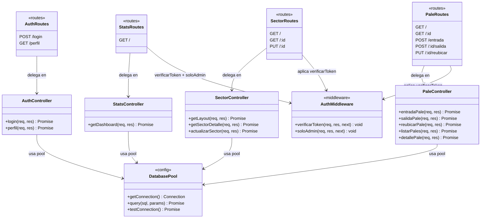

#### 3.3.2.4. Diagrama de Clases de Diseño — Capa Frontend

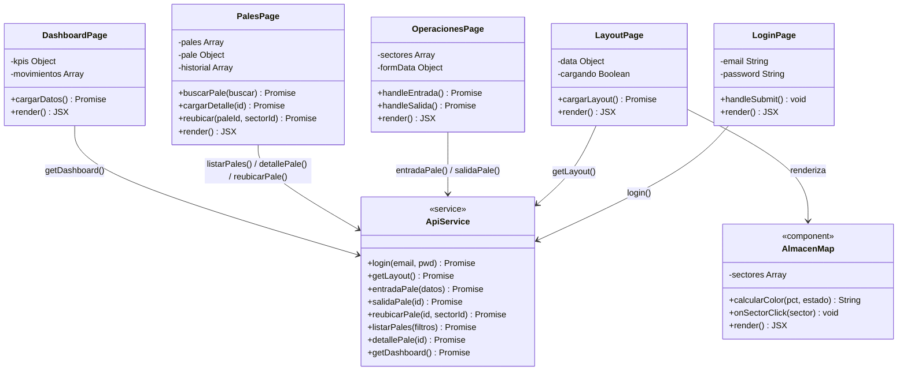

---

### 3.3.3. Diseño de los Casos de Uso — Diagramas de Secuencia de Diseño

Los diagramas de secuencia de diseño muestran la interacción entre los componentes reales de implementación, con los nombres de métodos y rutas exactas del código desarrollado. Permiten verificar la coherencia entre el diseño y la implementación descrita en el Capítulo 4.

#### 3.3.3.1. UC-01: Registrar Entrada de Palé (Diseño)

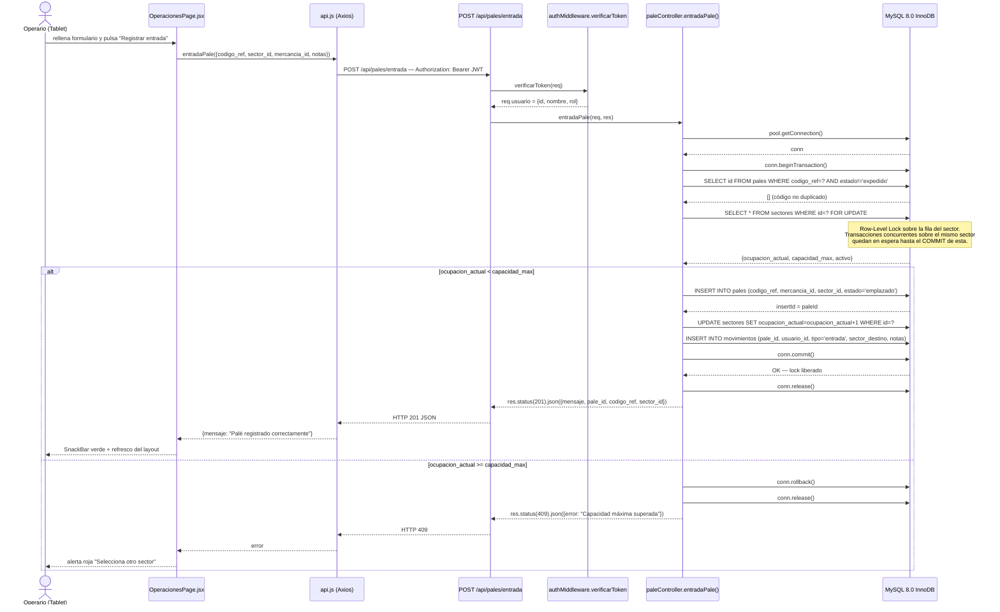

#### 3.3.3.2. UC-03: Consultar Layout — Renderizar Mapa (Diseño)

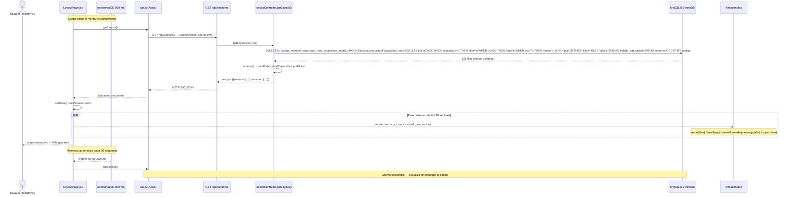

#### 3.3.3.3. UC-04: Reubicar Palé entre Sectores (Diseño)

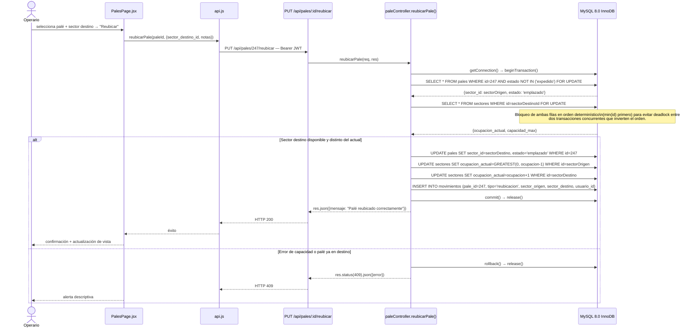

#### 3.3.3.4. UC-09: Autenticar Usuario (Diseño)

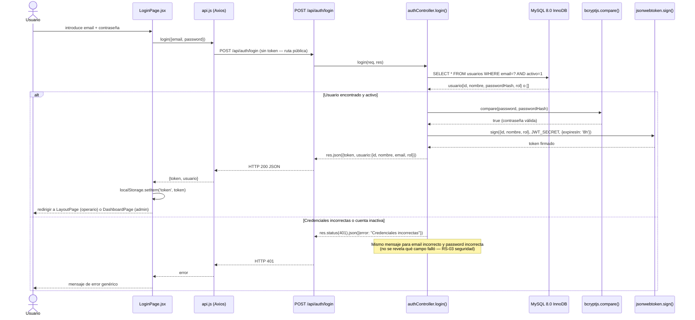

#### 3.3.3.5. UC-10: Buscar Palé por Referencia (Diseño)

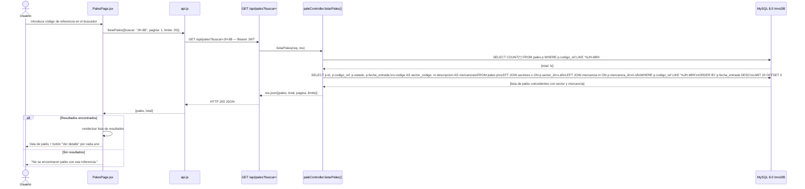

#### 3.3.3.6. UC-12: Consultar Historial de Palé (Diseño)

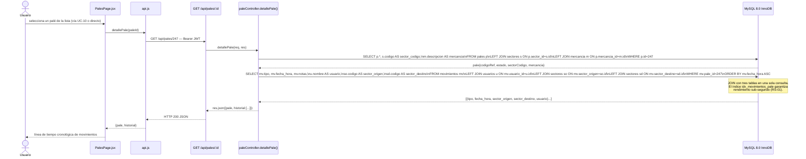

---

### 3.3.4. Diagrama de Despliegue

El diagrama de despliegue muestra la distribución física de los componentes de software sobre los nodos de hardware del entorno de ejecución (Larman, 2004):

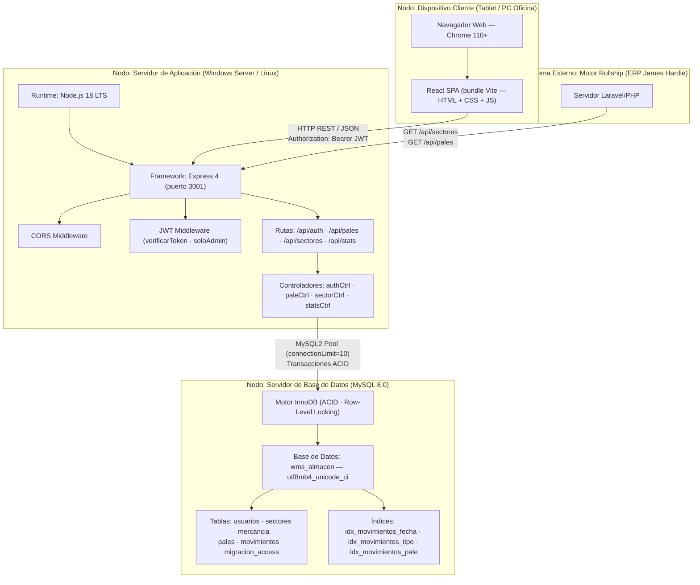

**Notas de despliegue:**

- El servidor de aplicación y el de base de datos pueden cohabitar en el mismo equipo físico en la fase inicial, separándose cuando el volumen de operaciones lo justifique.
- La comunicación entre la SPA y la API se realiza sobre HTTP (HTTPS en producción). El token JWT firmado con `JWT_SECRET` caduca cada 8 horas por defecto, forzando reautenticación al inicio de cada turno.
- El Motor Rollship consume la API REST del módulo logístico mediante peticiones GET autenticadas con su propio token, sin acceder directamente a la base de datos. Esto preserva el desacoplamiento y facilita la integración futura de nuevos almacenes.

---

### 3.3.5. Diagrama de Paquetes

El diagrama de paquetes muestra la organización modular del código fuente y las dependencias entre subsistemas (Larman, 2004):

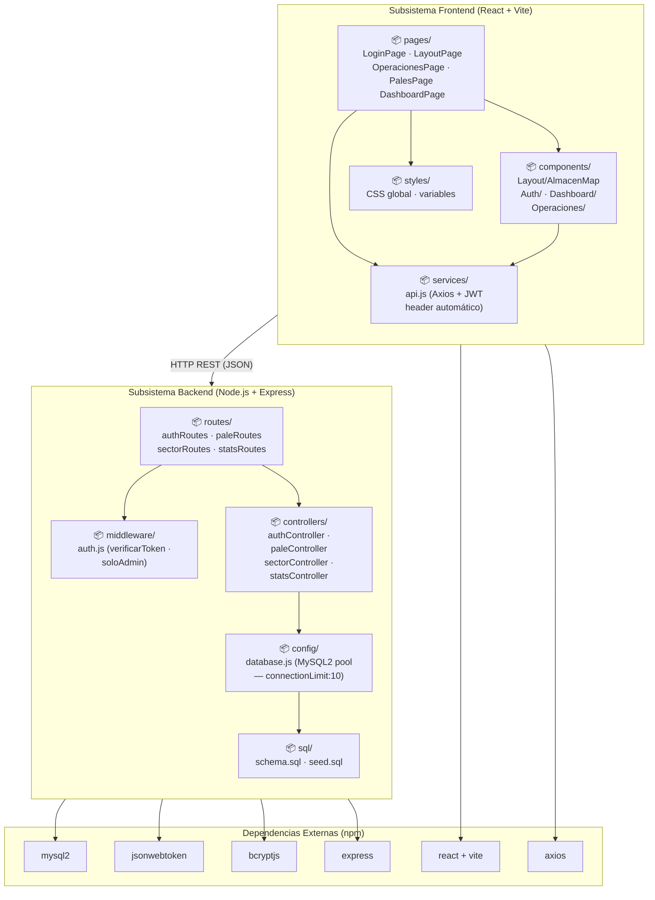

La arquitectura de paquetes garantiza una **alta cohesión interna** (cada paquete agrupa clases del mismo nivel de abstracción) y un **bajo acoplamiento externo** (los paquetes se comunican únicamente a través de interfaces bien definidas: la API REST entre frontend y backend, y el pool MySQL2 entre controladores y base de datos). Este diseño facilita tanto el mantenimiento correctivo como la incorporación futura de nuevos módulos, conforme al principio abierto/cerrado de SOLID (Martin, 2003).

---

### 3.3.6. Modelo de Datos

#### 3.3.6.1. Modelo Lógico — Diagrama Entidad-Relación

El Diagrama Entidad-Relación (DER) representa la estructura conceptual de los datos persistidos, derivada directamente del Modelo del Dominio del Capítulo 2 (Date, 2004):

```mermaid
erDiagram
    USUARIOS {
        int id PK
        varchar nombre
        varchar email UK
        varchar password
        enum rol "operario | administrador"
        tinyint activo
        timestamp created_at
        timestamp updated_at
    }
    SECTORES {
        int id PK
        varchar codigo UK
        varchar nombre
        int capacidad_max
        int ocupacion_actual
        tinyint activo
        text notas
        timestamp created_at
        timestamp updated_at
    }
    MERCANCIA {
        int id PK
        varchar codigo UK
        varchar descripcion
        enum tipo "bolsas | fardos | ladrillos | pizarras | otros"
        decimal peso_kg
        timestamp created_at
    }
    PALES {
        int id PK
        varchar codigo_ref UK
        int mercancia_id FK
        int sector_id FK
        enum estado "recepcionado | emplazado | en_reubicacion | en_preparacion | expedido"
        timestamp fecha_entrada
        timestamp fecha_salida
        text notas
        timestamp created_at
        timestamp updated_at
    }
    MOVIMIENTOS {
        int id PK
        int pale_id FK
        int usuario_id FK
        enum tipo "entrada | salida | reubicacion | ajuste"
        int sector_origen FK
        int sector_destino FK
        timestamp fecha_hora
        text notas
    }
    MIGRACION_ACCESS {
        int id PK
        json datos_raw
        tinyint procesado
        text error
        timestamp created_at
    }

    SECTORES ||--o{ PALES : "contiene (0..*)"
    MERCANCIA ||--o{ PALES : "categoriza (0..*)"
    PALES ||--|{ MOVIMIENTOS : "genera (1..*)"
    USUARIOS ||--o{ MOVIMIENTOS : "registra (0..*)"
    SECTORES ||--o{ MOVIMIENTOS : "sector_origen (0..*)"
    SECTORES ||--o{ MOVIMIENTOS : "sector_destino (0..*)"
```

#### 3.3.6.2. Modelo Físico — Decisiones de Implementación MySQL

El modelo físico concreta el modelo lógico en MySQL 8.0 con motor InnoDB. Las decisiones físicas más relevantes, cada una justificada en los requisitos suplementarios:

**Motor InnoDB (RS-07 Integridad):** Es el único motor MySQL que implementa bloqueo a nivel de fila (*row-level locking*) y soporte completo para transacciones ACID (Oracle Corporation, 2023). La sentencia `SELECT ... FOR UPDATE` dentro de `beginTransaction()` adquiere un bloqueo de escritura exclusivo sobre la fila del sector antes de comprobar la capacidad disponible, garantizando que dos transacciones concurrentes no puedan ubicar simultáneamente palés en un sector ya lleno. Este comportamiento sustituye el bloqueo de fichero completo de MS Access, que impedía el acceso concurrente de múltiples operarios.

**Juego de caracteres `utf8mb4` (RS-04 Usabilidad):** Soporta el rango completo Unicode, incluyendo caracteres especiales en nombres de mercancía y notas de operarios, evitando truncaciones o errores de codificación.

**Índices estratégicos en `movimientos` (RS-01 Rendimiento):** La tabla de movimientos crece aproximadamente 68.000 registros por año. Se definen tres índices explícitos:
- `idx_movimientos_fecha` sobre `fecha_hora` — para filtros de estadísticas por período (UC-05)
- `idx_movimientos_tipo` sobre `tipo` — para conteos por tipo de operación (UC-05)
- `idx_movimientos_pale` sobre `pale_id` — para la recuperación del historial de un palé concreto (UC-12)

**Constraint CHECK en `sectores` (RS-07 Integridad):** `CHECK (ocupacion_actual >= 0)` actúa como salvaguarda de integridad a nivel de base de datos. Junto con `GREATEST(0, ocupacion - 1)` en las consultas de decremento, garantiza que ningún error de aplicación pueda dejar la ocupación en un valor negativo.

**`sector_id NULL` en `pales` (coherencia con el Modelo del Dominio):** Un palé expedido no tiene sector asignado. Permitir `NULL` en `sector_id` mantiene la semántica correcta del Diagrama de Estados del Capítulo 2 (Figura 3): la ausencia de sector expresa el estado de expedición sin requerir un sector ficticio.

---

## 3.4. Trazabilidad y Coherencia del Capítulo

La siguiente tabla verifica que cada elemento de diseño tiene su origen documentado en los capítulos precedentes y su correspondencia prevista en la implementación del Capítulo 4:

| Requisito / CdU (Cap. 2) | Clase de Análisis (§3.2) | Decisión de Diseño (§3.3.1) | Componente de Implementación (Cap. 4) |
|---|---|---|---|
| UC-01 Entrada palé | `ControladorEntradaPale`, `Pale`, `Sector`, `Movimiento` | ACID InnoDB, `FOR UPDATE`, `beginTransaction()` | `paleController.entradaPale()` · `POST /api/pales/entrada` |
| UC-02 Salida palé | `ControladorSalidaPale`, `Pale`, `Sector` | Transacción ACID, `GREATEST(0, ocupacion-1)` | `paleController.salidaPale()` · `POST /api/pales/:id/salida` |
| UC-03 Layout | `ControladorLayout`, `Sector`, `IUCardSector` | REST GET, refresco 30 s, CASE SQL semáforo | `sectorController.getLayout()` · `AlmacenMap` |
| UC-04 Reubicación | `ControladorReubicacion`, `Pale`, `Sector` (×2) | Bloqueo doble determinístico para evitar deadlock | `paleController.reubicarPale()` · `PUT /api/pales/:id/reubicar` |
| UC-05 Estadísticas | `ControladorEstadisticas`, `Movimiento`, `Sector` | Agregación SQL, índice `idx_movimientos_fecha` | `statsController.getDashboard()` · `GET /api/stats` |
| UC-06 Migración ETL | `ControladorMigracion`, `IUVolcadoAccess` | Tabla `migracion_access` (JSON bruto + flag `procesado`) | Sprint futuro |
| UC-07 Saturación (subflujo) | `ControladorSaturacion` (interno) | CASE SQL incrustado en `getLayout()` | `sectorController.js` líneas 15-22 |
| UC-08 Incidencia | `ControladorIncidencia`, `Incidencia`, `Pale` | Estado `incidencia` en ENUM `pales.estado`, bloqueo de operaciones | Sprint futuro · `incidenciaController.js` |
| UC-09 Autenticación (subflujo) | `ControladorAutenticacion`, `Usuario` | JWT stateless, bcryptjs, expiración 8h | `authController.login()` · `POST /api/auth/login` |
| UC-10 Búsqueda | `ControladorBusqueda`, `Pale` | Query LIKE con paginación, JOIN sectores y mercancía | `paleController.listarPales()` · `GET /api/pales?buscar=` |
| UC-11 Usuarios | `ControladorUsuarios`, `Usuario` | CRUD usuarios, constraint `email UNIQUE`, hash bcrypt | Sprint futuro · `userController.js` |
| UC-12 Historial | `ControladorHistorial`, `Movimiento`, `Pale` | JOIN de cuatro tablas, índice `idx_movimientos_pale` | `paleController.detallePale()` · `GET /api/pales/:id` |
| RS-01 Rendimiento (<1,5 s) | `ControladorLayout` | Índices en `sectores`, consulta única con CASE | `getLayout()` — única consulta SELECT |
| RS-02 Disponibilidad (99,5 %) | — | Pool de conexiones `connectionLimit:10` | `config/database.js` |
| RS-03 Seguridad / Roles | `ControladorAutenticacion`, `AuthMiddleware` | JWT, `soloAdmin()` middleware, sesión expira en 8h | `middleware/auth.js` · `verificarToken` · `soloAdmin` |
| RS-04 Usabilidad / mobile-first | `IUCardSector`, `IUPrincipalOperario` | SPA React, componentes táctiles ≥60 px, sin recargas | `AlmacenMap`, `OperacionesPage` |
| RS-05 Portabilidad | `IUConectorRollship` | API REST JSON sin estado (Fielding, 2000) | Endpoints `GET /api/sectores`, `GET /api/pales` |
| RS-06 Mantenibilidad (MVC) | Separación Controller / Model / View | Patrón MVC explícito, cohesión funcional por módulo | Estructura `routes/` · `controllers/` · `config/` |
| RS-07 Integridad (ACID) | `Sector.bloquearYLeer()` | `FOR UPDATE` + `beginTransaction()` / `commit()` / `rollback()` | Pool InnoDB MySQL2 en todos los controladores de escritura |

---

## 3.5. Referencias Bibliográficas del Capítulo

*(Se incorporan a la bibliografía global del TFG, complementando las citadas en los capítulos anteriores.)*

Date, C. J. (2004). *Introducción a los sistemas de bases de datos* (7.ª ed.). Pearson Educación.

Fielding, R. T. (2000). *Architectural styles and the design of network-based software architectures* [Tesis doctoral, University of California, Irvine]. https://www.ics.uci.edu/~fielding/pubs/dissertation/rest_arch_style.htm

Fowler, M. (2002). *Patterns of enterprise application architecture*. Addison-Wesley.

Gamma, E., Helm, R., Johnson, R., & Vlissides, J. (1994). *Design patterns: Elements of reusable object-oriented software*. Addison-Wesley.

Larman, C. (2004). *Applying UML and patterns: An introduction to object-oriented analysis and design and iterative development* (3.ª ed.). Prentice Hall.

Martin, R. C. (2003). *Agile software development: Principles, patterns, and practices*. Prentice Hall.

Oracle Corporation. (2023). *MySQL 8.0 Reference Manual: InnoDB transaction and locking information*. https://dev.mysql.com/doc/refman/8.0/en/innodb-locking.html

Pressman, R. S., & Maxim, B. R. (2020). *Software engineering: A practitioner's approach* (9.ª ed.). McGraw-Hill Education.

Sommerville, I. (2015). *Software engineering* (10.ª ed.). Pearson.
