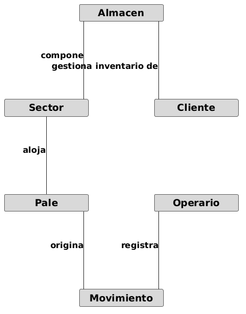
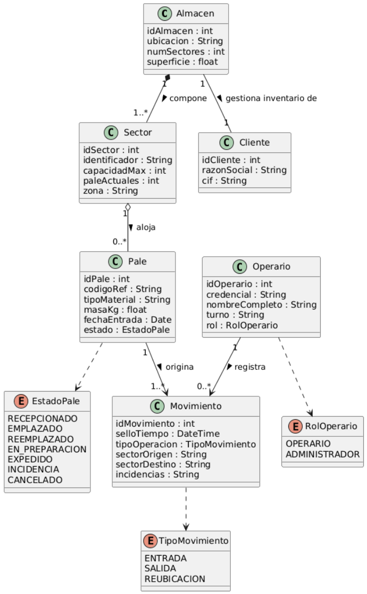
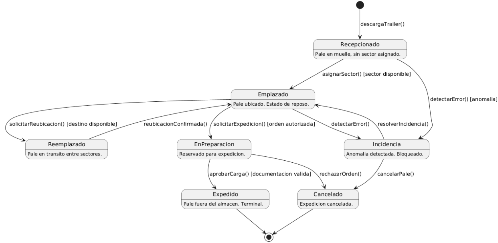
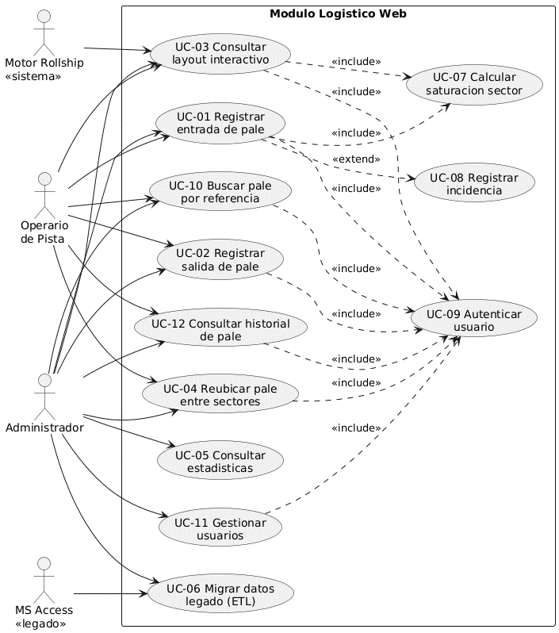
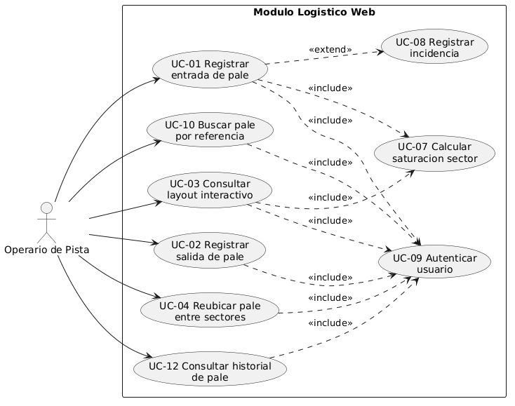
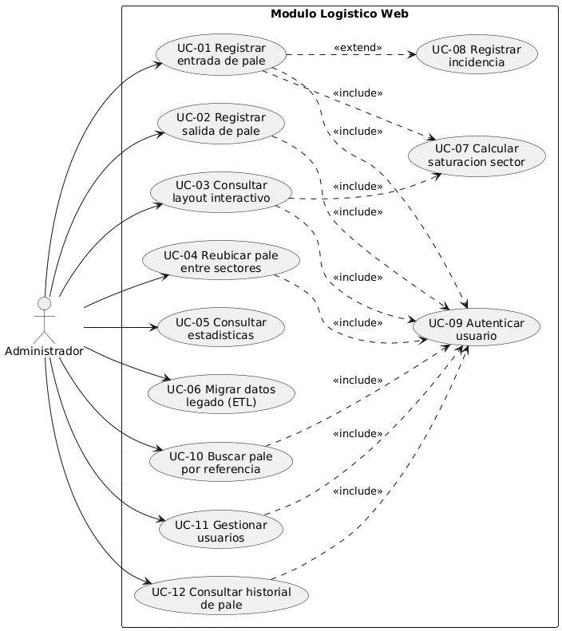
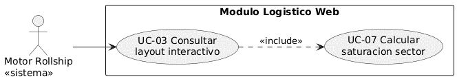
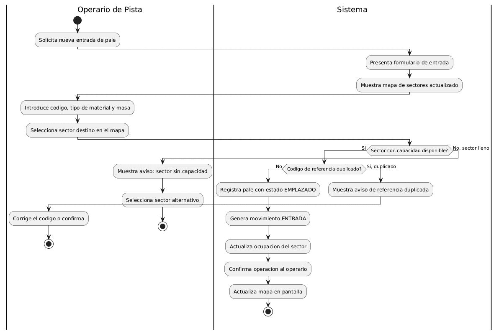
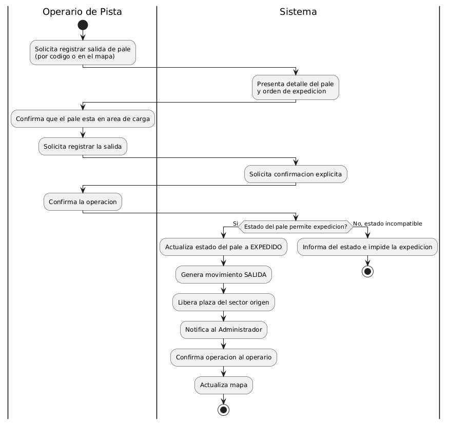
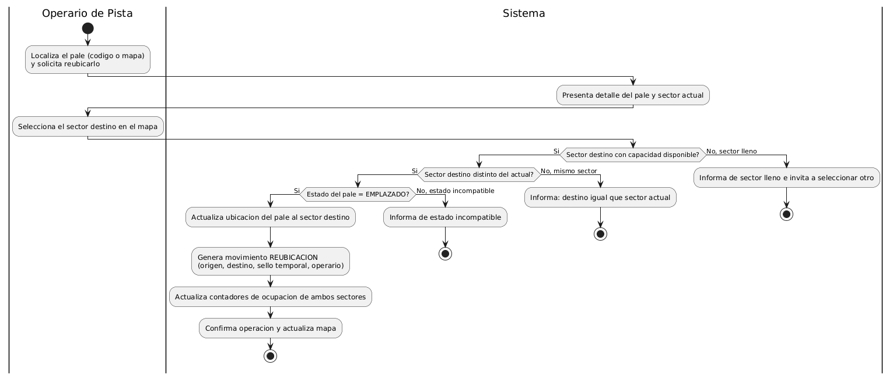

[1. Contexto](./Introduccion.md) | [2. Análisis y Requisitos](./AnalisisyRequisitos.md) | [3. Arquitectura](#) | [4. Demostración](#) | [5. Conclusiones](#)

---

## 1. Modelo del Dominio

Derivado del dominio real del almacén de Santander mediante **Job Shadowing** en pista logística.

- **Palé como entidad central:** Toda operación del sistema —entrada, salida, reubicación, incidencia— gira en torno al palé como unidad mínima de trazabilidad. No hay movimiento sin palé.
- **Movimiento como registro inmutable:** Cada operación genera un `Movimiento` persistido en transacción ACID. El historial nunca se borra; se consulta (UC-12) y audita.
- **Sector con capacidad propia:** No es un simple nombre de zona. Tiene ocupación real y un límite físico; el sistema calcula la saturación en cada escritura (UC-07) para evitar desbordamientos concurrentes.
- **Operario desacoplado de Cliente:** El trabajador de INTERMODAL (quien registra) y James Hardie (dueño de la mercancía) son entidades independientes — el modelo permite escalar a múltiples clientes sin tocar la lógica de operación.

#### Diagrama de clases conceptuales

| Entidad | Descripción | Relaciones clave |
|---------|-------------|-----------------|
| `Almacen` | Recinto logístico completo (Santander) | 1 almacén → 118 sectores |
| `Sector` | Área física de almacenaje con capacidad definida | 1 sector → 0..* palés |
| `Palé` | Unidad de mercancía James Hardie; tiene estado y código único | Objeto de todo movimiento |
| `Movimiento` | Registro transaccional ACID de cada operación | 1 palé → 1..* movimientos |
| `Operario` | Actor humano con credenciales y rol | Notifica movimientos |
| `Cliente` | James Hardie — propietario de la mercancía | 1 cliente por almacén |

---

## 2. Ciclo de Vida del Palé

> Los **casos de uso del sistema son los que provocan cada transición de estado** — ningún estado cambia sin una operación registrada.

- **Máquina de estados como contrato de negocio:** El palé solo puede estar en un estado a la vez; el sistema rechaza operaciones incoherentes (p.ej. sacar un palé en estado `Incidencia`).
- **Trazabilidad total garantizada:** Cada transición persiste un `Movimiento` ACID, lo que permite reconstruir el historial completo en UC-12 sin ambigüedad.
- **Estado `En reubicación` como salvaguarda de concurrencia:** Mientras la transacción de reubicación (UC-04) está abierta, el palé queda bloqueado para otras operaciones.

| Estado | Descripción | UC que lo provoca |
|--------|-------------|-------------------|
| **Recepcionado** | En muelle, sin sector asignado | Descarga física |
| **Emplazado** | Ubicado en sector con registro ACID | UC-01 Entrada palé |
| **En reubicación** | En tránsito entre sectores | UC-04 Reubicar |
| **En preparación** | Incluido en orden de expedición | UC-02 (flujo previo) |
| **Expedido** | Fuera del almacén | UC-02 Salida palé |
| **Incidencia** | Anomalía detectada, operación bloqueada | UC-08 Incidencia |
| **Cancelado** | Expedición rechazada | Administrador |

---

## 3. Requisitos del Sistema

#### Restricciones impuestas por la empresa (no negociables)

| ID | Restricción | Origen |
|----|-------------|--------|
| RS-E1 | Integración con Rollship mediante **API REST JSON** | James Hardie / INTERMODAL |
| RS-E2 | Operación en **navegador web** sin instalación (tablets industriales) | INTERMODAL SEA SOLUTIONS |
| RS-E3 | Base de datos **MySQL** (infraestructura WAMP64 ya disponible) | INTERMODAL SEA SOLUTIONS |
| RS-E4 | Interfaz **mobile-first** · CTAs ≥ 60×60 px (uso con guantes) | Operarios de pista |
| RS-E5 | Migración del **MS Access** a MySQL sin pérdida | James Hardie (auditoría) |

#### Requisitos suplementarios FURPS+

| ID | Requisito | Métrica |
|----|-----------|---------|
| RS-01 | **Rendimiento** | Layout < 1,5 s · escrituras < 2 s para 68.000 tx/año |
| RS-02 | **Disponibilidad** | 99,5 % en horario operativo (07:00–20:00) |
| RS-03 | **Seguridad** | JWT 8h · bcrypt · RBAC 4 roles |
| RS-04 | **Usabilidad** | Botones ≥ 60×60 px · Mobile-First |
| RS-05 | **Portabilidad** | Chrome / Firefox / Safari · sin cliente |
| RS-06 | **Mantenibilidad** | MVC estricta · capas desacopladas · API REST |
| RS-07 | **Integridad** | Transacciones ACID · InnoDB Row-Level Locking |

- **Restricción tecnológica forzada:** MySQL no es una elección libre — la infraestructura WAMP64 ya estaba desplegada en la empresa. El diseño ACID se adapta a esa restricción.
- **Mobile-first como requisito de negocio:** Los operarios trabajan en pista con tablets industriales y guantes. Los ≥ 60×60 px no son una recomendación de accesibilidad, son una exigencia operativa.
- **ETL como requisito de auditoría:** James Hardie exige trazabilidad histórica completa; sin la migración del Access, el sistema no podría auditarse ante reclamaciones de mercancía.

---

## 4. Identificación y Jerarquía de Actores

- **RBAC con 4 roles:** visualizador → operario → gerente → administrador. Cada nivel hereda los permisos del anterior; ningún rol accede a funciones fuera de su ámbito sin escalada explícita.
- **Actor humano vs. sistema externo:** Rollship ERP actúa como actor automatizado — no tiene sesión JWT, interactúa exclusivamente vía API REST con una clave de API fija.
- **Actor externo transitorio:** MS Access Legacy solo aparece como fuente de datos en UC-06 (migración ETL, operación única); tras la migración, queda eliminado del flujo operativo.

---

## 5. Casos de Uso: Operativa de Pista

- **Operario de Pista (Carga Operativa):** 6 casos de uso directos — entrada, salida, layout, reubicación, búsqueda e historial. UC-07 (saturación) y UC-09 (auth) son subflujos automáticos `<<include>>`; UC-08 (incidencia) se activa solo si algo sale mal `<<extend>>`.

---

## 6. Casos de Uso: Administración y Sistema Externo

- **Administrador (Control Total):** Hereda todos los UC del Operario y añade UC-05 (estadísticas de flujo), UC-06 (migración ETL Access→MySQL) y UC-11 (gestión de usuarios). Es el único rol con acceso al panel de datos históricos.

- **Motor Rollship (Actor Automatizado):** Solo tiene acceso a UC-03 (layout interactivo) vía API REST. No autenticado por JWT — consume el endpoint público de ocupación de sectores para sincronizar con el ERP de James Hardie.

---

## 7. Catálogo y Priorización MoSCoW

| ID | Caso de uso | Actor | MoSCoW | Sprint | Estado |
|----|-------------|-------|--------|--------|--------|
| UC-01 | Registrar entrada de palé | Operario / Admin | **Must** | 1 | ✅ |
| UC-02 | Registrar salida de palé | Operario / Admin | **Must** | 1 | ✅ |
| UC-03 | Consultar layout interactivo | Operario / Admin / Rollship | **Must** | 1 | ✅ |
| UC-04 | Reubicar palé entre sectores | Operario / Admin | **Must** | 2 | ✅ |
| UC-05 | Consultar estadísticas de flujo | Administrador | Should | 3 | ✅ |
| UC-06 | Migrar datos legado (ETL Access→MySQL) | Administrador | Should | 2 | ✅ Scripts |
| UC-07 | Calcular saturación de sector | Sistema (subflujo) | **Must** | 1 | ✅ |
| UC-08 | Registrar incidencia operativa | Operario / Admin | Should | 2 | ✅ |
| UC-09 | Autenticar usuario (JWT) | Todos los actores | **Must** | 1 | ✅ |
| UC-10 | Buscar palé por referencia | Operario / Admin | Should | 2 | ✅ |
| UC-11 | Gestionar usuarios del sistema | Administrador | Could | 2 | ✅ |
| UC-12 | Consultar historial de palé | Operario / Admin | Should | 3 | ✅ |

---

## 8. Detalle de Casos de Uso Clave

#### UC-01 — Registrar entrada de palé · Must · Sprint 1

| | |
|--|--|
| **Precondiciones** | Usuario autenticado · mercancía en muelle · sector destino con capacidad libre |
| **Flujo normal** | 1. Accede al layout → 2. Selecciona sector verde → 3. Introduce código referencia → 4. Sistema valida capacidad con `FOR UPDATE` → 5. Persiste palé + movimiento ENTRADA en transacción ACID → 6. Actualiza semáforo de saturación |
| **Excepción A1** | Sector alcanza capacidad concurrentemente → rechaza con "Capacidad Máxima Superada" |
| **Excepción A2** | Código ya existe en sistema activo → alerta de duplicado |
| **Postcondiciones** | Palé en estado **Emplazado** · movimiento ENTRADA registrado |
| **Include** | UC-07 Calcular saturación · UC-09 Autenticación |

---

#### UC-02 — Registrar salida de palé · Must · Sprint 1

| | |
|--|--|
| **Precondiciones** | Palé en estado Emplazado o En preparación · orden de expedición autorizada |
| **Flujo normal** | 1. Busca palé por código → 2. Verifica estado válido → 3. Confirma salida → 4. Actualiza palé a **Expedido** · decrementa ocupación · registra movimiento SALIDA |
| **Excepción** | Palé ya expedido o en estado Incidencia → operación rechazada |
| **Postcondiciones** | Palé en estado **Expedido** · sector liberado · trazabilidad completa |

---

#### UC-04 — Reubicar palé entre sectores · Must · Sprint 2

| | |
|--|--|
| **Precondiciones** | Palé en estado Emplazado · sector destino con capacidad libre |
| **Flujo normal** | 1. Localiza palé → 2. Selecciona sector destino → 3. Sistema bloquea palé + sector destino simultáneamente (doble `FOR UPDATE`) → 4. Transfiere palé · actualiza contadores de ambos sectores · registra movimiento REUBICACION |
| **Postcondiciones** | Palé **Emplazado** en nuevo sector · historial de la reubicación conservado |

---

[1. Contexto](./Introduccion.md) | [2. Análisis y Requisitos](./AnalisisyRequisitos.md) | [3. Arquitectura](#) | [4. Demostración](#) | [5. Conclusiones](#)
