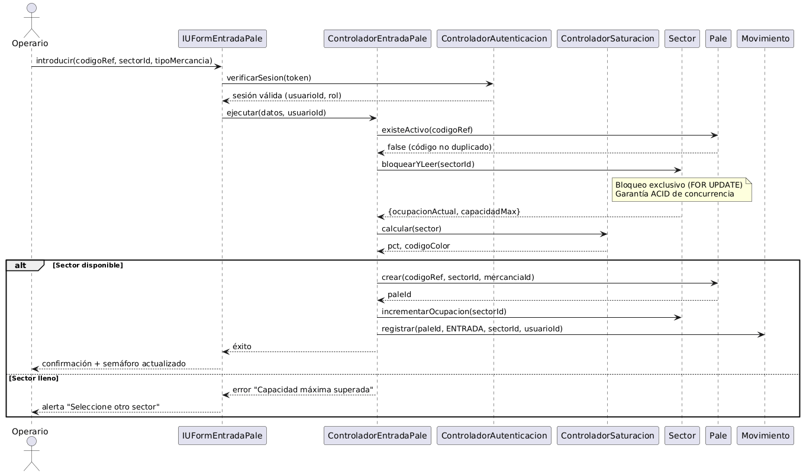
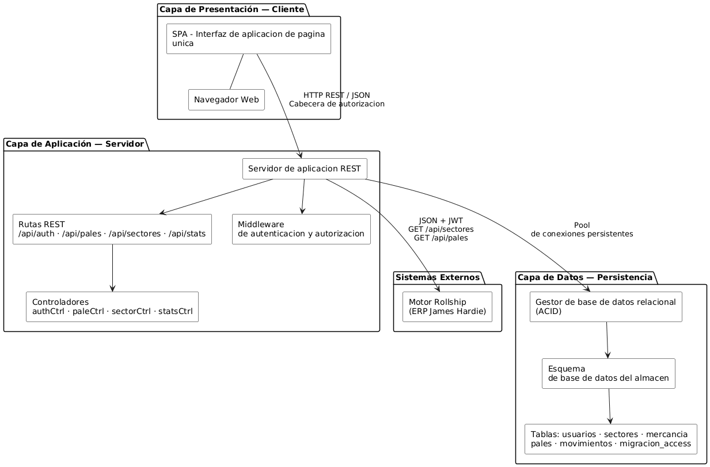
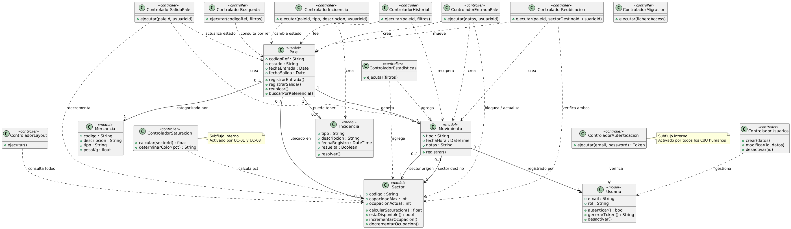
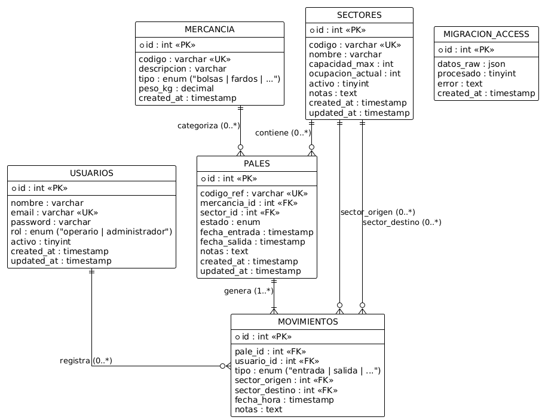

[1. Contexto](./Introduccion.md) | [2. Análisis y Requisitos](./AnalisisyRequisitos.md) | [3. Arquitectura](./Arquitectura.md) | [4. Demostración](./Demostracion.md) | [5. Conclusiones](./Conclusiones.md)

---

## 1. Caso de Uso en Acción: UC-01 Registrar Entrada de Palé

<div align="center">


</div>

<div align="center">



</div>

- **Controlador por Caso de Uso:** `ControladorEntradaPale` gestiona en exclusiva el flujo UC-01. La Vista solo invoca y presenta; el Modelo solo persiste — ninguna capa sobrepasa su responsabilidad.
- **Bloqueo FOR UPDATE:** El sector se bloquea en exclusiva antes de verificar su capacidad. Este `SELECT … FOR UPDATE` es la solución directa al deadlock que bloqueaba jornadas enteras en el Access.
- **Regla antifraude de timestamps:** La `fecha_hora` del movimiento la fija el servidor en el instante de la transacción ACID — nunca el cliente — garantizando la inmutabilidad del registro de auditoría.

---

## 2. Arquitectura MVC en Capas

<div align="center">



</div>

- **SPA sin framework:** Vanilla JS con hash routing (`#/layout`, `#/operaciones`, `#/inventario`) — cero dependencias en cliente, funciona en cualquier navegador del almacén sin instalación.
- **Middleware JWT centralizado:** Toda ruta REST pasa por `verificarSesion(token)` antes de llegar al controlador. Un único punto de control RBAC; si el token es inválido o el rol insuficiente, la petición no llega al controlador.
- **Un controlador por caso de uso:** 12 UC → 12 controladores independientes. Ningún controlador llama a otro — la lógica de cada UC está completamente encapsulada.

| Capa | Tecnología | Requisito que cubre |
|------|-----------|---------------------|
| **Vista** (invocar · presentar) | Vanilla JS · SPA hash routing · CSS Grid | Mobile-First sin build step · RS-04 · RS-05 |
| **Controlador** (un controlador por UC) | Node.js 20 · Express 4 · JWT 8h · bcryptjs | API REST para Rollship · RBAC 4 roles · RS-E1 · RS-03 |
| **Modelo** (derivado del dominio) | MySQL 8.0 · InnoDB · Row-Level Locking | ACID garantizado · sin deadlocks · RS-07 · RS-E3 |

<div align="center">



</div>

---

## 3. Modelo Entidad-Relación y Transacción ACID

<div align="center">



</div>

- **PALES como tabla central:** Todas las foreign keys convergen en `pales` — pivote entre `sectores`, `mercancia`, `movimientos` y `usuarios`. La integridad referencial de InnoDB impide borrar un palé con movimientos asociados.
- **Doble FK sector en MOVIMIENTOS:** `sector_origen` + `sector_destino` registra la reubicación (UC-04) en una sola fila. El historial completo de un palé en UC-12 se obtiene con un `SELECT … WHERE pale_id = ? ORDER BY fecha_hora`.
- **MIGRACION_ACCESS como tabla de staging:** Los datos del Access se importan en bruto como `datos_raw : json`, se procesan y se marcan `procesado = 1`. La migración ETL es idempotente — se puede relanzar sin duplicar registros.

```sql
-- ControladorEntradaPale — transacción ACID UC-01
START TRANSACTION;

  SELECT id, ocupacion_actual, capacidad_max
    FROM sectores WHERE id = ? FOR UPDATE;       -- Row-Level Lock: bloqueo exclusivo del sector

  INSERT INTO pales (codigo_ref, sector_id, mercancia_id, estado)
    VALUES (?, ?, ?, 'emplazado');

  INSERT INTO movimientos (pale_id, usuario_id, tipo, sector_destino, fecha_hora)
    VALUES (LAST_INSERT_ID(), ?, 'entrada', ?, NOW());  -- timestamp del servidor

  UPDATE sectores
    SET ocupacion_actual = ocupacion_actual + 1
    WHERE id = ?;

COMMIT;  -- ROLLBACK automático si cualquier paso falla
```

---

## 4. Vista: Layout Interactivo y Semáforo de Saturación

<div align="center">


</div>

- **Vista = invocar + presentar:** La SPA invoca `GET /api/sectores`, recibe el JSON de ocupación y colorea cada celda del grid de sectores sin recargar la página. Toda la lógica de negocio (cálculo, validación) vive en `ControladorLayout` y `ControladorSaturacion`.
- **Semáforo de 5 niveles:** Libre (<60%) · Bajo (<75%) · Medio (<85%) · Alto (<95%) · Crítico (≥95%) — calculado sobre `ocupacion_actual / capacidad_max`. El operario ve el estado del sector antes de seleccionarlo para una entrada.
- **Datos reales del almacén:** 2.444 palés activos · 10.382 huecos de capacidad total · 118 sectores activos · 23,5 % de ocupación global en el momento de las capturas de pantalla.

---

[1. Contexto](./Introduccion.md) | [2. Análisis y Requisitos](./AnalisisyRequisitos.md) | [3. Arquitectura](./Arquitectura.md) | [4. Demostración](./Demostracion.md) | [5. Conclusiones](./Conclusiones.md)
