[1. Contexto](./Introduccion.md) | [2. Análisis y Requisitos](./AnalisisyRequisitos.md) | [3. Arquitectura](./Arquitectura.md) | [4. Demostración](./Demostracion.md) | [5. Conclusiones](./Conclusiones.md)

---

> **Acceso al sistema en vivo**
>
> | Entorno | URL |
> |---------|-----|
> | 🖥️ Local (red interna) | http://localhost:3001 |
> | 🌐 Puente público (ngrok) | https://showbiz-mockup-primp.ngrok-free.dev |
>
> Credenciales de demo: `admin@almacen.com` · `operario@almacen.com` · `gerente@almacen.com` · `viewer@almacen.com` — contraseña: `ejecucion`

---

## 1. Autenticación — UC-09

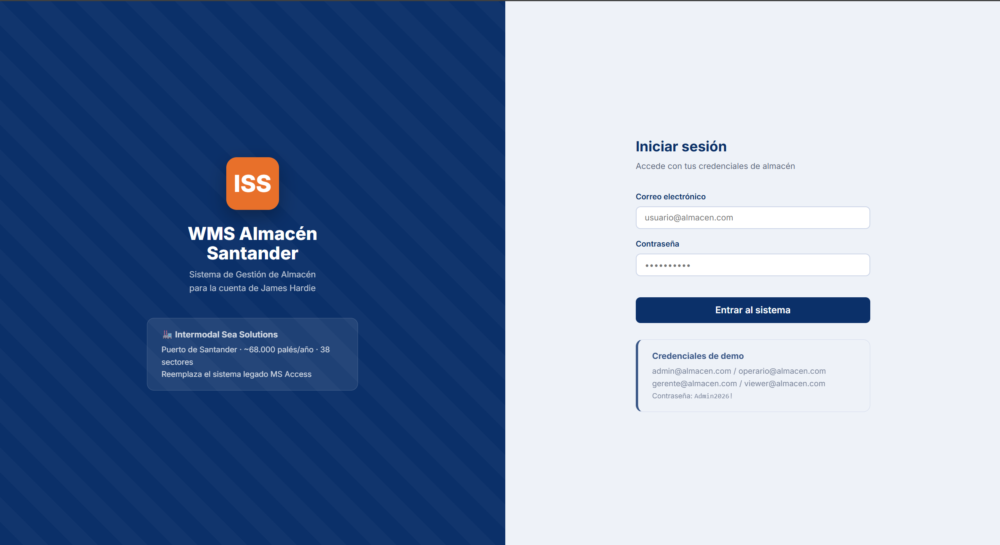

- **JWT + bcrypt:** Las credenciales se validan contra el hash almacenado; el servidor emite un token JWT firmado con rol incluido (8h de validez). Ninguna ruta de la API es accesible sin un token válido.
- **Branding real:** La pantalla de login muestra los datos reales de INTERMODAL SEA SOLUTIONS y reemplaza visualmente el MS Access que había antes.

---

## 2. Layout Interactivo del Almacén — UC-03

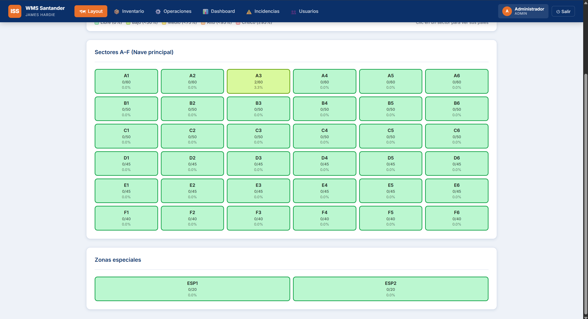

- **118 sectores en tiempo real:** El grid se construye dinámicamente desde `GET /api/sectores`. Cada celda muestra código, ocupación actual / capacidad máxima y el color del semáforo de saturación.
- **KPIs en cabecera:** 2.444 palés activos · 10.382 huecos totales · 23,5% ocupación global · 118 sectores activos — actualizados con cada petición.

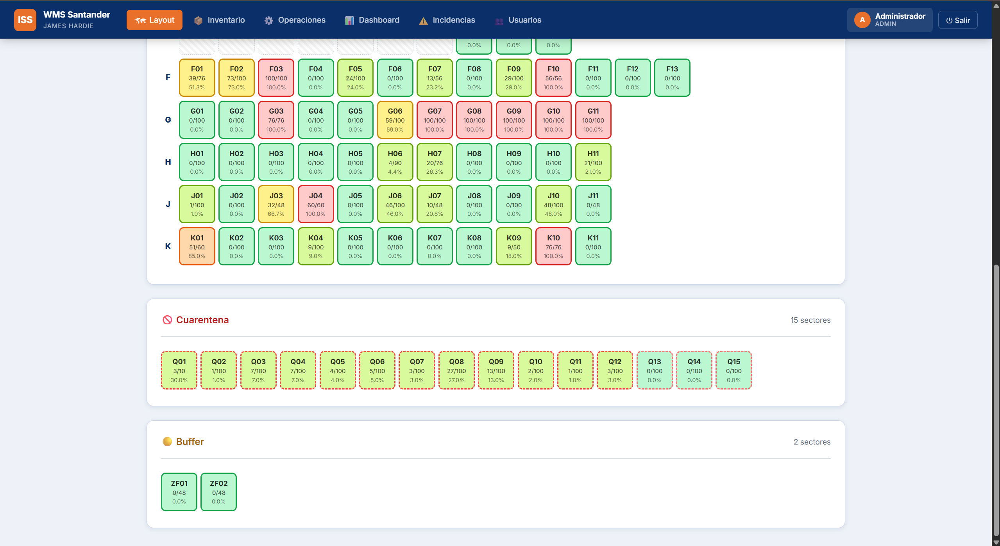

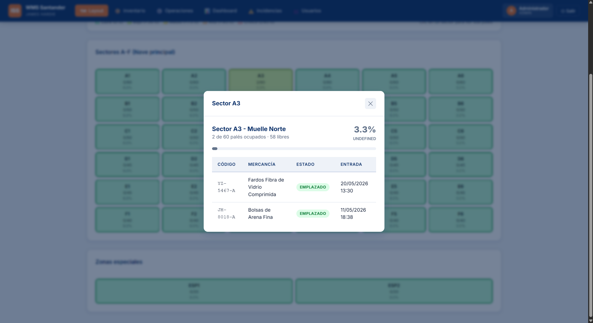

- **Drill-down por sector:** Al hacer clic en cualquier celda se abre el modal del sector mostrando los palés que contiene (código, mercancía, estado, fecha de entrada) y la ocupación exacta — sin cambiar de página.

---

## 3. Registrar Entrada de Palé — UC-01

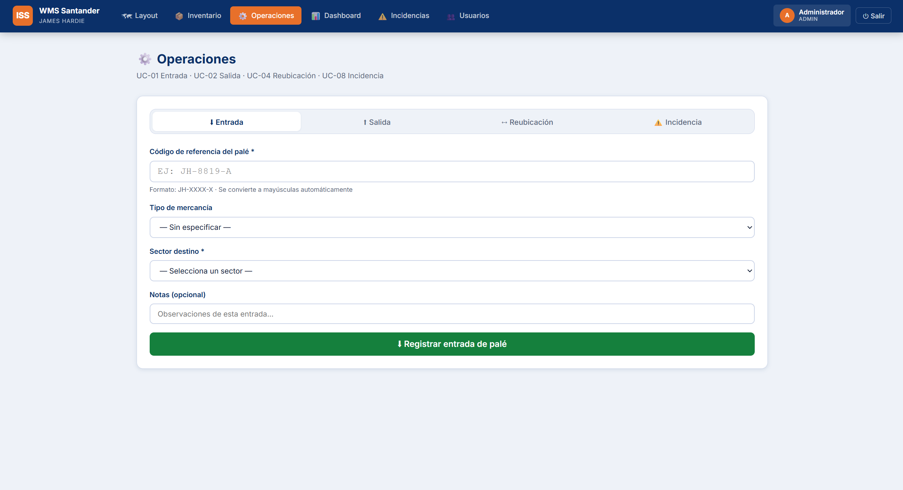

- **Transacción ACID con FOR UPDATE:** Al pulsar "Registrar entrada de palé" el servidor ejecuta `SELECT … FOR UPDATE` sobre el sector, inserta el palé y el movimiento ENTRADA atómicamente y actualiza el semáforo — todo en una sola transacción o ROLLBACK completo.
- **CTA ≥ 60×60 px:** El botón verde es apto para uso con guantes en pista logística (RS-E4).

---

## 4. Registrar Salida de Palé — UC-02

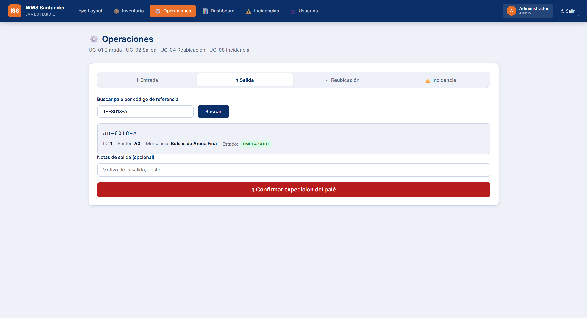

- **Búsqueda + confirmación en dos pasos:** El operario localiza el palé por código de referencia, el sistema valida que está en estado `EMPLAZADO` y entonces habilita el botón rojo "Confirmar expedición del palé". Un palé en `INCIDENCIA` no puede expedirse.

---

## 5. Reubicar Palé entre Sectores — UC-04

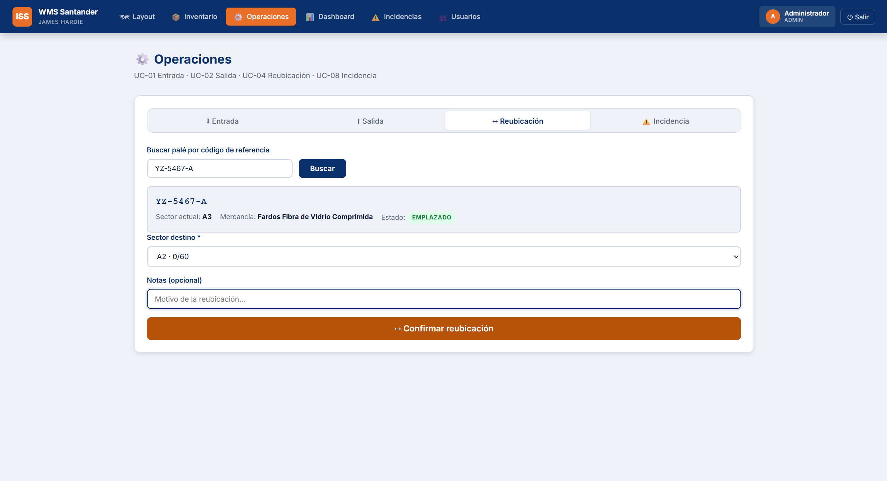

- **Doble FOR UPDATE:** El controlador bloquea simultáneamente el palé y el sector destino antes de mover — evita que dos operarios simultáneos muevan el mismo palé o sobrepoblen el mismo sector destino.

---

## 6. Inventario de Palés — UC-10 y UC-12

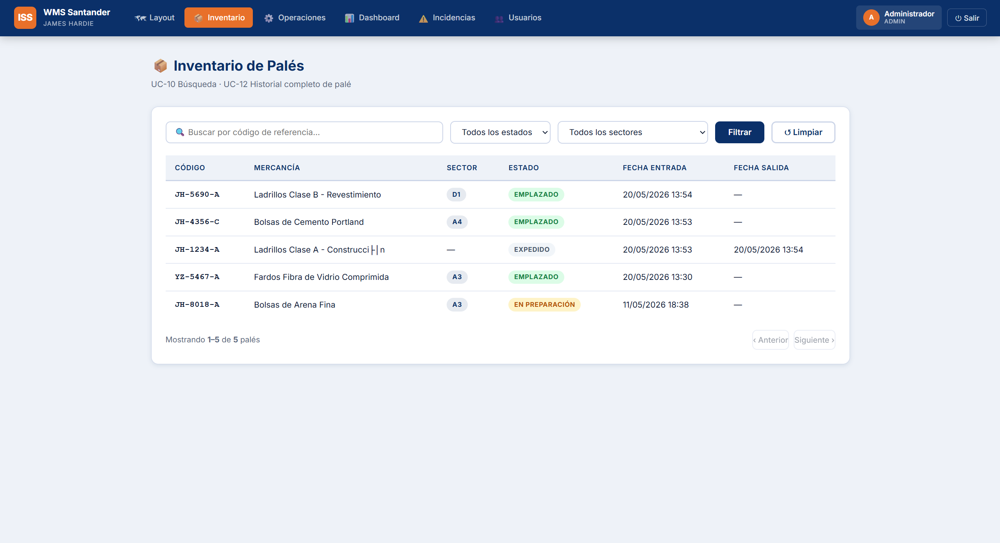

- **Búsqueda + filtros:** El operario filtra por código de referencia, estado (Emplazado / Expedido / En preparación) y sector de forma combinada. Los resultados muestran la trazabilidad completa: sector, mercancía, fechas de entrada y salida.

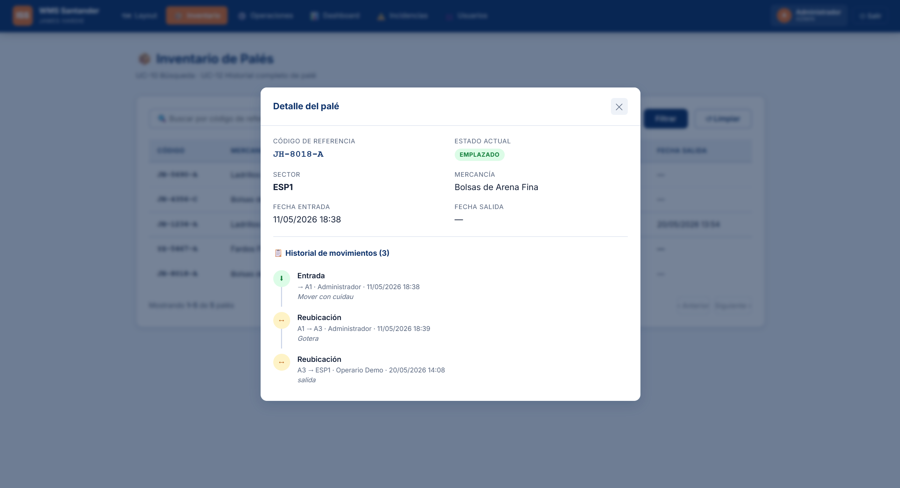

- **Historial completo:** Al seleccionar un palé se despliega la línea de tiempo de todos sus movimientos ACID ordenados cronológicamente — reconstruye cualquier operación pasada sin ambigüedad para auditoría de James Hardie.

---

## 7. Incidencias Operativas — UC-08

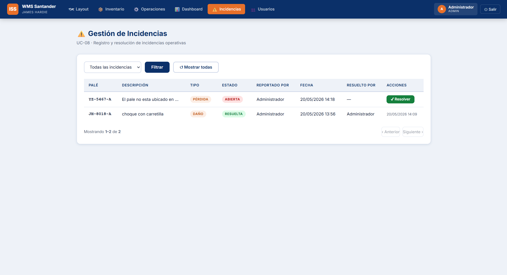

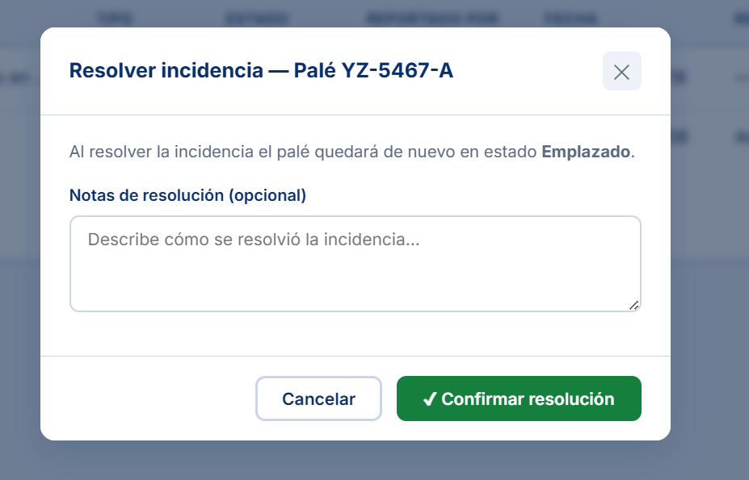

- **Estado bloqueante:** Al registrar una incidencia el palé pasa a estado `INCIDENCIA` — el sistema impide operar sobre él (ni salida ni reubicación) hasta que el administrador lo resuelva o cancela.

---

## 8. Dashboard Estadístico — UC-05

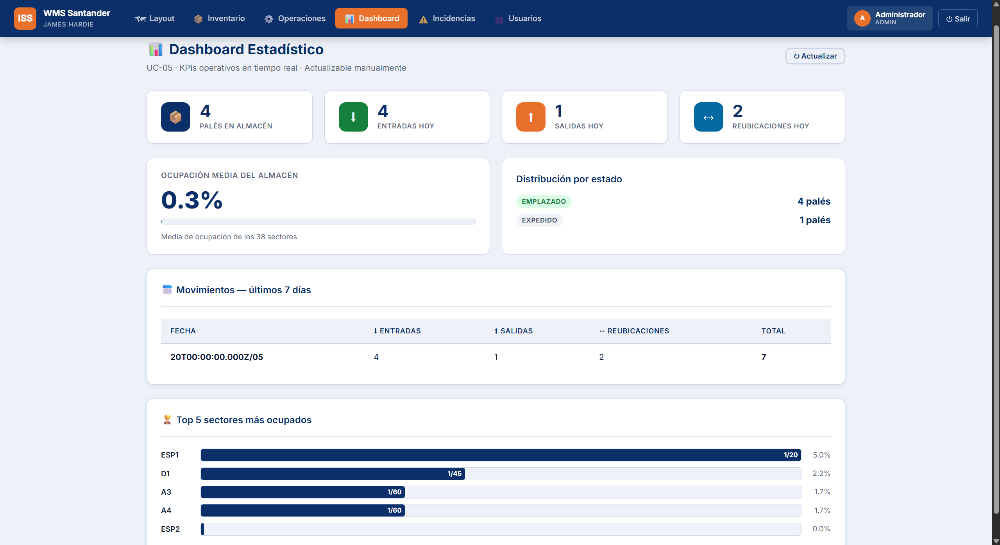

- **KPIs en tiempo real:** Palés en almacén · Entradas hoy · Salidas hoy · Reubicaciones hoy — consultados vía `GET /api/stats` al cargar la página, actualizables con el botón "Actualizar".
- **Top 5 sectores más ocupados:** Permite al gerente identificar cuellos de botella y redistribuir carga antes de que los sectores entren en estado Crítico.

---

## 9. Gestión de Usuarios — UC-11

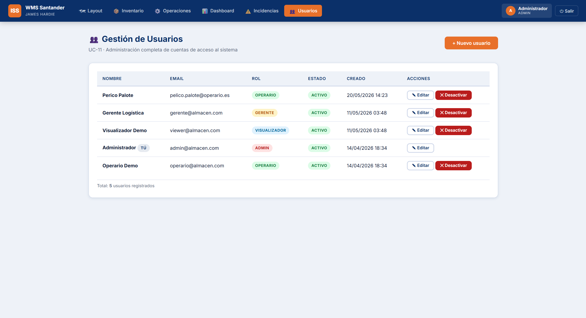

- **CRUD con RBAC:** Solo el rol `administrador` tiene acceso a esta vista. Permite crear, activar/desactivar y cambiar el rol de los operarios — la contraseña siempre se almacena como hash bcrypt, nunca en texto plano.

---

[1. Contexto](./Introduccion.md) | [2. Análisis y Requisitos](./AnalisisyRequisitos.md) | [3. Arquitectura](./Arquitectura.md) | [4. Demostración](./Demostracion.md) | [5. Conclusiones](./Conclusiones.md)
