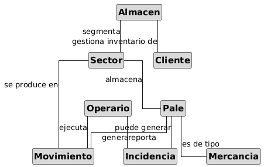

[1. Contexto](./Introduccion.md) | [2. Análisis y Requisitos](./AnalisisyRequisitos.md) | [3. Arquitectura](./Arquitectura.md) | [4. Demostración](./Demostracion.md) | [5. Conclusiones](./Conclusiones.md)

---

## Sistema WMS para la gestión logística del almacén de Santander

**Trabajo de Fin de Grado**  
Autor: Mario Del Río Merino

---

## El problema operativo en Intermodal Sea Solutions

- **Entorno real:** Almacén del Espigón de Raos (Muelle 7-8, Santander) — operador logístico 100% intermodal marítimo-terrestre.
- **Cliente del almacén:** James Hardie, fabricante de planchas de fibrocemento (destino UK, Dinamarca y España).
- **Sistema heredado:** MS Access monolítico en un único PC de escritorio, sin acceso concurrente.
- **El reto técnico:**
  - Deadlocks que bloqueaban jornadas enteras al operar simultáneamente.
  - Gestión del stock por hojas Excel desactualizadas — sin mapa visual de ocupación.
  - Imposible auditar entradas/salidas ni controlar quién modifica qué registro.

| Problema | Impacto real |
|----------|-------------|
| MS Access en un único PC | Un operario a la vez, sin acceso móvil |
| Deadlocks en operaciones concurrentes | Pérdida de datos y bloqueos de jornada |
| Sin mapa visual de ocupación | Gestión por hojas Excel desactualizadas |
| Sin trazabilidad de movimientos | Imposible auditar entradas/salidas |
| Sin control de roles | Cualquier usuario modifica cualquier registro |
| Sin posibilidad de modificar | El operario requiere cambiar datos |

**Volumen real del almacén:** ~73.064 palés entrados · ~68.248 salidos · **118 sectores físicos** · **10.382 huecos de capacidad total**

---

## Objetivos del proyecto (Enfoque SMART)

**Hipótesis técnica:** Un módulo web transaccional sobre MySQL InnoDB elimina los deadlocks del Access y habilita el control multiusuario en tiempo real.

Objetivos específicos y medibles:

- **Modelado:** Especificar el dominio con 6 entidades y 12 Casos de Uso con trazabilidad completa requisitos → código.
- **Rendimiento:** Layout < 1,5 s · escrituras ACID < 2 s para las ~68.000 transacciones anuales del almacén.
- **Seguridad:** JWT 8h · bcrypt · RBAC con 4 roles — visualizador / operario / gerente / administrador.
- **Usabilidad:** Mobile-first, CTAs ≥ 60×60 px, apto para uso con guantes en pista logística.
- **Interoperabilidad:** Reducir a cero el uso del Access manteniendo el histórico migrado y la integración con Rollship.

| # | Objetivo específico | Capítulo |
|---|---------------------|----------|
| O1 | Modelar el dominio y especificar requisitos del WMS | Cap. 2 |
| O2 | Diseñar la arquitectura MVC y los modelos de datos | Cap. 3 |
| O3 | Implementar y verificar el sistema funcional completo | Cap. 4 y 5 |

## Modelo del Dominio

---
  Derivado del dominio real del almacén de Santander mediante **Job Shadowing** en pista logística.

  - **Palé como entidad central:** Toda operación del sistema —entrada, salida, reubicación, incidencia— gira en torno al palé como unidad mínima de trazabilidad. No hay movimiento sin palé.
  - **Movimiento como registro inmutable:** Cada operación genera un `Movimiento` persistido en transacción ACID. El historial nunca se borra; se consulta (UC-12) y audita.
  - **Sector con capacidad propia:** No es un simple nombre de zona. Tiene ocupación real y un límite físico; el sistema calcula la saturación en cada escritura (UC-07) para evitar desbordamientos concurrentes.
  - **Operario desacoplado de Cliente:** El trabajador de INTERMODAL (quien registra) y James Hardie (dueño de la mercancía) son entidades independientes — el modelo permite escalar a múltiples clientes sin tocar la lógica de operación.

---

## Metodología

Desarrollo **iterativo e incremental** en 3 sprints + elicitación de requisitos mediante **Job Shadowing** en pista logística y entrevistas con operarios y gerencia:

- **Sprint 1:** UC-01, UC-02, UC-03, UC-09 — núcleo operativo (entrada, salida, layout, auth)
- **Sprint 2:** UC-04, UC-06, UC-08, UC-10, UC-11 — gestión avanzada (reubicación, ETL, incidencias, búsqueda, usuarios)
- **Sprint 3:** UC-05, UC-12 — dashboard de estadísticas y trazabilidad de palé

---

[1. Contexto](./Introduccion.md) | [2. Análisis y Requisitos](./AnalisisyRequisitos.md) | [3. Arquitectura](./Arquitectura.md) | [4. Demostración](./Demostracion.md) | [5. Conclusiones](./Conclusiones.md)
